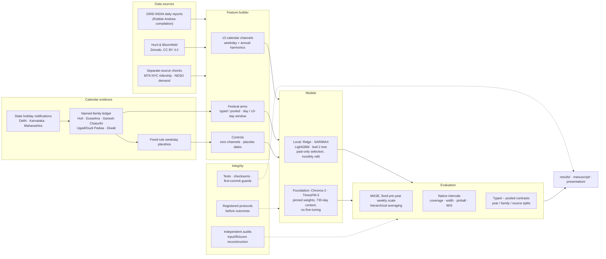
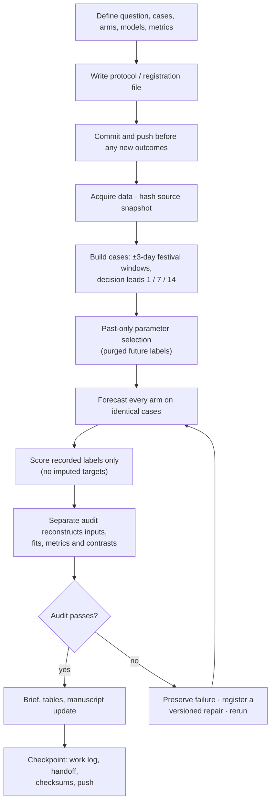
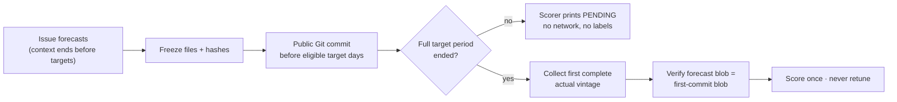

# TSFM India: festival covariates in foundation and local forecasting models

B.Tech(H) CSE (Data Science), RV University. Research in progress.

This repository studies how festival information should be given to forecasting models for **daily electricity supplied (GWh)** in Delhi, Karnataka and Maharashtra. Two pretrained time-series foundation models (Chronos-2, TimesFM-3) and four local models (Ridge, SARIMAX, LightGBM and a leaf-2 tree variant) are compared on the same cases with matched input designs: calendar only, typed festival flags (one per festival), pooled flags (one shared flag), ±3-day windows, zero channels and fake-date placebos.

**Main findings so far (historical data, exploratory):**

- Festival day flags usually lower next-day error versus calendar-only inputs.
- The better encoding (typed vs pooled) is **not stable**: it flips between 2024 and 2025 in 19 of 36 model/representation/lead comparisons and differs between India and a separate NYC holiday check in 11 of 36.
- A document-level calendar check corrected one festival date (Karnataka 2025 Vijayadashami: 1 Oct, not 2 Oct).
- Native 80% prediction intervals under-cover festival periods.

Forecasts for 31 Oct–11 Nov 2026 were frozen before outcomes and are scored from 12 Nov 2026. A 52-week rolling confirmation study is registered but not yet activated.

## Start here

| Read | Where |
| --- | --- |
| Current paper draft (v6) | [manuscript/integrated_review_v6/](manuscript/integrated_review_v6/) |
| Full project report (Word/PDF) | [manuscript/project_report_v1/](manuscript/project_report_v1/) |
| Current status and next steps | [docs/status/CURRENT_RESEARCH_STATUS.md](docs/status/CURRENT_RESEARCH_STATUS.md), [docs/status/HANDOFF.md](docs/status/HANDOFF.md) |
| Seven-task journal ledger | [review/journal_seven_tasks_20261031_v1/SEVEN_TASK_LEDGER.md](review/journal_seven_tasks_20261031_v1/SEVEN_TASK_LEDGER.md) |
| Viva slides | [presentation/viva_update_v2/](presentation/viva_update_v2/) |
| Setup and reproduction | [docs/reproduction/ENVIRONMENT_SETUP.md](docs/reproduction/ENVIRONMENT_SETUP.md) |
| Project rules (integrity, frozen forecasts, data rights) | [docs/PROJECT_GUIDELINES.md](docs/PROJECT_GUIDELINES.md) |

## System architecture



## Research workflow

Every experiment follows the same path. A failed run is never edited or deleted; it is kept and a new versioned folder is created.



## Prospective confirmation flow



The weekly rolling study (52 Monday windows from 16 Nov 2026) uses the same guards. It issues forecasts only when reviewed source-rights and observation-day evidence and verified calendars exist; missed windows are recorded, never back-filled.

## Forecast case timing

```
context (730 days)                     origin = first unseen day
|------------------------------------|O------------------------------>
                                      target = origin + lead − 1
India:  decision lead 1 / 7 / 14  → model step 1 / 7 / 14
NYC:    7-day observation buffer  → decision lead 1 / 7 / 14 = model step 8 / 14 / 21
```

## Input designs (arms)

| Arm | Channels | What it adds |
| --- | --- | --- |
| `calendar` | 13 | weekday one-hot + three annual sine/cosine pairs |
| `zero5` | 13 + 5 | five all-zero channels (does adding inputs alone change forecasts?) |
| `day5` (typed day) | 13 + 5 | one flag per festival family on its named day(s) |
| `pooled_day5` | 13 + 1 + 4 zeros | one shared flag for any family |
| `window5` (typed window) | 13 + 5 | one flag per family over ±3 days |
| `pooled_window5` | 13 + 1 + 4 zeros | one shared ±3-day flag |
| `placebo_day5`, `placebo_window5` | 13 + 5 | festival flags moved to wrong dates by whole weeks |
| `history` (foundation only) | 0 | target history only |

## Models

| Model | Type | Training / adaptation |
| --- | --- | --- |
| Rich Ridge | local, linear | 27 past-only history features + calendar/event covariates; parameters chosen on earlier data; monthly refit |
| SARIMAX | local, state space | declared seasonal order; fit and state update with logged convergence retries |
| Stable LightGBM (float32) | local, trees | same features as Ridge; float32 numerical contract |
| Tree, leaf minimum 2 | local, trees | separately reported sensitivity, never merged into a "best" choice |
| Chronos-2 | foundation | pinned weights, zero-shot, covariates as inputs, native quantiles |
| TimesFM-3 | foundation | pinned weights, zero-shot, future covariates, native quantiles |

## Evaluation

- **Point accuracy:** MASE = absolute error ÷ fixed pre-year 730-day mean absolute weekly difference. Averaged within state/year/family, then states, years and families equally.
- **Uncertainty:** unmodified native 80% intervals (coverage, scaled width, mean pinball, WIS); quantile crossings and invalid intervals are kept visible.
- **Comparisons:** every registered typed−pooled contrast, split by year, family and source; leave-one-family-out ranges.
- **Dependence:** the effective units are festival-year clusters (10 in India), not forecast rows; no row-level significance tests or bootstraps over two event years.

## Experiments

| Study | Results folder | What it tested |
| --- | --- | --- |
| Pilot benchmark | `results/benchmark_original_s28`, `results/extended_validation` | Chronos-2 vs classical models, daily origins 2022–2026; Diwali inputs |
| Refits and baselines | `results/strong_refit_v1`, `results/stable_tree_refit_v2` | annual vs monthly refits; float32 tree contract |
| Mechanism controls | `results/mechanism_controls_v1` | regional vs generic dates, equal channel counts, zero channels |
| Festival features | `results/festival_features_v1`, `results/festival_feature_spillover_v2` | explicit day/window flags; ordinary-day costs |
| Multi-festival models | `results/multifestival_models_v1` | five festival families, 15 configurations |
| Pooled vs typed | `results/pooled_festival_v1`, `results/festival_label_transfer_v2` | pooled vs separate flags; family-label exclusion |
| Post-weight daily panel | `results/postweight_daily_v1` | both foundation models after weight upload dates |
| Interval calibration | `results/native_calibration_v1` | past-only conformal calibration of native intervals |
| Full breadth (main) | `results/feature_breadth_v1`, `results/calendar_recenter_recovery_v1` | 528 corrected festival-window cases, all arms, six models |
| Calendar encodings | `results/calendar_encoding_v1` | daily adaptations of ordinal / one-hot / cyclic / target encodings |
| Calendar correction | `results/calendar_semantics_v2` | document-aligned named dates (Karnataka 2025) |
| Separate sources | `results/mta_holiday_recovery_v1`, `results/neso_replication_v1` | NYC holidays; England/Wales delay sensitivity |
| Comparators and simulation | `results/event_comparators_v1`, `results/pooling_simulation_v1`, `results/event_support_v1` | response-profile comparators; pooling trade-off simulation; support diagnostics |
| Frozen future forecasts | `results/prospective_20261030_v1`, `results/prospective_interval_20261030_v1`, `results/prospective_chronos_20261031_v1` | 31 Oct–11 Nov 2026, scored from 12 Nov |
| Rolling study | `results/rolling_confirmation_runtime_v1`, `results/rolling_confirmation_timing_v2` | 52 weekly issuances (not activated) |
| Singapore replication | `results/singapore_festival_replication_v1` | drafted, not registered, no data acquired |

## Code map (`src/`)

| Files | Role |
| --- | --- |
| `forecasting.py`, `robust_baselines.py`, `festival_feature_design.py` | shared data loading, causal filling, features, local models |
| `*_study.py`, `*_experiment.py` | experiment definitions: cases, arms, protocols |
| `*_engine_*.py`, `multifestival_models.py`, `timesfm_*.py` | model runners for local and foundation models |
| `finalize_*.py`, `report_*.py`, `summarize*.py` | aggregation into metrics, contrasts and reports |
| `audit_*.py` | independent re-construction of inputs, fits, scores and claims |
| `freeze_*.py`, `collect_prospective_actuals.py`, `score_*.py` | prospective freezing and date-gated scoring |
| `rolling_*.py`, `calendar_package_builder_v1.py` | weekly rolling study and its calendar package |
| `singapore_replication_v1.py` | Singapore data/calendar/case layer |
| `build_*.py` | manuscript and report builders |
| `verify_continuation.py`, `verify_package.py` | file-integrity checks |
| `test_*.py` | 121 tests on synthetic fixtures |

## Repository structure

```
README.md                 this overview
requirements*.txt         pinned environments (core, foundation, phase 2, controls, multifestival)
environment.json          recorded foundation-model package versions
run_all.py, run_extended.py, setup_project.py   historical entry points
GITHUB_CHECKSUMS_20261030.json   integrity manifest used by src/verify_continuation.py

src/            all code: data, features, models, experiment engines, scorers, audits, tests (test_*.py)
data/           raw and external source snapshots (see data/external/RIGHTS_NOTICE.md)
evidence/       retained calendar documents and model/corpus evidence
results/        one folder per registered experiment: protocol, forecasts, metrics, audits (frozen records)
review/         claim audits, re-analyses, calendar reviews, reviewer packets
manuscript/     paper drafts (v1–v6), supplements, project report
presentation/   college and viva decks with their builders
docs/
  PROJECT_GUIDELINES.md     research-integrity and working rules
  status/                   current status, handoff, work log, roadmap, results summary, plan/progress
  results_briefs/           short summaries of each completed study
  methods/                  architecture, integrity rules, protocol index, model-comparison scope
  data_and_calendars/       data sources, calendar verification and audits, pretraining audit
  reproduction/             environment setup and per-study reproduction notes
  literature/               literature notes, references, original literature survey
archive/        superseded integrity manifests (historical records)
.github/        prospective-evaluation workflow (kept disabled)
```

Files inside `results/` are registered research records: their contents and paths are protected by hashes and first-commit checks, so they are never edited or moved.

## Quick start

```bash
python3.12 -m venv .venv
.venv/bin/python -m pip install -r requirements.txt pytest   # Windows: .venv\Scripts\python.exe
.venv/bin/python -m pytest src -q                            # 121 tests, synthetic fixtures
python src/verify_continuation.py                            # file-integrity check (Linux/macOS/Colab)
```

Foundation-model reruns need `requirements-foundation.txt` and separately downloaded weights; see [docs/reproduction/ENVIRONMENT_SETUP.md](docs/reproduction/ENVIRONMENT_SETUP.md).

## Data and attribution

- Robbie Andrew, *Indian Energy and Emissions Data* (compiled from GRID-INDIA/POSOCO daily reports), snapshot of 29 Oct 2026. No licence found; reuse request pending — see [data/external/RIGHTS_NOTICE.md](data/external/RIGHTS_NOTICE.md).
- Hunt and Bloomfield (2025), Zenodo [10.5281/zenodo.14983362](https://doi.org/10.5281/zenodo.14983362), CC BY 4.0.
- SASEA (Coombes, Hunt and Bloomfield), Zenodo 10.5281/zenodo.17175212, CC BY 4.0.
- MTA NYC daily ridership (dataset sayj-mze2); NESO transmission demand (raw archives kept outside Git).

Model weights are not included. TimesFM-3 weights carry their own noncommercial terms.

## Status and limits

Historical outcomes were inspected, so all historical results are exploratory. Two event years and three related states limit generalisation. Independent human review, data-reuse permission and calendar amendment certification are outstanding. Earlier README content is kept in [docs/status/README_HISTORY.md](docs/status/README_HISTORY.md).
