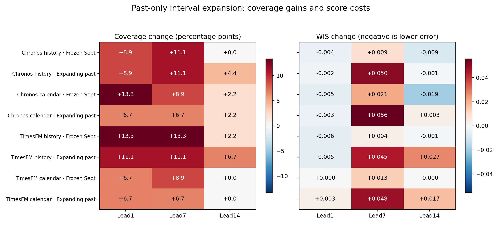

# Past-only native interval calibration and prospective annex

**Binay Verma · Research update · 30 October 2026 · Author/professor review draft**

This supplements the integrated journal draft without replacing its results. Q1 remains a target; source terms, calendar amendments, independent human review and adequate untouched/source-independent evidence remain open.

## Question and fixed design

Can a standard past-only adjustment improve native uncertainty without selecting intervals to match evaluated coverage? Point forecasts, medians and raw quantiles are unchanged. Native, frozen-September and expanding-past arms were fixed before the new comparison outcomes; both calibration methods were retained in the future annex before these historical coverage scores were inspected.

Expansion-only conformalized quantile regression uses s=max(lower−actual, actual−upper), the ceil((n+1)×0.8) order statistic, and nonnegative expansion max(0,s_order). The interval becomes [lower−expansion,upper+expansion]. There is no interpolation, shrinking, nominal-level/window search, cross-state pooling or selection of a best method from new errors. This is established prior work [1], not a new algorithm. Temporal dependence, changing contexts and distribution drift prevent claiming an exchangeability-based time-series coverage guarantee.

Each configuration/state/individual lead uses only calibration LABEL dates strictly before the query ORIGIN. Frozen calibration uses 16 labels from 15–30 September 2026. Expanding calibration uses all available labels from 15 September up to origin−1; counts vary from 16 to 43 in evaluation. Origin rather than target-date purging prevents long-lead label leakage.

The common cohort has 15 target dates, 14–28 October, in each state at leads 1/7/14 for all four foundation configurations. This gives 540 cases across configurations, repeated across three interval arms (1,620 rows). Fresh TimesFM inference on the original 171 contexts per mode preserves all 14 leads and reproduces all 792 earlier point/quantile rows. Its extended export has 3,780 interval rows including 810 overlapping common rows; unique historical rows total 4,590. Chronos is reused at its three archived leads only.

All historical data were already inspected; this is exploratory. The start date follows the September month boundary and maximum 14-day lead so the earliest origin has 16 calibration labels, rather than being chosen for good coverage. The new cohort is a subset of the previous 44-target-date daily panel; do not compare their aggregate scores as identical cohorts.

## Results: coverage with width and proper scores

Coverage is a proportion; width and scores are scaled by the same unchanged pre-2026 state reference. Lower interval score/WIS is better. WIS here combines one 80% interval with the unchanged native median; it is not a full-grid distributional score. All states, arms and leads are retained.

### Individual lead 1

| Configuration | Method | Coverage80 | Scaled width | Interval score | WIS80 |
| --- | --- | --- | --- | --- | --- |
| Chronos history | Native | 0.7333 | 1.6426 | 2.9565 | 0.3977 |
| Chronos history | Frozen Sept | 0.8222 | 1.8415 | 2.8943 | 0.3936 |
| Chronos history | Expanding past | 0.8222 | 1.8778 | 2.9248 | 0.3956 |
| Chronos calendar | Native | 0.7111 | 1.786 | 3.0302 | 0.4092 |
| Chronos calendar | Frozen Sept | 0.8444 | 2.0628 | 2.9537 | 0.4041 |
| Chronos calendar | Expanding past | 0.7778 | 2.0112 | 2.9844 | 0.4061 |
| TimesFM history | Native | 0.7111 | 1.4402 | 2.65 | 0.3649 |
| TimesFM history | Frozen Sept | 0.8444 | 1.7342 | 2.5674 | 0.3594 |
| TimesFM history | Expanding past | 0.8222 | 1.6907 | 2.5749 | 0.3599 |
| TimesFM calendar | Native | 0.7778 | 1.3993 | 2.7366 | 0.3769 |
| TimesFM calendar | Frozen Sept | 0.8444 | 1.7459 | 2.7369 | 0.377 |
| TimesFM calendar | Expanding past | 0.8444 | 1.8848 | 2.7857 | 0.3802 |

### Individual lead 7

| Configuration | Method | Coverage80 | Scaled width | Interval score | WIS80 |
| --- | --- | --- | --- | --- | --- |
| Chronos history | Native | 0.8 | 3.6103 | 4.8781 | 0.6926 |
| Chronos history | Frozen Sept | 0.9111 | 4.3323 | 5.0095 | 0.7013 |
| Chronos history | Expanding past | 0.9111 | 4.8186 | 5.63 | 0.7427 |
| Chronos calendar | Native | 0.8 | 3.6383 | 4.8781 | 0.7088 |
| Chronos calendar | Frozen Sept | 0.8889 | 4.3491 | 5.1927 | 0.7298 |
| Chronos calendar | Expanding past | 0.8667 | 4.7668 | 5.7119 | 0.7644 |
| TimesFM history | Native | 0.7556 | 3.0162 | 4.2814 | 0.6304 |
| TimesFM history | Frozen Sept | 0.8889 | 3.5094 | 4.3349 | 0.634 |
| TimesFM history | Expanding past | 0.8667 | 3.9342 | 4.9495 | 0.675 |
| TimesFM calendar | Native | 0.8222 | 3.1825 | 4.3999 | 0.6302 |
| TimesFM calendar | Frozen Sept | 0.9111 | 3.8999 | 4.6003 | 0.6436 |
| TimesFM calendar | Expanding past | 0.8889 | 4.2031 | 5.1229 | 0.6784 |

### Individual lead 14

| Configuration | Method | Coverage80 | Scaled width | Interval score | WIS80 |
| --- | --- | --- | --- | --- | --- |
| Chronos history | Native | 0.7111 | 3.9858 | 6.4108 | 0.8727 |
| Chronos history | Frozen Sept | 0.7111 | 4.1901 | 6.2745 | 0.8636 |
| Chronos history | Expanding past | 0.7556 | 4.635 | 6.3945 | 0.8716 |
| Chronos calendar | Native | 0.7111 | 4.0927 | 6.7015 | 0.916 |
| Chronos calendar | Frozen Sept | 0.7333 | 4.5138 | 6.4093 | 0.8965 |
| Chronos calendar | Expanding past | 0.7333 | 4.908 | 6.7516 | 0.9193 |
| TimesFM history | Native | 0.6889 | 3.4235 | 4.8266 | 0.7146 |
| TimesFM history | Frozen Sept | 0.7111 | 3.4576 | 4.8142 | 0.7138 |
| TimesFM history | Expanding past | 0.7556 | 3.9179 | 5.2243 | 0.7411 |
| TimesFM calendar | Native | 0.7556 | 3.8822 | 5.0966 | 0.7331 |
| TimesFM calendar | Frozen Sept | 0.7556 | 3.8875 | 5.0931 | 0.7328 |
| TimesFM calendar | Expanding past | 0.7556 | 4.1716 | 5.3492 | 0.7499 |

*Figure 1. All common-cohort calibration contrasts relative to native intervals. Coverage and WIS use separate colour scales and units. Higher coverage is not automatically better uncertainty: widening can raise coverage and worsen WIS. See the tables for width costs.*

Some next-day coverage increases accompany small score improvements, but this is not universal. At lead 7, expansion generally raises coverage above an already near-nominal native level and worsens WIS. Lead 14 can remain below 80% despite expansion. A calibration transformation does not guarantee calibrated future intervals or improve unchanged point forecasts. The earlier festival-feature undercoverage is a different cohort and has not been solved by this daily experiment.

## Prospective interval annex: issued, not yet scored

A separate annex was issued at 2026-10-30T15:12:14.014369+00:00 (20:42:14 India time on 30 October), from ORIGINAL TimesFM future quantiles and points. No new future model inference or future actual retrieval occurred. Both fixed and expanding methods were issued before inspecting new historical calibration coverage results. The public first checkpoint is 29bdd984770904a032cebe9efcd2a12a8d5ffc17, remote-verified before eligible target dates. This is an auditable Git checkpoint, not external preregistration.

There are 252 interval records and 216 eligible records: 72 original TimesFM future cases × three interval arms. Eligible targets are 31 October–11 November; earlier 29/30 October targets are excluded. This is the SAME forecast episode/source as the original freeze, not independent replication or 216 independent cases. The original six-configuration 252-row forecast/protocol/freeze remains byte-identical to its original Git blobs. The annex has its own later issuance and is never backdated.

**Future results remain pending.** The manual scorer cannot read labels or score before the complete target period ends. Afterwards it requires the original collector’s exact completed actual snapshot/vintage, source/metadata hashes, GWh units, complete positive labels, actual retrieval timing and first-annex-Git-commit equality. It never chooses a later vintage after viewing errors. The automatic workflow remains paused; no background scoring is promised.

## Reproduction and remaining limits

Internal independent date/NumPy input reconstruction passes for all 342 new task inputs; the stdlib audit reconstructs calibration dates/ranks, original scales, intervals, scores, macro weights and the annex. All 1039 protected prior scientific/code/presentation/manuscript files are unchanged. Fifty-three tests pass in working and separate clean environments, including future-label perturbation and prospective date/completeness guards. These are internal software checks, not independent human review.

One short retrospective period, related states, overlapping horizons, limited calibration labels, source revisions/report-day ambiguity and unknown source reuse terms limit generalisation. Native quantile crossings in older studies remain preserved; current TimesFM all-lead outputs have no crossing, which does not prove calibration. Prior numerical matrix discrepancies remain retained. No new-method, universal improvement, completed future accuracy, independent approval or Q1 submission readiness is claimed.

## Reference

[1] Yaniv Romano, Evan Patterson and Emmanuel J. Candès (2019), *Conformalized Quantile Regression*, arXiv:1905.03222v1. Primary metadata verified during this phase: https://arxiv.org/abs/1905.03222 . Applying this established method is not a novelty claim.

Full protocols/rows/audits: results/native_calibration_v1 and results/prospective_interval_20261030_v1. Earlier integrated draft: manuscript/journal_draft_v1. The new annex remains pending rather than being presented as future evidence already obtained.
