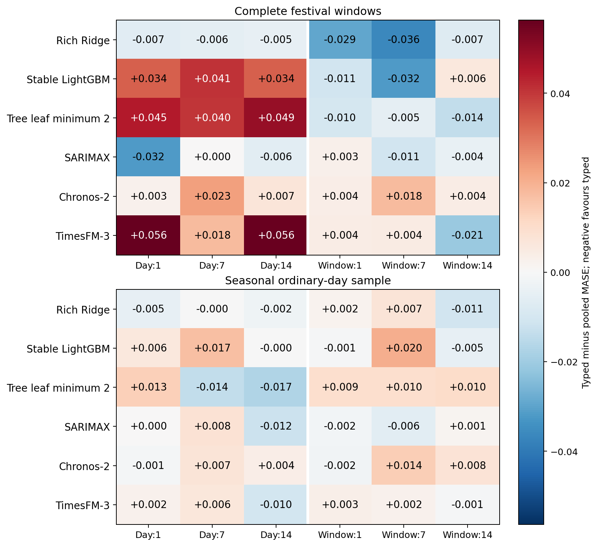
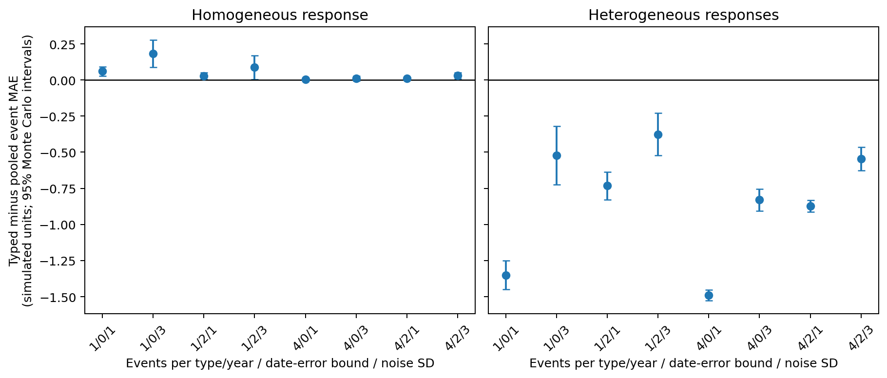

# Sparse festival representations in foundation forecasting: matched electricity evidence and pooling controls

**Focused research draft for Binay Verma and professor review. Not submitted or submission-ready.**

**Calendar correction notice:** These tables preserve the original frozen ledger. A later document-level check found that Karnataka’s 2025 notification labels 1 October as Vijayadasami and 2 October as Gandhi Jayanthi; the ledger uses 2 October for Dussehra. Annual holiday-date membership did not verify the festival name. This known mismatch is not silently repaired in these results. The all-58 semantic review also finds Maharashtra2022 Gudi Padwa uncorroborated in the retained one-page schedule, an evidence gap rather than proof of a wrong date. See review/used_calendar_v4 and the separately versioned correction/recentering experiments before interpreting state-calendar accuracy.

Author: Binay Verma. College/department: __________. Corresponding-author email: __________. These fields are intentionally blank at the author’s request. Funding, conflicts and any real coauthor contributions remain to be completed. No professor authorship or independent review is assumed.

## Abstract

Sparse event labels create a trade-off between response specificity and statistical sharing. We examine that trade-off in daily supplied electricity from Delhi, Karnataka and Maharashtra using five festival families, two pinned foundation models and four local model variants. A fixed exploratory extension compares eight representations on 528 complete festival-window cases and 216 calendar-selected ordinary cases per configuration, producing 35,712 forecasts. Typed and pooled flags are compared at the same five-channel event budget, with ordinary-calendar, zero and active-placebo controls. Typed-minus-pooled MASE changes across models, leads and day/window representations range from -0.036 to 0.056; their interpretation is conditional on the cohort and adaptation policy. Additional past-only target-encoding and response-profile baselines contribute 5,952 matched forecasts. A prespecified 512-dataset simulation illustrates how heterogeneity, support and date errors change pooling value under a known baseline and response shape. Complete comparator/simulation reruns in a separate Python environment are byte-identical. Historical outcomes remain exploratory; correlated event years, model exposure, source-vintage/calendar uncertainty, unresolved reuse terms and absent external review limit generalisation. The contribution is a controlled empirical qualification, not a new architecture, causal effect or universal festival-enhancement claim.

**Keywords:** event representation; electricity forecasting; partial pooling; time-series foundation models; calendar provenance; temporal evaluation.

## 1. Forecasting question and related work

Separate event identities offer response specificity but have few historical examples. Pooling shares information while assuming greater response similarity. This is an established statistical trade-off. In a covariate-informed foundation model, the interface adds another complication: changing the number or allocation of channels can change forecasts even if some channels contain zeros. The practical question is when sparse event information benefits from pooling, and whether the answer survives complete event windows and ordinary-day costs.

Calendar target encodings are directly studied by Kreusel et al. [1], including Chronos-2 and TimesFM-3. Alipour et al. [2] learn impact-driven event covariates from residual responses; their primary page and linked paper have unresolved venue metadata differences. Indian moving-holiday regressors [3], covariate-uncertainty load evaluation [4], and sample/proxy leakage analysis [5] are also close antecedents. We do not claim to invent event indicators, window regressors, target encoding, pooling, residual profiles or conformal calibration.

The empirical contribution is deliberately narrower: a named-calendar evaluation with matched typed/pooled/dimension/placebo controls, explicit sparse-support/adaptation logs, complete event-window and seasonal ordinary-day comparisons, and preserved negative/numerical/provenance evidence. The known Karnataka family/date mismatch limits calendar-quality claims. Subsequent pure-encoding, NESO source/delay and document-aligned correction experiments have separate versioned results; their forecasts are not included in these original-ledger tables. Exact contrastive learned-event replication and untouched multi-event evidence remain gaps. More model names alone do not close those gaps.

## 2. Data, calendar and evaluation units

The target is daily energy met/supplied in GWh, which can reflect supply constraints; it is not latent unconstrained demand, household consumption or hourly peak load. We use a single frozen GRID-INDIA/POSOCO compilation, without splicing the earlier corrected dataset. Historical labels through 28 October 2026 have already been inspected. Every new historical method comparison is exploratory. Chronological weight identities do not clear historical or correlated-proxy overlap [5–7].

A frozen ledger contains 58 named anchors across 48 family/state/year groups in 2022–2025. Families are Holi, Dussehra, Ganesh Chaturthi, Ugadi/Gudi Padwa and Diwali, with documented state scope rather than presumed impact in every state. Karnataka 2023 Ganesh is 18 September, while Maharashtra is 19 September; Maharashtra 2023 Holi is 7 March. The legacy Diwali definition retains shared-main and subsidiary dates, including two explicit Maharashtra annual-office-date exceptions. The ledger is annual-as-issued, not fully amendment-certified; office closure is not proof of statewide response. Coincident holidays remain confounders.

The primary breadth cohort retains all 528 original window/lead cases: 176 state/target-date combinations across 24 festival/state/year groups in 2024–2025, with leads 1, 7 and 14. These are not 528 independent events. The ordinary cohort has 216 cases: one target per month/state/year, with three leads. Dates are the first eligible rotating weekday in each month, excluding ±3 days around annual-as-issued and registered holidays. Targets lie between 14 January and 18 December to keep all context/future covariates inside the audited 2022–2025 ledger. No target value or error selects dates. The bounded ordinary sample is not exhaustive all-day evaluation.

An origin is the first unseen model date; lead h targets origin+h−1. All compared arms and variants have identical cases. MASE uses each state’s pre-year 730-calendar-day mean absolute weekly difference, scoring only positive recorded labels. Event summaries average target errors within state/year/family, states within year, years within family, and then families equally. Ordinary summaries weight states and years equally. Raw daily rows, states, leads and nearby holidays are correlated. We report both years and leave-family-out composition sensitivity rather than independent-row significance or precise two-year bootstrap claims.

## 3. Models, representations and prior registration

Eight arms retain the ordinary 13-channel weekday/annual-harmonic calendar: calendar alone, five exact zeros, typed day5, pooled day5, typed window5, pooled window5, and typed day/window placebos. Pooled5 contains the logical union of state-scoped family flags in one channel plus four zeros; typed5 uses one channel per family. Windows are unions of ±3 days, not counts of subsidiary dates. Placebos use the original fixed seeded weekday-preserving shifts, avoiding registered true windows; one seed is a bounded control, not a randomisation distribution. Padding is not assumed inert and representation contrasts do not identify causal identity effects.

Pinned Chronos-2 [6] and TimesFM-3 [7] use 730 prior target days, 14 forecast steps, no task fine-tuning, seed 42, two CPU threads and batch 16. Every task records actual target/covariate bytes and future-target perturbation invariance; first batches are checked against solo inference. All native quantiles/crossings remain unchanged. This wider study uses fresh inference, preserving earlier anchor outputs. Model weight hashes and noncommercial TimesFM weight terms are retained in the model audits.

Local variants are rich Ridge, stable LightGBM, a separately reported leaf-minimum 2 tree sensitivity, and fixed SARIMAX. Ridge/trees use 27 past-only history features plus the same calendar/event features, monthly fits and unchanged pre-year selected parameters across every arm. Trees receive float32 matrices. The leaf2 change is fixed and not selected by evaluated errors. SARIMAX uses (1,0,0)×(1,0,0,7), no trend, annual 730-day parameter fits and past-only state updates; training-convergence retries and failures remain logged. Differences in adaptation/fitting policy preclude an architecture-only attribution.

The breadth protocol was committed before new outcomes. It follows inspected anchor/pooling studies and is not an external preregistration or clean final test. The protocol, source/input hashes, full case matrix, packages, sparse support, failures, checkpoints and separate audits are available with the repository. Historical negative findings, including the original four-year Chronos seven-channel Diwali deterioration, remain unchanged.

## 4. Matched breadth results

Tables 1–2 give predeclared next-day scores for both representations; all three leads, eight arms, state-years, families and controls are retained in the machine-readable supplement. Figure 1 shows typed-minus-pooled differences for every model, representation, lead and cohort. A negative difference favours separate identities. Ordinary and event levels describe different target cohorts and are not a causal treatment/control estimate.

Table 1. Full festival-window next-day MASE. Lower is better.

| Model | Calendar | Typed day | Pooled day | Typed window | Pooled window |
| --- | --- | --- | --- | --- | --- |
| Rich Ridge | 0.57813 | 0.45554 | 0.46207 | 0.58003 | 0.60952 |
| Stable LightGBM | 0.70086 | 0.69704 | 0.66331 | 0.70389 | 0.71454 |
| Tree leaf minimum 2 | 0.68830 | 0.65121 | 0.60662 | 0.69270 | 0.70249 |
| SARIMAX | 0.57478 | 0.41872 | 0.45079 | 0.57953 | 0.57689 |
| Chronos-2 | 0.53897 | 0.52074 | 0.51821 | 0.53678 | 0.53291 |
| TimesFM-3 | 0.55002 | 0.47891 | 0.42256 | 0.55369 | 0.54953 |

Table 2. Calendar-selected ordinary-day next-day MASE. Lower is better.

| Model | Calendar | Typed day | Pooled day | Typed window | Pooled window |
| --- | --- | --- | --- | --- | --- |
| Rich Ridge | 0.28458 | 0.27908 | 0.28360 | 0.28892 | 0.28710 |
| Stable LightGBM | 0.39366 | 0.39545 | 0.38932 | 0.39507 | 0.39562 |
| Tree leaf minimum 2 | 0.39178 | 0.37852 | 0.36525 | 0.38882 | 0.37955 |
| SARIMAX | 0.23073 | 0.22949 | 0.22910 | 0.22995 | 0.23155 |
| Chronos-2 | 0.24924 | 0.26477 | 0.26567 | 0.26117 | 0.26297 |
| TimesFM-3 | 0.26547 | 0.26928 | 0.26696 | 0.26214 | 0.25902 |

The full-window typed-minus-pooled contrasts span -0.03640 to 0.05635 MASE across the registered cells. This range describes the evaluated matrix and does not select a winning method. Both-year and leave-family-out tables allow assessment of composition sensitivity; two event years and unequal state scopes still limit generality. Zero/placebo contrasts help diagnose representation sensitivity without establishing a causal mechanism.

## 5. Established-method comparators and simulation

Eight additional daily methods use exactly the same cases. Four are rolling-context weekday/holiday conditional means adapted from target-encoding ideas [1], with explicit unseen-category fallbacks. These direct point baselines omit the hourly paper’s hour variable and are not its multivariate TSFM encodings. Their weak 730-day context means do not establish that target encoding is intrinsically poor.

Four response methods share a last-four-recorded-same-weekday baseline: no response, typed OLS amplitudes, one pooled amplitude, and partial pooling with fixed penalty 2 toward the pooled amplitude. Past residuals use only earlier same-weekday observations; profile training uses strictly pre-origin recorded labels. The fixed ±3-day triangular shape is declared rather than learned on test errors. This is a simple daily residual-profile adaptation, not the contrastive system of Alipour et al. [2].

Table 3. Full-window matched response-profile comparator MASE. No penalty is selected on these errors.

| method | Lead 1 | Lead 7 | Lead 14 |
| --- | --- | --- | --- |
| response_none | 1.05617 | 1.05617 | 1.12777 |
| response_partial | 0.99059 | 1.04974 | 1.08356 |
| response_pooled | 1.04499 | 1.06250 | 1.11693 |
| response_typed | 1.02429 | 1.11325 | 1.11001 |

The partial-pooling response comparator improves its matching no-response baseline but remains weaker than the rich local models in Table 1 at the next-day lead. It is not a new state-of-the-art algorithm. On the selected ordinary dates, all four response methods coincide by construction because query event windows are excluded. This cannot be cited as learned spillover evidence. Direct family-label exclusion from the earlier study is a separate sensitivity: earlier family responses remain in target-history features, so it is not wholly unseen-event transfer.

A prespecified simulation crosses event frequency 1/4 per family/year, heterogeneity 0/3, integer date-error bound 0/2 days and noise SD 1/3, with 32 seeds per setting. Five event types share a known triangular response shape and an exactly removed baseline; two years fit and one year evaluates. Noise is stationary AR(1) with coefficient0.5. No-event, pooled OLS, typed OLS, fixed partial pooling and an explicitly unavailable true-effect oracle are all retained. Figure 2 illustrates the expected trade-off: homogeneous responses favour pooling on average, while strong heterogeneity favours separate effects under this generator. This is not an explanation of neural internals or new real-world independent evidence.

## 6. Native uncertainty and reproducibility

Both foundation models are scored on unchanged common quantiles 0.1–0.9. Empirical 80% coverage accompanies scaled width, marginal pinball and a one-interval WIS: (0.5×median absolute error+0.1×80% interval score)/1.5. Crossings are retained; invalid endpoints make the full associated interval aggregate undefined rather than dropping cases. These are native, uncalibrated festival-feature distributions.

Table 4. Native next-day full-window intervals. Full lead 1/7/14 tables and every control arm remain in the supplement.

| Model | Arm | Coverage80 | Scaled width | Scaled WIS80 |
| --- | --- | --- | --- | --- |
| chronos | calendar | 0.70714 | 1.44827 | 0.36767 |
| chronos | day5 | 0.73942 | 1.44383 | 0.35179 |
| chronos | pooled_day5 | 0.73095 | 1.45796 | 0.35010 |
| chronos | pooled_window5 | 0.73228 | 1.48665 | 0.36528 |
| chronos | window5 | 0.72857 | 1.45596 | 0.36515 |
| timesfm | calendar | 0.65926 | 1.21409 | 0.38440 |
| timesfm | day5 | 0.69762 | 1.23286 | 0.32140 |
| timesfm | pooled_day5 | 0.70265 | 1.16786 | 0.27846 |
| timesfm | pooled_window5 | 0.63651 | 1.19210 | 0.38556 |
| timesfm | window5 | 0.64735 | 1.21810 | 0.38886 |

The separate September–October 2026 CQR exercise improves some historical coverage while widening intervals and sometimes worsening longer-lead proper scores. It uses a different cohort and does not calibrate the present festival-feature distributions. The original future point/native freeze and later interval annex remain immutable and unscored; the annex repeats existing TimesFM cases from the same episode.

Separate scalar/calendar/NumPy audits reconstruct sources, cases, scales, actual inputs, local budgets/labels/support, chronological cutoffs, probability arithmetic and aggregate metrics. Complete clean-environment reruns of all 5,952 daily comparator forecasts and 2,560 simulation cells produce byte-identical scientific output files. This uses the same machine and exact source/input copies, not an independent human team or complete new foundation-model rerun. The earlier stricter pooled scalar review retains its near-zero tree-feature byte discrepancy even though its 135 forecasts agree within tolerance. Passing software tests is evidence about specific checks, not proof of zero scientific error.

## 7. Limits and confirmation requirements

All historical method choices are exploratory; model/source/proxy exposure remains unresolved. Three related states and two event years do not establish broad regional or temporal generalisation. Weather, supply constraints, coincident events, annual versus amended calendars and source revisions remain possible explanations. Public source access does not itself settle redistribution rights. The author reports manually requesting clarification; no response or independent sign-off is inferred.

A separate primary-source audit acquired MTA and Elexon probes without treating them as forecast replication. The deprecated MTA view stops 9 January 2025; an Elexon UTC week crosses a 46-period local settlement day and a date boundary. A subsequent registered NESO England/Wales experiment integrates actual half-hour MW into daily GWh and compares ideal versus 21 additional days of archive delay. Its separately audited local checkpoint covers 16 ordinary September dates; the complete foundation comparison is outside this draft’s tables. These dates provide no independent holiday result or first-vintage reconstruction. Indian shared-source derivatives do not provide source independence.

A new 52-week manual confirmation plan starts 16 November 2026, but is not activated and has issued no forecasts. Its explicit two-day availability bridge maps decision leads 1/7/14 to model steps 3/9/16; a manifest-contract validator is not an end-to-end runner. New-year ledger, capture/runner/scorer adapters, publication/time guards, human review and actual future observations remain prerequisites. Existing prospective automation stays paused. One future event year would still provide limited annual replication.

The study therefore supports a conditional forecasting lesson about event representation and evaluation discipline. It does not yet establish a sufficiently general or distinct contribution for IJF acceptance. Before submission, reproduce the closest TSFM encodings/event methods under matched information budgets, obtain genuinely separate/untouched evidence, complete the source/calendar/independent-review gates, and verify current journal instructions and declarations.

## Data, code and author statements

Code and completed exploratory artifacts are at https://github.com/Binay-verma/tsaf_project . Model weights/caches and newly audited raw external probes are excluded. Dataset attribution and unresolved rights are explicit; no new open-data licence is granted. Original/follow-up protocols and failed attempts are retained. The official IIF states data/code sharing and an acceptance-conditional reproducibility check; any restriction needs an editor-acceptable justification. No journal submission/contact, acceptance or fee is implied.

Funding, conflicts, affiliation, corresponding-author details and any coauthor contributions await factual author confirmation. Binay Verma is author/requester, not an independent reviewer.

## References

[1] Kreusel et al. (2026). On the Encoding of Calendar Features in Covariate-Informed Time Series Foundation Models. arXiv:2610.13676v1. https://arxiv.org/abs/2610.13676

[2] Alipour et al. Impact-driven event covariates for time-series foundation models. Primary publication page; venue metadata unresolved. https://www.amazon.science/publications/impact-driven-event-covariates-for-time-series-foundation-models

[3] Sanyal, Mitra, McElroy and Roy (2017). Holiday Effects in Indian Manufacturing Series. Census RRS2017-04. https://www.census.gov/library/working-papers/2017/adrm/rrs2017-04.html

[4] Kaljevic, Arzola and Zhang (2026). Benchmarking Time Series Foundation Models for Load Forecasting Under Covariate Uncertainty. arXiv:2610.07232v1. https://arxiv.org/abs/2610.07232

[5] Meyer et al. Rethinking Evaluation in the Era of Time Series Foundation Models: (Un)known Information Leakage Challenges. arXiv:2510.13654v3. https://arxiv.org/abs/2510.13654

[6] Ansari et al. (2025). Chronos-2: From Univariate to Universal Forecasting. arXiv:2510.15821v1. https://arxiv.org/abs/2510.15821

[7] Jain and Sen (2026). TimesFM-3: A zero-shot foundation model for multivariate forecasting. Official model announcement. https://research.google/blog/timesfm-3-a-zero-shot-foundation-model-for-multivariate-forecasting/

[8] Romano, Patterson and Candès (2019). Conformalized Quantile Regression. arXiv:1905.03222v1. https://arxiv.org/abs/1905.03222
