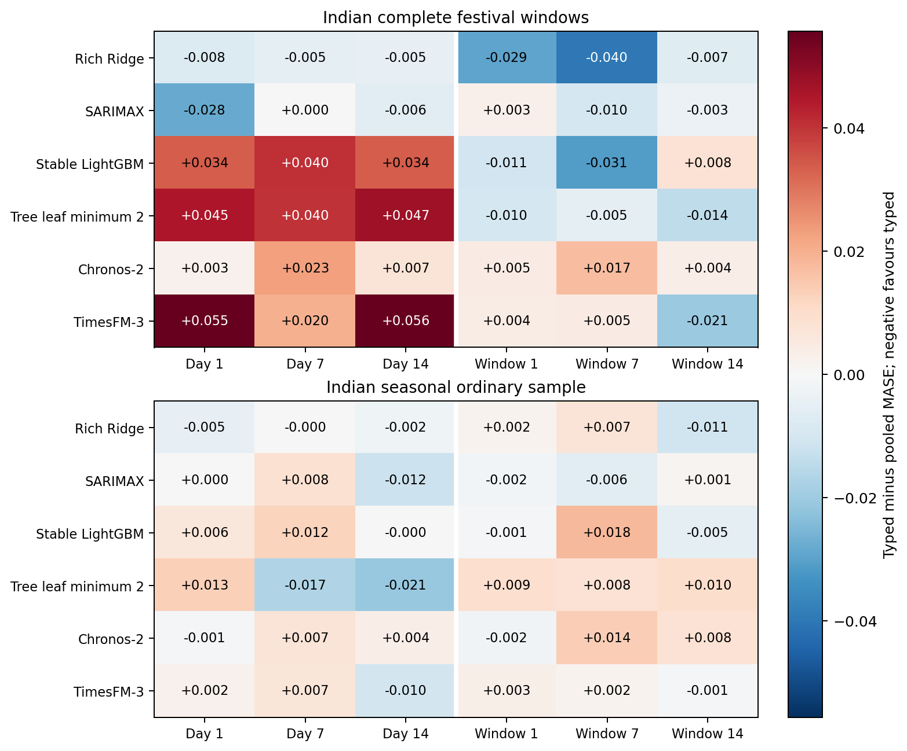
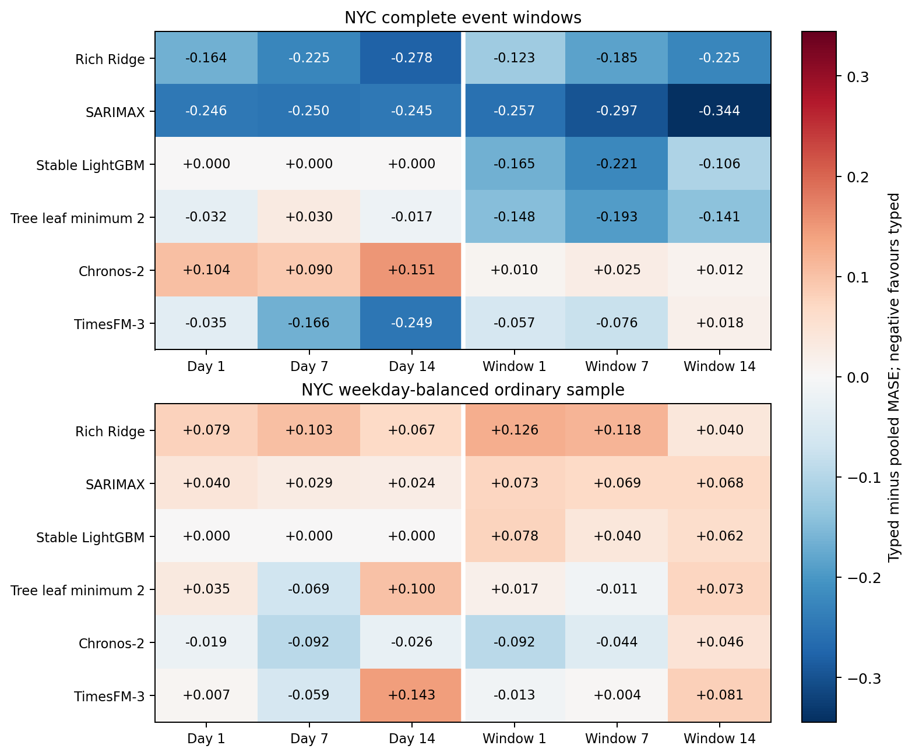
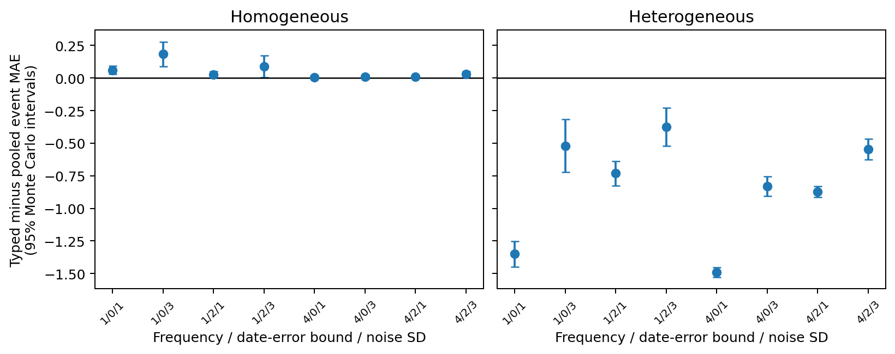

# When does pooling sparse event information help forecasting? Matched representations, calendar corrections and cross-source evidence

**Integrated research draft for professor review. Not submitted or submission-ready.**

Binay Verma. College/department: __________. Corresponding-author email: __________.

## Abstract

Sparse events create a familiar trade-off between separate response identities and statistical sharing. Covariate-informed foundation models add sensitivity to channel allocation and encoding. We study this conditional forecasting problem using two pinned foundation models and four local variants, retaining calendar, zero-channel, typed, pooled and weekday-placebo controls. The main analysis uses 528 complete festival-window cases and 216 seasonal ordinary cases from three Indian states and two historical years. A source-driven correction changes one named festival date, restores its complete window and weekday-matched placebo, and separates feature changes from case-composition changes. Closest-method daily calendar encodings, established response comparators and a controlled simulation supplement this analysis. A pre-acquisition registered NYC replication adds two later holiday occurrences from a separate ridership lineage; an England/Wales electricity study examines a different source and an explicit observation-delay sensitivity. Typed-minus-pooled event MASE spans -0.03971 to 0.05564 in the aligned Indian panel and -0.34441 to 0.15136 in NYC. These are complete registered contrast ranges, not selected improvements or sampling intervals. Source revisions, sparse event years, unmatched adaptation policies, model exposure, unresolved Indian reuse terms and absent independent human review limit generalisation. The evidence qualifies when representations help; it does not introduce a new architecture or establish causal event effects.

**Keywords:** event representation; pooling; foundation models; calendar provenance; electricity; temporal evaluation.

## 1. Question, contribution and closest work

When does sharing an event response across sparse named families help, and does that answer survive the model interface, ordinary-day costs and a new source? Pooling, event regressors, partial pooling and calendar encodings are established ideas. A useful contribution must show conditions and failure modes beyond adding models to a benchmark.

Kreusel et al. [1] directly examine calendar encodings in Chronos-2 and TimesFM-3. Alipour et al. [2] learn impact-driven event representations from residual responses. Indian moving-holiday regression [3], covariate-uncertainty evaluation [4] and sample/proxy leakage analysis [5] are close antecedents. We compare simple representations under logged information and channel contracts rather than claim to invent them. The proposed contribution is a conditional empirical qualification with complete controls, source-driven corrections and separate-source evidence. Whether it is sufficiently distinct and general for International Journal of Forecasting remains an external scientific judgment.

The primary manuscript tables now use the document-aligned, recentered panel. Original forecasts, the original-ledger manuscript, the flag-only correction, failed attempts and negative findings remain available. A calendar repair is justified by its source, regardless of its forecast score. It is not permission to select the better historical version.

## 2. Data, dates and forecast information

### 2.1 Indian supplied electricity and named calendars

The target is daily energy met/supplied in GWh for Delhi, Karnataka and Maharashtra. It is not latent unconstrained demand, household consumption or hourly peak load. The later GRID-INDIA/POSOCO compilation is kept separate from an earlier corrected source. Outcomes through 28 October 2026 have been inspected; new historical method choices are exploratory. Historical revisions, exact release availability and correlated pretraining proxies remain unresolved. Weight dates alone do not establish contamination-free evaluation [5–7].

Five families are Holi, Dussehra, Ganesh Chaturthi, Ugadi/Gudi Padwa and Diwali, with declared state scopes and subsidiary anchors. Twelve retained annual documents support an internal all-58 named-date review: 54 declared-family matches, two explicit shared-national-main exceptions, one Karnataka 2025 mismatch and one Maharashtra 2022 Gudi Padwa evidence gap. The last means the retained one-page schedule does not corroborate the name/date; it is not proof that 2 April is wrong. Visible notification dates are not certified first-publication histories, and amendment chains and human sign-off remain incomplete. Office closure does not establish statewide electricity response.

The Karnataka notification labels Vijayadasami on 1 October 2025 and Gandhi Jayanthi on 2 October. The original ledger used 2 October for Dussehra. A separately registered flag-only correction holds cases and old placebos fixed. A further registered recentering replaces only three old 5 October target/lead cases with 28 September, yielding the complete 28 September–4 October window, and moves the corresponding +35-day placebo from 6 to 5 November. No error selects these dates. Both original-feature and aligned-feature forecasts are compared on the identical corrected cohort. Case-composition changes under original features are reported separately.

The resulting 528 event-window cases are 176 state/target-date combinations at leads 1, 7 and 14 across 24 family/state/year groups in 2024–2025. Nearby days, states and leads are correlated, not independent event replications. The 216 ordinary cases are a bounded seasonal sample: the first eligible rotating weekday per month/state/year, excluding registered windows. This is not exhaustive daily deployment evaluation.

### 2.2 NYC: a separately registered holiday replication

The canonical MTA daily ridership/traffic dataset, identifier sayj-mze2, provides Subway and Bus reported estimated counts. A fixed query returned 2,780 records and 1,390 complete daily labels per mode, 1 January 2023–21 October 2026. Counts are converted to million estimated rides, not GWh or unique travellers. The two modes are related series in one city and one source lineage; no deprecated-view splice or Staten Island addition is made. Actual API mode type is TEXT, although the attached dictionary says NUMERIC; the discrepancy is retained.

The protocol was publicly committed before these new evaluation records were acquired. Five calendar families retain the Indian study's five-channel budget. The 84 event cases cover complete ±3-day windows around Yom Kippur on 21 September and Columbus Day on 12 October 2026, two modes and three decision leads. The 42 ordinary cases balance weekdays and exclude all registered September–October NYC DOT observance windows. The calendar PDFs have matching archive digests in pre-year captures. They document parking observances, not MTA service closures or complete amendments. These target dates follow both actual model-weight uploads, but correlated proxy exposure is not ruled out.

A fixed seven-day observation buffer maps decision leads 1/7/14 to actual model steps 8/14/21. The intervening labels are unobserved, unscored bridge dates. This sensitivity accommodates uncertain update timing without pretending to reconstruct first releases. The current source is revised; the study is retrospective despite registration before target acquisition. Two occurrences cannot establish broad new-geography or annual generalisation.

### 2.3 England/Wales: source and delay, not holiday confirmation

NESO transmission demand supplies an independent electricity lineage. Daily GWh integrate complete actual half-hourly MW averages, including 46/48/50-period clock changes; forecast flags and incomplete days are excluded. Sixteen ordinary targets, 15–30 September 2026, are compared under ideal availability and 21 additional days of observation delay. Decision leads 1/7/14 become actual steps 22/28/35 in the delayed case. The archived estimates can be revised and published in arrears. This is a fixed lag sensitivity, not a first-vintage reconstruction, and it contains no target holiday. It cannot replace the NYC holiday replication.

### 2.4 Scoring and dependence

Each origin is the first unseen model date. Target date equals origin plus model step minus one. Scales are fixed pre-year 730-calendar-day mean absolute weekly differences, using positive recorded labels; imputed labels are never scored. Indian event summaries average target errors within state/year/family, states within year, years within family, then families equally. NYC uses the analogous related-mode hierarchy. Ordinary samples and NESO have their declared equal-date/series rules. MAE units remain source-specific. MASE levels across datasets are not direct measures of common task difficulty.

We retain both years, every family, all registered pairwise contrasts and leave-family-out composition tables. We do not use daily-row significance tests or precise annual bootstrap claims from two years. New families, widths, penalties or models are not chosen using evaluated errors.

## 3. Models and representations

Chronos-2 and TimesFM-3 use pinned code/weights, 730 prior target days, fixed seeds, two CPU threads, logged batching and no task fine-tuning. Actual weight bytes and input bytes are checked. Future-target perturbation and solo/batch checks accompany every registered lane; native quantiles and crossings are retained. TimesFM's weight terms include academic noncommercial restrictions. A model release date does not resolve all historical/proxy exposure.

The four local variants are rich Ridge, stable float32 LightGBM, a separately reported minimum-leaf-2 sensitivity, and fixed SARIMAX. Ridge/trees have 27 past-only history features and the same calendar/event covariates; parameters come from pre-evaluation chronological validation with purged future labels and are shared across arms. Monthly local refits differ from frozen foundation inference. Their lag features can draw on observations preceding the 730 labelled training-origin window. Thus total raw-history access and adaptation policies are not identical; model rankings do not identify an architecture-only effect. SARIMAX retains its declared seasonal order, fit/update policy and logged convergence retries. Original and leaf-2 tree budgets are never merged into a chosen winner.

Eight main arms retain 13 ordinary weekday/annual-harmonic channels: calendar, calendar plus five zeros, typed day, pooled day, typed window, pooled window, and typed day/window placebos. Pooled information occupies one channel padded by four zeros; typed information uses five named channels. Windows are ±3-day unions, including subsidiary dates. Fixed seeded weekday shifts avoid the registered true windows, but are bounded active controls, not a randomisation distribution or proof of semantic neutrality. Equal dimensions do not imply equal information, and zero padding is not assumed inert.

Ten pure daily encodings include history-only, a zero channel, ordinal weekday/H, one-hot weekday/H, cyclic weekday/H and five context-mean target encodings. H means any declared named-family anchor, not every public holiday. The hourly paper's hour feature is omitted. Means use only the 730-day input context, with fixed global-context fallback for absent categories; support and future fallback are logged. The unchanged 13-channel calendar reference is added by exact forecast reuse. Channel and information differences are explicit, so a pure encoding versus calendar contrast is not an isolated coding effect. Document-aligned pure encodings use the same corrected cases and ledger as the main analysis.

Eight direct daily comparators include conditional means and no-response/typed/pooled/fixed-partial residual profiles. The latter use a last-four-recorded-same-weekday baseline, a declared triangular ±3-day shape and fixed penalty 2. They are daily adaptations, not an exact replication of Alipour's residual tensors, learned 16-dimensional contrastive representations or past-occurrence prototypes. The primary paper's incomplete implementation details and the lack of a comparable account-level panel remain reproduction gaps.

A separately registered explanatory diagnostic measures recorded support and past family residual heterogeneity within each exact 730-day pre-origin context. Its baseline uses four preceding recorded same-weekday labels outside all named ±3-day windows, with no residual until four exist. Family residual means are scaled by the fixed pre-year weekly scale; their population RMS dispersion requires at least two supported families. Prior-year and current-year support days are separated, and undefined moderators propagate to their cell without dropping forecast errors. Associations round cell variables to eight decimals to define numerical ties. These are observational proxies, not model-learned or causal effects.

## 4. Matched Indian evidence

Tables 1–2 display the prespecified next-day comparison; Figure 1 includes all six variants, both representations and all three leads. Every zero/placebo arm remains in the supplement. Original four-year Chronos seven-channel Diwali deterioration is preserved as a different cohort/definition, not erased by later results.

Table 1. Document-aligned, recentered Indian festival windows: lead-1 MASE.

| Model | Calendar | Typed day | Pooled day | Typed window | Pooled window |
| --- | --- | --- | --- | --- | --- |
| Rich Ridge | 0.57699 | 0.45317 | 0.46093 | 0.57914 | 0.60838 |
| SARIMAX | 0.57301 | 0.42533 | 0.45345 | 0.57787 | 0.57511 |
| Stable LightGBM | 0.69865 | 0.69483 | 0.66110 | 0.70168 | 0.71233 |
| Tree leaf minimum 2 | 0.68582 | 0.64952 | 0.60469 | 0.69028 | 0.70001 |
| Chronos-2 | 0.53767 | 0.52009 | 0.51752 | 0.53720 | 0.53268 |
| TimesFM-3 | 0.55148 | 0.48005 | 0.42459 | 0.55540 | 0.55131 |

Table 2. The matched Indian seasonal ordinary sample: lead-1 MASE.

| Model | Calendar | Typed day | Pooled day | Typed window | Pooled window |
| --- | --- | --- | --- | --- | --- |
| Rich Ridge | 0.28458 | 0.27908 | 0.28363 | 0.28887 | 0.28709 |
| SARIMAX | 0.23073 | 0.22949 | 0.22910 | 0.22995 | 0.23155 |
| Stable LightGBM | 0.39366 | 0.39545 | 0.38932 | 0.39507 | 0.39604 |
| Tree leaf minimum 2 | 0.39178 | 0.37852 | 0.36518 | 0.38876 | 0.37951 |
| Chronos-2 | 0.24924 | 0.26482 | 0.26567 | 0.26108 | 0.26287 |
| TimesFM-3 | 0.26547 | 0.26931 | 0.26685 | 0.26196 | 0.25877 |

The full event contrast range is -0.03971 to 0.05564; it describes registered cells rather than a selected gain. Same-case aligned-feature changes at lead 1 range from -0.00119 to 0.00836. Separately, replacing the three date/lead cases under original features changes the aggregate by -0.00251 to 0.00171. These are different estimands; an old/new macro-score difference must not be attributed entirely to corrected festival features.

Table 3. Matched Indian festival windows: every registered pure encoding and calendar reference, lead-1 MASE.

| Encoding | Chronos-2 | TimesFM-3 |
| --- | --- | --- |
| history | 0.54769 | 0.55366 |
| zero1 | 0.55892 | 0.55616 |
| ordinal | 0.51574 | 0.42608 |
| onehot | 0.51171 | 0.43188 |
| cyclic | 0.51636 | 0.45004 |
| te_weekday | 0.56433 | 0.55172 |
| te_sunday | 0.51563 | 0.42528 |
| te_holiday | 0.52400 | 0.39840 |
| te_joint | 0.53781 | 0.44470 |
| te_separate | 0.52832 | 0.41227 |
| calendar | 0.53767 | 0.55148 |

Table 3 gives every registered pure encoding at the same lead, without selecting a recommended encoding. Complete lead-7/14, ordinary-day, sparse-support and all-pair tables accompany it. Learned category means are past-only summaries of this dataset, not newly discovered holidays or learned causal event effects.

## 5. Cross-source checks and pooling conditions

Table 4. NYC event windows: decision lead 1, actual model step 8, MASE.

| Model | Calendar | Typed day | Pooled day | Typed window | Pooled window |
| --- | --- | --- | --- | --- | --- |
| Rich Ridge | 0.99718 | 1.00451 | 1.16887 | 1.19074 | 1.31328 |
| SARIMAX | 0.99947 | 0.79417 | 1.04067 | 1.15250 | 1.40939 |
| Stable LightGBM | 0.91940 | 0.91940 | 0.91940 | 0.91940 | 1.08484 |
| Tree leaf minimum 2 | 0.84819 | 0.84610 | 0.87819 | 0.88083 | 1.02851 |
| Chronos-2 | 0.93276 | 0.86384 | 0.76003 | 0.93928 | 0.92961 |
| TimesFM-3 | 0.88394 | 0.75636 | 0.79143 | 0.86121 | 0.91833 |

NYC's complete event contrast range is -0.34441 to 0.15136. Its local checkpoint already supplied a counterexample to universal pooling gains: SARIMAX typed-day event MASE improves on calendar while pooled-day worsens it, whereas pooling helps the ordinary sample. The full table and Figure 2 now retain both foundation models and every registered contrast. The ordinary table is in Appendix A. Two parking-observance occurrences and two related modes support a bounded robustness check, not universal mechanism identification or a pooled cross-country treatment effect.

Table 5. NESO calendar models at decision lead 1: ideal model step 1 versus lag-21 model step 22, MASE.

| Model | Ideal | Lag 21 |
| --- | --- | --- |
| Rich Ridge | 0.48703 | 0.50152 |
| SARIMAX | 0.48080 | 0.46981 |
| Stable LightGBM | 0.53385 | 0.46448 |
| Tree leaf minimum 2 | 0.55685 | 0.47201 |
| Chronos-2 | 0.53605 | 0.59170 |
| TimesFM-3 | 0.45629 | 0.38886 |

The NESO comparison keeps ideal and delayed information separate, including all leads and controls. Delay need not monotonically worsen realised error on a small serial sample. It changes the available information and forecast step, not only a calendar label. These ordinary dates supply no additional festival occurrences.

The prespecified simulation has 16 combinations of event frequency, effect heterogeneity, date-error bound and noise, each with 32 seeds: 512 datasets and 2,560 method cells. Five families share a known triangular shape and an exactly removed baseline; noise is stationary AR(1) with coefficient 0.5. No-event, pooled OLS, typed OLS, fixed partial pooling and the unavailable true-effect oracle are all retained. Homogeneous versus heterogeneous effects illustrate the familiar pooling trade-off under that generator. They do not explain foundation-model internals or constitute new real-world replication.

The past-support diagnostic reuses all 6,336 typed/pooled case contrasts, producing 864 family/state/year/lead cells and 1,728 descriptive association records across all variants, representations, leads, moderators and fixed scopes. Table A3 reports the prespecified next-day day-representation support-ratio and response-heterogeneity Spearman diagnostics; both years, all leads and leave-family-out results remain in the supplement. We do not pool models as independent observations or infer a mechanism from a correlation. State/family/year composition and earlier responses from the same event episode can confound these associations. Current-year past responses are legitimate available information, not evidence of forecasting a wholly unseen episode.

## 6. Native uncertainty and reproducibility

Both foundations are compared on unchanged common quantiles 0.1–0.9. Empirical 80% coverage accompanies scaled width, mean marginal pinball and one-interval WIS: (0.5 × median absolute error + 0.1 × 80% interval score)/1.5. Native crossings are retained. Any invalid lower/upper endpoint makes the associated interval aggregate undefined rather than silently dropping cases. Native interval quality and point MASE are different criteria.

Table 6. Unmodified native Indian festival-window intervals at lead 1. Undefined interval cells retain invalid endpoints.

| Model | Arm | Coverage 80% | Scaled width | Scaled WIS80 |
| --- | --- | --- | --- | --- |
| Chronos-2 | Calendar | 0.70714 | 1.44736 | 0.36718 |
| Chronos-2 | Typed day | 0.73466 | 1.44335 | 0.35160 |
| Chronos-2 | Pooled day | 0.72619 | 1.45710 | 0.34982 |
| Chronos-2 | Pooled window | 0.73228 | 1.48578 | 0.36511 |
| Chronos-2 | Typed window | 0.72381 | 1.45537 | 0.36526 |
| TimesFM-3 | Calendar | 0.65926 | 1.21333 | 0.38483 |
| TimesFM-3 | Typed day | 0.70238 | 1.23353 | 0.32158 |
| TimesFM-3 | Pooled day | 0.70741 | 1.16836 | 0.27890 |
| TimesFM-3 | Pooled window | 0.63651 | 1.19181 | 0.38615 |
| TimesFM-3 | Typed window | 0.64735 | 1.21759 | 0.38944 |

Separate audits reconstruct raw source transformations, primary dates, cohorts, weekly scales, actual inputs, local fit/query arrays, label purging, unchanged-forecast reuse and scalar/hierarchical metrics. NYC additionally reruns all 72 past-only validation fits from independently constructed matrices using the same numerical model libraries; maximum validation-MAE difference is zero. Complete clean-environment reruns of all 5,952 direct-comparator forecasts and 2,560 simulation cells are byte-identical. A complete isolated-environment NYC rerun also reproduces all 4,032 local forecasts as byte-identical prediction files and all 72 validation MAEs exactly, including the declared SciPy 1.18.1 versus 1.17.0 package-drift sensitivity. These are internal software checks on one machine, not independent human review or independent foundation reimplementation.

Earlier numerical failures remain material. A float64 tree reproduction failed before a separately named float32 revision. In the stricter scalar review, 135 forecasts agree within tolerance, but 15 of 45 Delhi lead-1 near-zero feature entries differ after float32 conversion. That discrepancy is not removed by later tests. Failed calendar preflight, interrupted report generation and output-directory-only recovery are retained with their original source and result hashes. Two later integration failures also remain visible: the final aligned encoder omitted three registered H-independent arms, and the MTA output writer required a foreign scenario field. Versioned adapters repaired the dispatch/schema without changing cases, numerical features, model settings, metrics or tolerances; closed forecasts were retained byte-for-byte.

The historical daily CQR study [8] improves some coverage at the cost of wider intervals and some worse longer-lead proper scores. Its cohort differs from festival-feature distributions; it is not presented as their calibration. The original 30 October future freeze contains TimesFM history/calendar, Ridge, the original float64 tree and naive forecasts, with no Chronos or festival-feature arms. Its later interval annex repeats the same TimesFM episode with actual later issuance. Both remain immutable and unscored until the registered collection date. They do not directly confirm the main typed-versus-pooled hypothesis. A separate manual rolling plan is not activated and has issued no forecasts.

A separately registered Chronos history/calendar competitor follows the existing provider lane. Its new predictions/public issuance are not assumed complete here; it does not test festival features.

## 7. Limits, interpretation and submission gates

The evidence is conditional on source, event definition, representation, horizon and adaptation policy. It cannot establish a new architecture, a causal holiday effect, contamination-free historical testing or a universal best model. India has two main event years; NYC contributes two occurrences from one city; NESO contributes no holiday targets. Weather, supply constraints, transit conditions, coincident observances, source revisions and calendar amendments remain alternative explanations. Local total-history access and fitting policies differ from foundation inference. Row counts and additional models do not create independent events.

The named-date correction demonstrates why checking whether a date is a holiday is weaker than checking which festival the document names. Annual-as-issued alignment is still not final amendment certification. Maharashtra 2022 evidence, shared-main exceptions, first-publication histories and independent human review remain open. Generic encodings and sparse pooling have close prior work; an exact runnable impact-driven comparison or a clearly justified alternative still needs resolution before a novelty claim is defensible.

Indian source-reuse permission is pending after the author manually emailed the curator. Public access and GitHub publication do not imply a grant. The MTA attached Overview explicitly states no data-use limitations, supporting the attributed minimal filtered snapshot; it does not name a standard licence or authorise Indian data. NESO has custom terms whose full body could not be retrieved; raw and complete derived archives remain outside Git. Any journal data-sharing restriction needs an editor-acceptable explanation. No independent reviewer, professor approval, first-vintage reconstruction or future outcome is inferred.

The immediate scientific next step is a genuinely future-issued feature comparison or repeated untouched events with a verified dated calendar and explicit availability/issuance guards, together with external review of the current evidence. It must have a new protocol, actual completion timestamp and pre-outcome public freeze. Current retrieval failures are not grounds to guess 2026 regional dates or silently modify the old future episode. Journal fit, current author instructions, declarations and data/code arrangements require verification; no acceptance or quartile claim follows from these experiments.

## Data, code and author statements

Completed code, protocols, predictions, failures and audit artifacts are retained at https://github.com/Binay-verma/tsaf_project . New rows are distinguished from exact reused forecasts and composed views; no grand total is treated as independent evidence. Local environments, model weights/caches and restricted or unresolved external raw archives are excluded. This draft is a reproducible review document, not a submission or permission certification.

Author: Binay Verma. Affiliation and corresponding email remain blank at the author's request. Funding, conflicts and any real coauthor contributions await factual confirmation. Binay Verma is not the independent reviewer. No outreach or journal submission is made by this build.

## References

[1] Kreusel et al. (2026). On the Encoding of Calendar Features in Covariate-Informed Time Series Foundation Models. arXiv:2610.13676v1. https://arxiv.org/abs/2610.13676

[2] Alipour et al. Impact-driven event covariates for time-series foundation models. Primary page and linked paper have unresolved venue/name metadata; see the retained primary-method audit. https://www.amazon.science/publications/impact-driven-event-covariates-for-time-series-foundation-models

[3] Sanyal, Mitra, McElroy and Roy (2017). Holiday Effects in Indian Manufacturing Series. Census RRS2017-04. https://www.census.gov/library/working-papers/2017/adrm/rrs2017-04.html

[4] Kaljevic, Arzola and Zhang (2026). Benchmarking Time Series Foundation Models for Load Forecasting Under Covariate Uncertainty. arXiv:2610.07232v1. https://arxiv.org/abs/2610.07232

[5] Meyer et al. Rethinking Evaluation in the Era of Time Series Foundation Models: (Un)known Information Leakage Challenges. arXiv:2510.13654v3. https://arxiv.org/abs/2510.13654

[6] Ansari et al. (2025). Chronos-2: From Univariate to Universal Forecasting. arXiv:2510.15821v1. https://arxiv.org/abs/2510.15821

[7] Jain and Sen (2026). TimesFM-3: A zero-shot foundation model for multivariate forecasting. Official model announcement. https://research.google/blog/timesfm-3-a-zero-shot-foundation-model-for-multivariate-forecasting/

[8] Romano, Patterson and Candès (2019). Conformalized Quantile Regression. arXiv:1905.03222v1. https://arxiv.org/abs/1905.03222

## Appendix A. Complete companion comparisons

Table A1. NYC ordinary sample: decision lead 1, actual model step 8, MASE.

| Model | Calendar | Typed day | Pooled day | Typed window | Pooled window |
| --- | --- | --- | --- | --- | --- |
| Rich Ridge | 0.93022 | 0.82514 | 0.74570 | 0.82214 | 0.69602 |
| SARIMAX | 0.69848 | 0.57159 | 0.53110 | 0.61851 | 0.54580 |
| Stable LightGBM | 0.83653 | 0.83653 | 0.83653 | 0.83653 | 0.75887 |
| Tree leaf minimum 2 | 0.76625 | 0.75037 | 0.71580 | 0.72767 | 0.71070 |
| Chronos-2 | 0.32126 | 0.35468 | 0.37401 | 0.31593 | 0.40822 |
| TimesFM-3 | 0.36890 | 0.40051 | 0.39322 | 0.33823 | 0.35082 |

Table A2. Fixed response-profile comparators on the original Indian case ledger. This is a separate, unchanged sensitivity.

| Method | Lead 1 | Lead 7 | Lead 14 |
| --- | --- | --- | --- |
| response_none | 1.05617 | 1.05617 | 1.12777 |
| response_partial | 0.99059 | 1.04974 | 1.08356 |
| response_pooled | 1.04499 | 1.06250 | 1.11693 |
| response_typed | 1.02429 | 1.11325 | 1.11001 |

Table A3. Prespecified day-representation, lead-1 Spearman diagnostics. Positive forecast contrasts favour pooling; n counts available family/state/year cells, not independent replications. Undefined means insufficient variation or support.

| Model | Support rho | Support n | Response rho | Response n |
| --- | --- | --- | --- | --- |
| Rich Ridge | 0.05912 | 24 | 0.15478 | 24 |
| SARIMAX | 0.46684 | 24 | 0.12087 | 24 |
| Stable LightGBM | 0.30970 | 24 | 0.01451 | 24 |
| Tree leaf minimum 2 | 0.37794 | 24 | 0.08000 | 24 |
| Chronos-2 | -0.04204 | 24 | 0.17391 | 24 |
| TimesFM-3 | 0.10992 | 24 | -0.02174 | 24 |

The supplementary source tables retain all leads, both cohorts, both feature views, every control and every registered pair. Figure and table values are copied from audited aggregates; the build manifest records exact source hashes. The companion audit compares every DOCX table cell with its exported CSV. PDF rendering and visual review are separate presentation checks, not independent scientific review.
