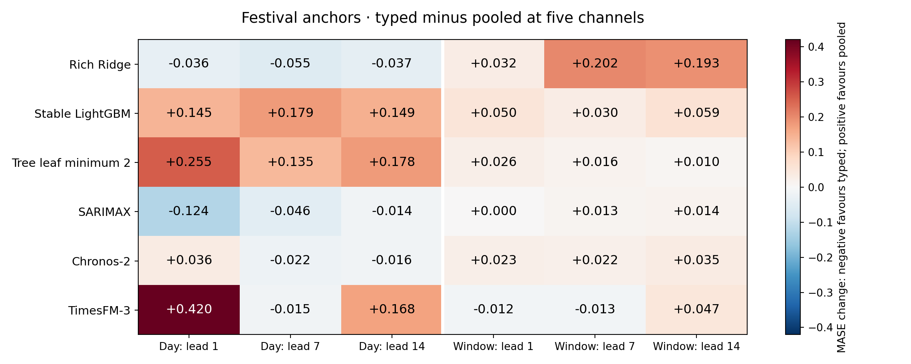
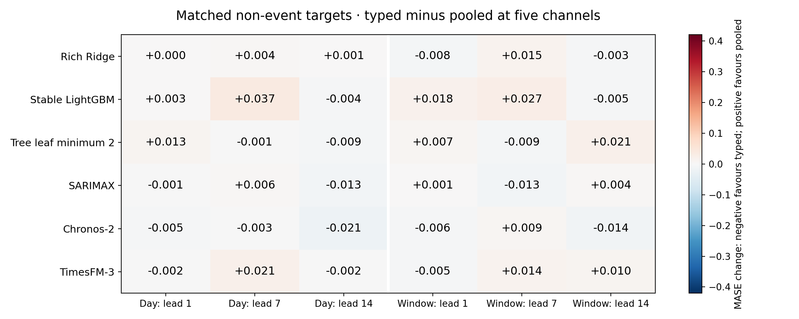
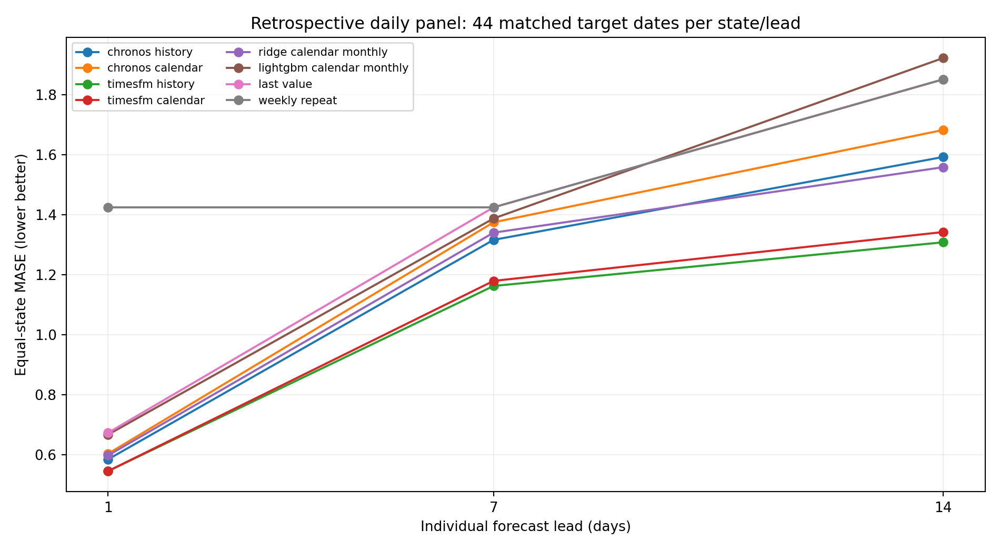
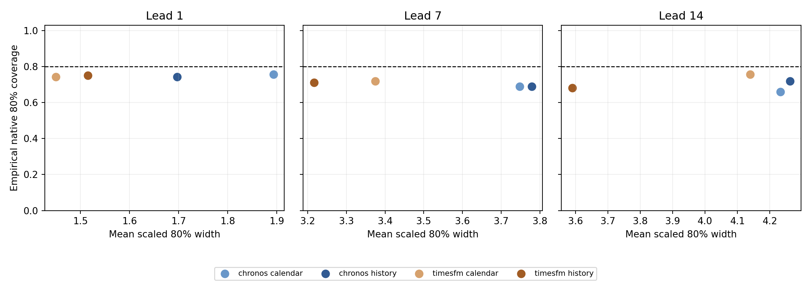

# Festival representation and adaptation in forecasting Indian supplied electricity: matched controls, transfer and reproducibility

**Working manuscript for author and professor review — 30 October 2026. Not submitted or submission-ready.**

Author: Binay Verma. Affiliation, corresponding-author contact, coauthor/contribution decisions and funding/conflict declarations require author confirmation. No professor authorship or independent sign-off is assumed.

## Abstract

Moving festivals create forecasting challenges that ordinary weekday and annual-seasonality features may not capture. We study whether explicit festival representations help predict daily supplied electricity in Delhi, Karnataka and Maharashtra, and whether separate family identities add value beyond a pooled event flag. A named 2022–2025 calendar ledger supports five festival families. Fixed historical anchor and non-event cohorts compare four classical/machine-learning variants and two pinned foundation models under equal-case and feature-count controls. In the next-day anchor cohort, rich Ridge MASE changes from 1.244 with ordinary calendar inputs to 0.561 with separate day flags and 0.597 with a five-channel padded pooled flag. Separate-versus-pooled effects differ across model, lead and representation. A further fixed-budget experiment removes own-family fitting labels with matched training-row controls; earlier target history remains allowed. A broader daily panel uses 44 target dates after both audited weight uploads and evaluates native quantiles as well as point errors. Independent software implementations reveal that forecast agreement can coexist with byte-level feature discrepancies. These findings support careful representation, adaptation and provenance controls rather than universal model or festival-enhancement claims. Previously inspected data, correlated events, unresolved source terms, source revisions, calendar amendments and incomplete independent review limit confirmatory interpretation.

**Keywords:** electricity forecasting; moving holidays; time-series foundation models; calendar covariates; temporal evaluation; reproducibility.

## 1. Introduction

Electricity supplied around a moving holiday can differ from an ordinary weekday because economic activity, institutional closures, weather and supply conditions change together. A holiday label is therefore potentially useful predictive information, but it is not a causal measure of demand reduction. The problem is particularly delicate when a nominally shared festival has different regional dates, office/bank definitions or subsidiary observances.

Time-series foundation models can accept future-known covariates, but apparent improvements can conflate event dates, representation, channel count, statistical sharing and adaptation policy. Separate festival channels may fit distinct responses while receiving only one or two historical positive examples. A pooled flag has more examples but assumes greater sharing. Extra channels can alter foundation-model forecasts even when they contain zeros. These possibilities require direct controls rather than a comparison of errors during festivals alone.

Calendar encodings and learned event covariates are established prior work [1,2]. Load forecasting under covariate uncertainty [3], foundation-model evaluation leakage [4] and Indian moving-holiday regression [8] also precede this study. We make no first-ever or new-architecture claim. The candidate empirical contribution is a documented Indian regional-calendar evaluation that separates added-date information from representation and padding, examines supervised family-label transfer, and retains numerical and source-vintage failures.

We ask four questions. RQ1: do fixed explicit festival features improve matched historical errors beyond ordinary calendar, zero and placebo controls? RQ2: do separate family channels help beyond a pooled event flag at the same channel budget? RQ3: can pooled information help when direct fitting labels around one family are withheld, compared with removing the same number of ordinary labels? RQ4: how do broader post-weight daily errors, native uncertainty and reproduction limits qualify the conclusions? All new-method evaluations on already inspected historical data remain exploratory.

## 2. Data and provenance

The target is recorded daily electricity energy met/supplied, in GWh (equivalently MU), rather than latent unconstrained demand or hourly peak power. We use a frozen Robbie Andrew compilation of GRID-INDIA/POSOCO state data ending 28 October 2026. It is kept separate from an older corrected Hunt/Bloomfield CC BY 4.0 source. Shared-source national derivatives are not independent replication.

Missing historical inputs are filled causally using a preceding weekly value, then the preceding available value where necessary. Recorded positive labels alone are scored; missing labels are not imputed for evaluation. A separate provenance study verifies the frozen Git source bytes and older archive payload digests. Observed historical revisions reach 61.5 GWh, and two fixed publication-vintage scenarios show context lag. Sparse captures do not reconstruct every historical release. Ideal origin-1 availability must therefore be distinguished from a real-time operational trial.

The named feature ledger contains 58 anchors in 48 family/state/year groups across 2022–2025. Holi is evaluated in Delhi/Maharashtra; Ganesh Chaturthi and Ugadi/Gudi Padwa in Karnataka/Maharashtra; Dussehra and Diwali in all three states. State scope is part of the definition. Karnataka lists Ganesh on 18 September 2023 whereas Maharashtra lists 19 September; Maharashtra Holi is 7 March 2023. Annual-as-issued notices, library dates, restricted leave, bank holidays and religious observances are not interchangeable.

The current used-anchor crosswalk covers all 58 rows and 12 state-years: 56 dates match the audited state annual schedule, while 2 declared shared-main dates do not. Retained state PDFs cover 46 anchor rows and previously strengthened notice dates cover 29. Shared-main Maharashtra Diwali anchors are not relabelled as state Lakshmi Pujan dates. None of the 58 amendment chains or human sign-offs is certified. Known notice dates are not automatically first historical public-availability times.

## 3. Experimental design

### 3.1 Temporal rules and metrics

An origin is the first unseen date; individual lead h targets origin+h−1. Every input target observation precedes the origin. Direct local-model fitting purges labels beyond the refit cutoff, and scaler fitting uses only retained rows. Parameters are selected on chronological pre-year validation when that policy is declared; no evaluated error selects a new representation, case, budget or deployment winner.

MAE is reported in GWh by state. MASE divides absolute error by the recorded mean absolute weekly difference in the preceding annual 730-calendar-day reference window. This reference stays fixed across arms/refits within year. Event summaries average states within year, years within family, and families equally. Daily summaries average states equally. Relative MAE effects are computed within state/year before aggregation; they are not ratios of macro MASE. Near-zero denominators are not stabilized by an arbitrary epsilon. More related forecast rows do not create more independent event years.

### 3.2 Models and adaptation

Classical/machine-learning models include rich-history Ridge, stable-interface LightGBM, a separately fixed leaf-minimum-2 sensitivity, fixed-order annual SARIMAX, and earlier weekly ETS/persistence comparators. Rich regressions use 27 causal lag/rolling/trend/annual-history predictors and 13 ordinary weekday/Fourier features. They refit monthly using the original pre-year-selected parameters in the feature intervention. Local feature warm-up can extend before the 730-day fitting-label window; adaptation and memory budgets are not architecture-identical.

Chronos-2 and TimesFM-3 perform inference without task fine-tuning, with 730 past targets, 14 forecast days, seed 42, CPU batch 4 and two threads. Independent-task attention is enforced for Chronos; TimesFM symmetric averaging is disabled. Actual weight bytes and code versions are audited: Chronos weights SHA-256 ddcda3c7… first uploaded 30 October 2025; TimesFM weights a7592b0a… first uploaded 24 August 2026. Historical/proxy exposure remains unresolved. TimesFM model terms permit the noncommercial academic setup; weights are not redistributed.

### 3.3 Added features and pooled comparison

The first intervention uses the same 72 anchor/lead cases across six variants: 24 family/state/year targets at leads 1/7/14. Its arms are ordinary calendar, five zeros, five family day flags, five family ±3-day window flags, and same-size seeded shifted day/window placebos. Wider classical windows contain 528 cases; their scores are not compared with foundation anchor-only scores. The matched non-event cohort has another 72 cases, selected by fixed weekday-preserving 28–42-day shifts excluding annual/registered holiday windows.

The pooled follow-up adds pooled day/window flags as either one channel or one active union channel plus four exact zeros, together with a one-zero control. Calendar/typed predictions are reused from hash-checked parents. It produces 4,320 new forecasts and 2,592 reused forecasts across the two distinct cohorts. Typed versus pooled5 fixes dimensions but changes signal allocation and statistical sharing; it is not causal identification of identity. Pooled1 versus pooled5 checks padding sensitivity. All channel names, dates, contexts and parameters are retained.

### 3.4 Supervised family-label transfer

A separate study fixes Ridge alpha=10 and two 7-leaf, 200-estimator, lambda-10 tree budgets with leaf minima 20/2. It does not reuse hyperparameters whose validation had seen the held family. Calendar, typed-day5 and pooled-day5 are crossed with all rows, removal of every direct own-family ±3-day fitting label, and removal of the same number of eligible ordinary labels. Model/scaler fitting uses retained rows only.

Control dates are matched deterministically by weekday, year, training-window availability and holiday exclusion, using fixed ±28, ±35, …, ±84-day shifts. The first version correctly aborted when a 28–42-day match was infeasible; its partial outputs and failure are retained. Version 2 preflights all 141 training blocks before model execution. Larger shifts weaken seasonal comparability. Crucially, past electricity history and annual lags can still contain earlier family responses: this is supervised label exclusion with available target history, not fully unseen-event or history-free zero-shot transfer. Three budgets × nine arms × 144 cases produce 3,888 forecasts.

### 3.5 Daily post-weight panel and native uncertainty

A broader panel uses 44 identical target dates, 15 September–28 October 2026, for three states and three leads: 396 cases per configuration. All origins are 2 September or later, after both audited weight uploads and the documented TimesFM announcement. Eight configurations compare history/calendar in both foundation models, original pre-2026-selected monthly rich-calendar Ridge/tree, last value and weekly repeat. This yields 3,168 forecasts and 684 foundation context/mode tasks. No 2026 festival calendar or future weather is supplied. Previously inspected outcomes remain exploratory despite post-weight chronology.

Native marginal quantiles 0.1–0.9 are scored by mean scaled pinball. Central 80% intervals are evaluated using coverage, lower/upper misses, scaled width and interval score. A one-interval WIS combines the native median absolute error and the 80% interval score; it is not a full-grid WIS. No quantile sorting, clipping or calibration is applied. Invalid endpoints remain explicit and propagate undefined interval summaries. These native intervals differ from an earlier past-residual nominal-90% interval study.

## 4. Results

### 4.1 Explicit and pooled festival features

Table 1 reports all six variants on identical next-day anchor cases. It is an error table, not accuracy percentages. All other leads, windows, zeros/placebos, states and years remain in the versioned reports.

**Table 1. Next-day anchor MASE: ordinary, pooled and typed day features.**

| Model | Calendar | Pooled day: 1ch | Pooled day: 5ch | Typed day: 5ch |
| --- | --- | --- | --- | --- |
| Rich Ridge | 1.24369 | 0.59692 | 0.59692 | 0.56112 |
| Stable LightGBM | 1.28595 | 1.12357 | 1.12357 | 1.2681 |
| Tree leaf minimum 2 | 1.27323 | 0.84252 | 0.84252 | 1.09736 |
| SARIMAX | 1.31035 | 0.656 | 0.656 | 0.53159 |
| Chronos-2 | 1.3711 | 1.25978 | 1.2933 | 1.32921 |
| TimesFM-3 | 1.34818 | 0.69871 | 0.68281 | 1.1033 |

Across the 18 model/lead cells in the equal-five-channel typed-day versus pooled-day contrast, typed errors are lower in 9, pooled errors lower in 9, with 0 ties within 1e-9 MASE. These counts are descriptive and correlated, not independent trials or a selection rule. Figure 1 shows both day and window contrasts at every lead; Figure 2 shows matched non-event effects. Separate family channels are not assumed to dominate pooling.

*Figure 1. Event-anchor typed minus pooled5 MASE, all variants/leads. Negative favours typed; positive favours pooled.*

*Figure 2. The same contrast on the separate matched non-event cohort. This is not exhaustive all-day performance or a causal event/control comparison.*

Earlier controls remain essential: the original four-year seven-channel Diwali enhancement worsens Chronos mean day-1 error, while later differently scoped day-feature gains can be positive. Zero and placebo channels change some foundation forecasts without equivalent event information. Broad windows and spring-family comparisons can worsen errors. No earlier negative result is replaced by the newer anchor cohort.

### 4.2 Supervised transfer and matched data-removal controls

**Table 2. Event-anchor next-day MASE under fixed budgets and row policies.**

| model | policy | calendar | pooled_day5 | typed_day5 |
| --- | --- | --- | --- | --- |
| ridge_fixed10 | all_rows | 1.29619 | 0.59977 | 0.55744 |
| ridge_fixed10 | exclude_control | 1.29997 | 0.60301 | 0.55616 |
| ridge_fixed10 | exclude_family | 1.30951 | 0.7106 | 1.32139 |
| tree_fixed2 | all_rows | 1.2831 | 0.86181 | 1.12244 |
| tree_fixed2 | exclude_control | 1.28201 | 0.88787 | 1.13196 |
| tree_fixed2 | exclude_family | 1.28728 | 1.01676 | 1.2754 |
| tree_fixed20 | all_rows | 1.28723 | 1.28723 | 1.28723 |
| tree_fixed20 | exclude_control | 1.29638 | 1.29638 | 1.29638 |
| tree_fixed20 | exclude_family | 1.30805 | 1.30805 | 1.30805 |

The primary interpretation compares pooled and calendar inputs within the family-excluded policy, then examines family exclusion versus equally sized control removal for the same feature. Comparing only with the full-data model would confound the kind of lost labels with training-set size. Every own-family typed indicator has zero active fitting rows after exclusion; historical target exposure remains available through lag/rolling features. All-lead and family/state/year contrasts, distance inventory and retained-label hashes are provided in the transfer report. For Ridge under family-label exclusion, pooled MASE worsens at leads 7/14 (1.33987/1.52931 versus calendar 1.18662/1.21157), despite its next-day gain. The leaf-minimum-2 tree has lower aggregate errors at all three leads in this bounded cohort; the leaf-minimum-20 tree ignores the sparse indicators. These results cannot establish foundation-model unseen-event transfer.

### 4.3 Daily comparison after actual weight uploads

**Table 3. Equal-state daily MASE on the 44-target-date panel.**

| configuration | Lead 1 | Lead 7 | Lead 14 |
| --- | --- | --- | --- |
| chronos_history | 0.58548 | 1.3167 | 1.59292 |
| chronos_calendar | 0.60418 | 1.37518 | 1.68293 |
| timesfm_history | 0.5462 | 1.16303 | 1.30856 |
| timesfm_calendar | 0.54622 | 1.17994 | 1.34277 |
| ridge_calendar_monthly | 0.59838 | 1.34065 | 1.55885 |
| lightgbm_calendar_monthly | 0.66784 | 1.38801 | 1.9228 |
| last_value | 0.67397 | 1.42503 | 1.85165 |
| weekly_repeat | 1.42503 | 1.42503 | 1.85165 |

*Figure 3. All eight daily configurations and individual leads. Lines connect summary points, not a continuous forecast trajectory.*

TimesFM history-only has the lowest macro MASE among the eight configurations in this panel: 0.54620, 1.16303 and 1.30856 at leads 1, 7 and 14. These errors provide a broader two-model comparison than the small festival anchor cohorts. They are conditional on fixed fitting policies and this late-2026 period, not proof of universal superiority or full-year ranking. Post-weight dates support direct temporal exposure evidence, conditional on correct source observation dates; retrospective inspection and source publication lag remain separate issues.

### 4.4 Native probability quality and numerical reproduction

**Table 4. Next-day native uncertainty: common pinball, empirical 80% coverage, scaled width and one-interval WIS.**

| configuration | scaled_mean_pinball | coverage80 | scaled_width80 | scaled_WIS80_median |
| --- | --- | --- | --- | --- |
| chronos_calendar | 0.2362 | 0.75758 | 1.89322 | 0.38213 |
| chronos_history | 0.22835 | 0.74242 | 1.69686 | 0.3746 |
| timesfm_calendar | 0.2137 | 0.74242 | 1.44967 | 0.35386 |
| timesfm_history | 0.21332 | 0.75 | 1.51517 | 0.34661 |

*Figure 4. Native 80% coverage versus scaled interval width at each lead. The dashed line is nominal 0.8, not a guarantee or fitted calibration target.*

Coverage must be read with width and proper scores. Point forecast improvement alone does not imply a calibrated or ordered predictive distribution. In the event-anchor cohort, next-day event-balanced coverage of nominal 80% intervals is 0.100 for calendar-only Chronos and 0.16667 for calendar-only TimesFM; TimesFM pooled-day5 improves coverage to 0.500 but remains below nominal. These are weighted historical proportions, not independent binomial trials. The pooled comparison retains 14 all-native adjacent crossing pairs (9 new, 5 reused) for Chronos and none for TimesFM; its common 0.1–0.9 grid has no crossings. All native adjacent crossings are inventoried and retained. The panel has correlated days/states and overlapping horizons, so nominal coverage is descriptive rather than a reliable calibration certification.

Separate internal software audits reconstruct labels, denominators, complete cases, aggregation, paired changes, actual foundation input bytes, fitting labels/cutoffs and probability arithmetic. The bounded clean scalar review reproduces all 135 checked pooled regression forecasts within tolerance, maximum 7.617e-12 GWh, while its strict overall status remains discrepancies_retained. One near-zero Delhi trend entry per checked block differs after float32 conversion by up to 1.421e-14 GWh. The earlier float64 tree study also retains larger forecast discrepancies. Agreement on checked forecasts does not imply universal byte identity or independent human review.

## 5. Discussion

The study separates several questions that a simple holiday benchmark can collapse. Measuring error during an event does not test incremental event information. Adding family channels does not demonstrate that identities beat pooled dates. Holding dimensions fixed does not equalize statistical sharing. Withholding direct labels does not erase historical event responses from causal target features. Post-weight chronology does not turn retrospectively inspected data into untouched evaluation. Each distinction changes what a positive numerical result can support.

For practitioners, the implication is to compare event representations under matched cases and declared adaptation budgets, include ordinary-day costs and report sparse support. Pooled learning can be a useful comparator when separate events have few past examples, but its value must be measured rather than assumed. Calendar provenance should preserve administrative/religious scope and subsidiary anchors; an office schedule is not a direct measure of statewide activity.

For evaluation, native uncertainty, numerical feature contracts and source vintages need explicit audits. Minute floating-point differences can matter to trees, and zero channels can matter to foundation models. Source revisions and reporting delays can alter the idealized history available at an origin. These are empirical reproducibility and availability questions, not reasons to suppress failures or revise outcomes for more attractive tables.

## 6. Limitations and confirmation plan

The current evidence uses one source lineage, three related states, five scoped families and only two primary historical event years. Nearby dates, leads and states are correlated. All historical outcomes have been inspected, so the new-method experiments remain development/exploratory. The placebo/control constructions are bounded and not exchangeable causal assignments. Model/source proxy exposure, exact historical publication times, curator revisions/imputation and full calendar amendments remain unresolved.

An existing prospective freeze contains252 predictions issued 30 October 2026, with216 eligible rows for 31 October–11 November; earlier two target dates are explicitly excluded. The original Git blobs remain unchanged. No prospective outcomes are available here and the auto-scoring workflow remains deliberately paused. One eventual shared-source episode will still not replace independent-source or broader independent-event confirmation.

The next confirmation requires a separately frozen protocol, independent or genuinely untouched observations with model-specific chronology, source-reuse clarification, complete used-date amendment review and independent scientific reproduction. The professor/author must verify contribution, bibliography, affiliation, declarations and venue suitability. A Q1 aspiration does not change these evidence requirements. No submission or acceptance is claimed.

## 7. Conclusion

Calendar/date representation, pooling, adaptation and numerical/source provenance must be distinguished when assessing foundation forecasts of supplied electricity around Indian festivals. The controlled comparisons provide bounded positive and negative findings while retaining earlier results. They support an empirical evaluation and failure-analysis framing; a new architecture, universal holiday benefit and confirmatory generalisation are not established.

## Data, code and review statements

Code, versioned predictions, protocols, failures and handoffs are synchronized to https://github.com/Binay-verma/tsaf_project under the author’s explicit instruction. Upstream source-reuse permission and processing clarification remain pending after the author’s manual email; public availability does not grant a new licence. Model weights and caches are excluded from the repository; pinned restoration/hash instructions are retained. Any journal data-sharing exception requires actual editorial acceptance and is not assumed.

All automated/separate-implementation checks are internal software evidence. No independent human scientific/calendar approval has occurred. Author contributions, competing interests, funding, acknowledgements, affiliation and corresponding-author details require author confirmation. No human-subject claim or declaration is fabricated. No other person has been contacted on the author’s behalf during this work.

## References and artifact map

Bibliographic details and venue status require final author verification. Preprints and software are not represented as journal publications.

1. Kreusel et al. (2026). On the Encoding of Calendar Features in Covariate-Informed Time Series Foundation Models. arXiv:2610.13676. https://arxiv.org/abs/2610.13676

2. Alipour et al. Impact-driven event covariates for time-series foundation models. Amazon Science primary page; final author/venue metadata unresolved. https://www.amazon.science/publications/impact-driven-event-covariates-for-time-series-foundation-models

3. Kaljevic, Arzola and Zhang (2026). Benchmarking Time Series Foundation Models for Load Forecasting Under Covariate Uncertainty. arXiv:2610.07232. https://arxiv.org/abs/2610.07232

4. Meyer et al. Rethinking Evaluation in the Era of Time Series Foundation Models: (Un)known Information Leakage Challenges. arXiv:2510.13654v3. https://arxiv.org/abs/2510.13654

5. Ansari et al. (2025). Chronos-2: From Univariate to Universal Forecasting. arXiv:2510.15821. https://arxiv.org/abs/2510.15821

6. Shchur et al. fev-bench: A Realistic Benchmark for Time Series Forecasting. arXiv:2509.26468. https://arxiv.org/abs/2509.26468

7. Aksu et al. (2024). GIFT-Eval: A Benchmark for General Time Series Forecasting Model Evaluation. arXiv:2410.10393. https://arxiv.org/abs/2410.10393

8. Sanyal, Mitra, McElroy and Roy (2017). Holiday Effects in Indian Manufacturing Series. Census RRS2017-04. https://www.census.gov/library/working-papers/2017/adrm/rrs2017-04.html

9. Google Research (2026). TimesFM-3 official announcement and pinned model/code. https://research.google/blog/timesfm-3-a-zero-shot-foundation-model-for-multivariate-forecasting/

10. Hyndman and Athanasopoulos. Forecasting: Principles and Practice. https://otexts.com/fpp3/toolbox.html

11. Source/model/calendar identities and primary URLs: DATA_SOURCES.md, REGIONAL_CALENDAR_AUDIT.md, PRETRAINING_AUDIT.md and results/second_model_audit_v1/REPORT.md.

12. Current experiment protocols/results: results/festival_features_v1, festival_feature_spillover_v2, pooled_festival_v1, festival_label_transfer_v2 and postweight_daily_v1. Earlier failed prototypes, original expanded findings, selected parameters and prospective freeze remain versioned. PROTOCOL_INDEX.md provides the complete experiment registry.

## Appendix: exact result sources

Table 1: pooled_festival_v1/event/primary_metrics_balanced.csv. Figures1/2: contrasts_balanced.csv with equal state/year/family weights. Table 2: festival_label_transfer_v2/metrics_balanced.csv. Table 3/Figure 3: postweight_daily_v1/metrics_macro.csv. Table 4/Figure 4: postweight_daily_v1/native_uncertainty_macro.csv. All full-arm/state/year/lead tables and native outputs accompany the manuscript; no row-count-based significance claim or final-model selection is made.
