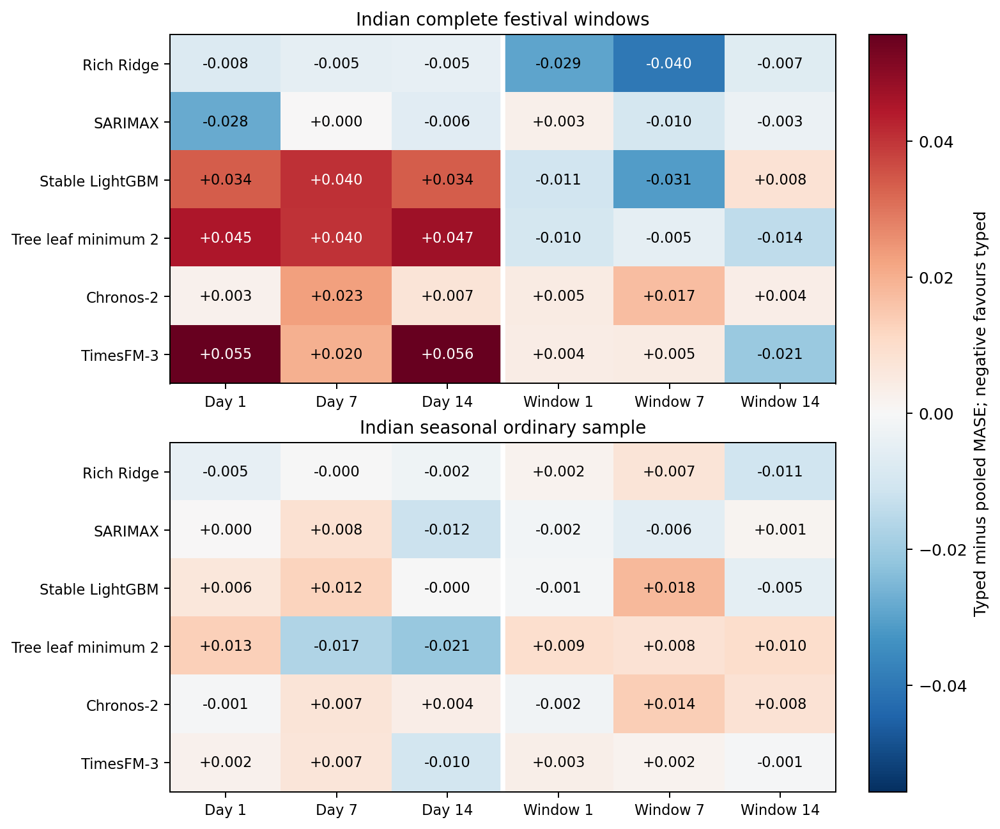
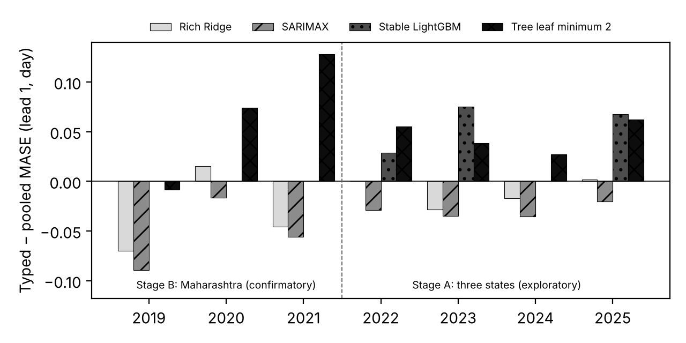

# Typed or pooled festival indicators? Evidence from seventeen Indian states with two registered tests

Binay Verma

Affiliation: __________ . Corresponding author email: __________ .

**Draft for supervisor review (journal format, version 12). Not submitted.**

## Abstract

Forecasters adding festival indicators must choose between one indicator per festival (typed) and one shared indicator (pooled). We compare both for daily electricity in Indian states, with matched zero and placebo controls, four local models and two foundation models. Hypotheses formed in three exploratory states were registered and tested on seven further states, then again on seven more. A LightGBM with a small minimum leaf size did better with a pooled indicator in both tests, though not when calendars were limited to official or individually checked rows. SARIMAX did better with typed indicators in the first test only, by a small margin resting mainly on one state. Neither TimesFM-3's expected pooling preference (first test) nor a benefit of typing where festival effects differ was confirmed. Trees cannot use an indicator active on fewer training days than their minimum leaf size, so a larger-leaf LightGBM ignored typed indicators.

**Keywords:** holiday effects; event covariates; load forecasting; time-series foundation models; forecast combination; pre-registration.

## Highlights

- Typed and pooled festival flags compared with matched zero and placebo controls
- Two registered tests in 14 new states: small-leaf trees prefer a pooled flag
- SARIMAX preferred typed flags in the first test but not in the second
- The expected TimesFM-3 preference for a pooled flag was not confirmed
- Trees ignore flags set on fewer training days than their minimum leaf size

## 1. Introduction

Holidays and festivals are rare, recurring and heterogeneous. A forecaster who adds them to a model faces a choice that predates modern machine learning: give each named event its own indicator, so that each can have its own response, or pool them into one indicator, so that sparse events borrow strength from one another. In load forecasting the trade-off is familiar [9, 10]. Covariate-informed time-series foundation models (TSFMs) such as Chronos-2 [6] and TimesFM-3 [7] reopen it in a new form, because the model is not re-estimated: the forecaster controls only which channels are passed and how they are encoded [1, 2].

An earlier version of this study, with two event years and 10 family-year clusters, found that the ordering changed between years, models and data sources and that no ordering could be confirmed. This version extends the evaluation in time and across states and adds two confirmatory steps. Our contributions are:

1. **A matched comparison.** Typed and pooled festival indicators are compared for two pinned TSFMs and four local models on identical cases, with a calendar baseline, an equal-dimension zero-channel control and weekday-shifted placebos, so that gains from adding channels and gains from festival information can be separated (Sections 3 and 4).
2. **A model-class pattern over four years.** With 1,056 festival-window cases in 2022–2025 and hand-checked state calendars, the preferred representation depends on the model: SARIMAX leans towards typed flags, while LightGBM and TimesFM-3 do better with one pooled flag (Sections 5.2 and 5.3); the TimesFM-3 part did not replicate in seven further states.
3. **Registered tests.** The pattern was written down as a hypothesis before three further Maharashtra years were evaluated (Section 5.4), and three hypotheses were then registered and tested once on seven further states (Section 6.1). Two were confirmed, with small effects that rest mainly on one state, and one was not. A second registered test on seven more states (Section 6.2) replicated the tree result, more strongly, but not the SARIMAX result, and did not confirm that typing helps where festival effects differ.
4. **A mechanism for tree models.** Trees cannot use a flag that is set on fewer training days than their minimum leaf size. A simulation matched to the forecasting pipeline reproduces this; run with each state’s own earlier parameters, it reproduces the main differences between states for Ridge and trees, mainly through the two states with the most heterogeneous festivals (Sections 7 and 8; exploratory). A registered out-of-sample test of the Ridge part of this explanation was not confirmed (Section 6.2).
5. **Decision rules for uncertain orderings.** Following last year's winner often picks the worse representation, and an equal-weight average of the two representations limits the worst case (Section 9).

We do not propose a new architecture, claim causal holiday effects or claim contamination-free testing of pretrained models.

Section 2 reviews related work, Sections 3 and 4 describe the data, models and tests, and Section 5 summarises the exploratory stages in which the hypotheses were formed. The main evidence is the two registered tests on fourteen further states in Section 6. Section 7 explains the pattern with a mechanism and simulations, Section 8 reports exploratory follow-ups, Section 9 turns the results into advice, and Sections 10 to 12 cover uncertainty, limitations and conclusions. A comparison with the closest published designs and a replication on New York transit data are in the appendices; companion tables and a reproduction map are in the online supplement.

## 2. Related work

**Holidays in load forecasting.** Load forecasting is reviewed in [17], and competition models include special treatment of public holidays [19, 20]. Ziel [9] compared one shared holiday dummy, grouped dummies and a separate dummy for each holiday for German load. He reported that many additional per-holiday dummies did not seem to improve on one additional dummy, with univariate results mixed by holiday type; in his multivariate comparison three models were not significantly worse than the best model forecast, M-RpH (a replacing design with one dummy per holiday), and the holiday-as-Saturday and holiday-as-Sunday designs were in most cases significantly worse than the best approach. Arora and Taylor treat special days with rule-based seasonal models [10, 18]. For India, evidence is sparse: a regional study found no significant effect of a single pooled national-holiday dummy on hourly northern-grid load [21], and day-ahead holiday load forecasting in the Indian context has been addressed at a conference [22]; moving Indian holidays have been modelled in manufacturing statistics [3].

**Moving holidays in official statistics.** Festivals that follow lunar or lunisolar calendars move between months, and calendar adjustment has long used holiday-specific regressors for them [23, 24, 25]. For Taiwan's three main lunar holidays each festival gets its own before, during and after regressors, chosen by information criteria [26]; for Chinese New Year the windows are chosen in the same way and insignificant holiday regressors are dropped [27], so "typed" in practice need not mean "keep every dummy". Forecasting software follows the same pattern: the Prophet procedure [28], as implemented, gives each named holiday its own effect with a prior scale that shrinks it, and textbook regression models use one dummy per holiday [29].

**Foundation models and covariates.** Pretrained time-series models such as TimesFM and Chronos were introduced without covariate inputs, and Moirai for a varying number of variates [30, 31, 32]; support for known future covariates came later and differs between models, from exogenous inputs added during fine-tuning [33] to adapters that inject covariates such as holidays into a pretrained model [34] and the native covariate interfaces of Chronos-2 and TimesFM-3 [6, 7]. General benchmarks have followed [35], and some now include tasks with covariates [36]. Closest to our question, Kreusel et al. [1] examine calendar encodings in Chronos-2 and TimesFM-3, Alipour et al. [2] learn event representations from residual responses, and Kaljevic et al. [4] benchmark foundation models for load forecasting under covariate uncertainty; Meyer et al. [5] show how information leakage can affect their evaluation.

**Typed, pooled, or in between.** Typed and pooled indicators are the two ends of a familiar trade-off. Pooling categories reduces variance at the cost of bias when the categories differ, and shrinkage estimators sit between the two, improving accuracy on average although they can worsen it for individual categories [37]; for categorical features with many levels, target encoding [38] in regularised form outperforms integer and indicator (dummy) encodings [39]. Our setting has few categories but very few occurrences of each, which is where this trade-off bites. For random forests the minimum node size is an important tuning parameter [40], and in LightGBM the minimum number of rows in a leaf limits which splits are possible [41]; Section 7 shows how it decides whether typed flags can be used at all.

**Evaluation and inference.** We compare forecasts with the mean absolute scaled error [13], which can be used in tests of equal accuracy [47], rather than the usual pairwise tests [42] or model confidence sets [43], because our unit of evidence is a festival-year cluster and there are few of them. With few clusters, conventional cluster-robust tests over-reject [44], and randomisation tests based on sign changes are an established alternative when cluster-level differences can be taken as symmetric about zero under the null [45, 46]; we adjust for multiple hypotheses with Holm's procedure [16]. Forecasting-practice reviews stress such evaluation choices [48, 49].

**Combination, replication and simulation.** Averaging forecasts goes back to Bates and Granger [11], and simple equal weights often perform as well as estimated weights [12], a result that a simulation can explain [54]; we use equal weights only as a hedge between two representations. Published forecasting results do not always replicate [50], large open comparisons such as the M4 competition [51] set common benchmarks, and leakage undermines many machine-learning results [52]; registering hypotheses before testing them separates hypotheses formed from data from those tested on new data [15]. We report our simulations following the usual structure of aims, data-generating mechanisms, methods and performance measures [53].

Our study does not introduce typed or pooled indicators, which are established. It examines how that choice behaves under a fixed channel budget with zero and placebo controls, across model classes, with two registered tests on new states, and why the answer differs between models and festivals.

## 3. Data and calendars

### 3.1 Electricity data

The target is daily energy met/supplied in GWh for Delhi, Karnataka and Maharashtra, from a GRID-INDIA/POSOCO compilation. It is not latent unconstrained demand, household consumption or hourly peak load. Days with a missing or non-positive value are never scored. All outcomes used here were public and many had been inspected before the analyses were designed, so every result is retrospective; the registrations described in Section 4.4 fix the analysis before it is run, not before the data exist.

### 3.2 Festival calendars

Five festival families are used: Holi, Dussehra, Ganesh Chaturthi, Ugadi/Gudi Padwa and Diwali, each in the states where it is a listed holiday; Diwali has a main anchor and a state-listed second day. Each calendar row records its source document and was checked by hand before use, and the code refuses unchecked rows. For 2022–2025, twelve retained annual state documents support an internal review of all 58 named dates: 54 match the declared family, two are explicit shared-national-main exceptions, one Karnataka 2025 date did not match, and one Maharashtra 2022 Gudi Padwa date could not be corroborated from the retained one-page schedule. The Karnataka notification labels Vijayadasami on 1 October 2025 while the original ledger used 2 October (Gandhi Jayanthi); a separately registered flag-only correction and recentering are reported in the supplement. Rows for 2017–2021 were added for the longer panel from state notifications or third-party reproductions of them (for Maharashtra, only 2019 is from the official document) and checked by the author before the corresponding stage was registered; the Maharashtra 2017–2019 rows were checked after the hypothesis of Section 5.4 had been formed. A check found, for example, that a reposted 2019 Maharashtra list gave 26 October for Laxmi Pujan, while the official date was 27 October. Visible notification dates are not certified first-publication histories, so it is not established that every flag was publicly known at each forecast origin.

### 3.3 Seven further states

The first registered test (Section 6.1) uses the same GRID-INDIA/POSOCO series for Uttar Pradesh, Rajasthan, Madhya Pradesh, Gujarat, Telangana, Andhra Pradesh and Tamil Nadu. Their festival calendars for 2015–2025 (331 rows) were assembled before any model was fitted to these states. The conventions, refined while the rows were sourced and fixed before any forecast, are: the festival day itself is flagged, not a substitute holiday; a family is in scope for a state if it is a public holiday there in most years; weekend festivals stay flagged; years in which a festival is only an optional holiday get no flag. Of the 331 rows, 90 come from official notifications or government reproductions and 241 from secondary sources (reposts of the notifications on teacher, employee and HR-compliance sites, holiday-listing aggregators and, for a few rows, news reports). The author reported checking every row; the method of each check was not recorded per row, and evidence is recorded for disputed rows. After the registered analysis, a search for the original notifications behind the 241 secondary rows found matching dates for 35 of them (4 in official gazette copies, the rest in third-party copies of the government orders) and no new discrepancy; the rest could not be read, because official portals block automated access and the copies found are image-only scans. On average 5.33 states contribute to each family-year cluster. The second registered test (Section 6.2) uses the same series for Punjab, Haryana, West Bengal, Kerala, Bihar, Odisha and Chhattisgarh; its calendar is described there.

### 3.4 Evaluation cohorts

For each festival anchor a ±3-day window is formed, overlapping windows are merged, and every target date in the window is forecast at leads 1, 7 and 14. Family-year combinations (clusters), not rows, are the effective event units. A seasonal ordinary sample takes the first eligible rotating weekday per month, state and year, outside festival windows. Table 1 lists the cohorts.

Table 1. Evaluation cohorts.

| Cohort | Role | States | Event years | Event cases | Ordinary cases | Clusters | Models |
| --- | --- | --- | --- | --- | --- | --- | --- |
| Two-year (Section 5.1) | exploratory | 3 | 2024–2025 | 528 | 216 | 10 | 6 |
| Stage A (Sections 5.2–5.3) | exploratory | 3 | 2022–2025 | 1,056 | 432 | 20 | 6 |
| Stage B (Section 5.4) | confirmatory | Maharashtra | 2019–2021 | 327 | – | 15 | 4 local |
| New states (Section 6.1) | confirmatory | 7 | 2017–2025 | 5,157 | – | 45 | 6 |
| Second test (Section 6.2) | confirmatory | 7 | 2017–2025 | 3,969 | – | 36 | 4 local |

## 4. Models, representations and evaluation

### 4.1 Models

Chronos-2 and TimesFM-3 use pinned code and weights, 730 prior target days, fixed seeds, two CPU threads and no task fine-tuning. The four local specifications are a rich Ridge regression, a float32 LightGBM [14], a minimum-leaf-2 LightGBM sensitivity ("tree leaf minimum 2"), and SARIMAX(1,0,0)(1,0,0,7). Ridge and LightGBM use 27 past-only history features; their parameters are selected for each year, state and lead on the 180 days before the event year, with the ordinary calendar only and purged future labels, and are then shared by all arms, so arms differ only in their festival channels. Local models are refitted monthly while foundation models are frozen, so model rankings do not isolate architecture.

### 4.2 Representations and controls

Every arm keeps 13 ordinary calendar channels (seven weekday indicators and three annual harmonic pairs). Apart from the calendar arm, each main arm adds five channels:

- **calendar** (no festival information) and **calendar + five zeros** (equal dimension, no information);
- **typed day / typed window**: one indicator per family, on the festival day or on its ±3-day window;
- **pooled day / pooled window**: one shared indicator plus four zero channels;
- **typed day / window placebos**: the same indicators shifted by fixed seeded weekday-preserving offsets of four to six weeks that avoid true windows.

Three further local-model arms adapt Ziel's designs [9] (Appendix C): **hSun** treats each anchor day as a Sunday; **Rph** adds the pooled day flag and sets all seven weekday dummies to zero on flagged days; **RpH** does the same with the five typed flags.

### 4.3 Error measure and tests

The error measure is MASE [13] with a fixed pre-year scale (the mean absolute weekly difference over the previous 730 days); imputed labels are never scored. Event summaries average errors within state/year/family, then states within year, years within family, and families equally. The main contrast is typed minus pooled MASE, so positive values favour pooling.

Because rows within a festival window are correlated, contrasts are tested with exact sign-flip permutation tests on family-year cluster means, enumerating all 2^n sign assignments, and Holm-adjusted [16]; tests are two-sided except the registered Stage B and new-states tests, which are one-sided in the hypothesised direction. With 45 clusters (first test) and 36 clusters (second test) the new-states tests use 1,000,000 Monte Carlo sign assignments (fixed seeds), with p = (k+1)/(N+1); the second test also uses 45 state-family-year units for M1 and an exact Spearman permutation test over seven states for M2 (Section 6.2). With 10 clusters (Section 5.1) the smallest attainable two-sided p is 2/1,024, so Holm over 36 cells cannot go below 0.070; with 20 clusters (Stage A) it is 2/2^20 (about 1.9 × 10^-6), and Holm is applied over the eight lead-1 cells. A sign-flip test assumes cluster differences are symmetric about zero under the null; clusters in the same year share weather and source vintage, so the tests are approximate.

### 4.4 Registration sequence

Each stage's protocol was committed to the repository before that stage's selection and forecasts were run, and every worker checks the hashes of its inputs against the registered protocol before running; the 2024–2025 forecasts already existed when Stage A was registered. The order matters for interpreting Section 5: the Stage A protocol was committed at 13:23 UTC on 11 November 2026 and its results at 13:49; the model-class hypothesis (results/model_class_hypothesis_v1) was formed from those results and committed at 14:13, with its test, decision rule and a 2020 sensitivity fixed in advance; the Stage B protocol, carrying the hash of the hypothesis file, at 14:18; and the Stage B analysis at 14:25. These are local commit times; the commits are now in the public repository, but their push time is not recorded in the commit history, so the order rests on the author's commit history rather than an external timestamp. Stage A is therefore exploratory, and Stage B is a registered follow-up test on data that were public but not yet evaluated.

For the seven further states, the protocol, hypotheses, test, decision rule, sensitivities and the hash of the analysis script were committed at 13:27 UTC on 13 November 2026, before any parameter selection or forecast for these states. The OSF registration (osf.io/yw7mr) was submitted no later than 14:02 UTC (the commit recording it), after the parameter selection for the local models (ordinary calendar only) had started but before any forecast with festival indicators. Times are author timestamps; later rebases changed the committer timestamps of some commits but not their content. Foundation forecasts were run in a hosted notebook; two runs whose final upload failed were recovered from the notebook output, and their prediction files match the hashes the runs wrote. The analysis script, unchanged from registration, was run once at 21:28 UTC on 14 November 2026. The first simulation design of Section 7, with its three-state calibration, was committed (by author timestamp) before the new-states analysis; the pipeline-matched version and its per-state predictions were designed after that analysis, and after the first version's effect sizes were seen to be too large, with each design committed before its single run. Everything in Section 8 was written after the analysis and is exploratory. For the second test (Section 6.2), the calendar, power calculation, protocol and analysis script were committed by 17:52 UTC on 15 November 2026 (commit f1f3560, pushed to the public repository before the OSF submission). The author recorded the OSF submission as complete by 18:21 UTC, the minute parameter selection started; this order rests on the author's record. All forecasts ran between 18:48 and 19:25 UTC, and the analysis script, unchanged, was run once at 19:26 UTC.

## 5. Where the hypotheses came from

This section summarises the exploratory work on the three original states and the registered follow-up on further Maharashtra years. It is the basis of the hypotheses tested in Section 6, not the main evidence.

### 5.1 Two event years with all six models

Table 2 gives the next-day comparison on the 528 festival-window cases of 2024–2025, and Figure 1 all leads. Festival information helps the local models: typed and pooled day flags lower Rich Ridge event MASE from 0.57699 to 0.45317 and 0.46093, and SARIMAX from 0.57301 to 0.42533 and 0.45345. Chronos-2 gains little; TimesFM-3 gains with both day flags (typed 0.48005, pooled 0.42459, against 0.55148 for calendar). Window indicators help little. The typed-minus-pooled contrast ranges from -0.03971 to 0.05564 across the 36 model/representation/lead cells and its sign is opposite between 2024 and 2025 in 19 cells (supplement; lead 1 by family in Supplementary Table S4). Across the 36 cells, 3 reach a raw sign-flip p below 0.05, against 1.8 expected if every null were true; the smallest raw p is 0.0059 (TimesFM-3 day flags). With 10 clusters no ordering can be confirmed (Supplementary Table S13). On ordinary days (Supplementary Table S1) the arms differ less, but for both foundation models the day arms slightly raise ordinary-day MASE. Zero-channel and placebo controls for this cohort are in Supplementary Table S14; pure daily calendar encodings for the foundation models, fixed response-profile comparators and support/heterogeneity diagnostics are in Supplementary Tables S6, S3 and S5.

Table 2. 2024–2025 festival windows (document-aligned, recentered): lead-1 MASE.

| Model | Calendar | Typed day | Pooled day | Typed window | Pooled window |
| --- | --- | --- | --- | --- | --- |
| Rich Ridge | 0.57699 | 0.45317 | 0.46093 | 0.57914 | 0.60838 |
| SARIMAX | 0.57301 | 0.42533 | 0.45345 | 0.57787 | 0.57511 |
| Stable LightGBM | 0.69865 | 0.69483 | 0.66110 | 0.70168 | 0.71233 |
| Tree leaf minimum 2 | 0.68582 | 0.64952 | 0.60469 | 0.69028 | 0.70001 |
| Chronos-2 | 0.53767 | 0.52009 | 0.51752 | 0.53720 | 0.53268 |
| TimesFM-3 | 0.55148 | 0.48005 | 0.42459 | 0.55540 | 0.55131 |

### 5.2 Stage A: four event years

Two earlier event years (2022–2023) were added after the 2020–2021 calendars needed as their training history had been checked; this doubles the event cases to 1,056 and the clusters to 20. Parameters for the new years were selected by the unchanged pre-year procedure, and re-running the 2024–2025 subset reproduced the stored local forecasts (maximum difference 1.4 × 10^-13). Table 3 gives the lead-1 contrasts.

One cell passes the pre-set rule (Holm p below 0.05 and the same sign in at least three of four years): Stable LightGBM is better with the pooled day flag (+0.0429, Holm p 0.029; 2024 is an exact tie). The leaf-2 LightGBM points the same way in all four years (+0.0458, Holm p 0.063), and SARIMAX points the other way in all four years (−0.0300, raw p 0.0266, Holm p 0.160). Rich Ridge shows no ordering. Leaving out any one festival family does not change the sign of these three day contrasts. The window representations show no clear ordering. The LightGBM result needs care: a typed flag has at most four flagged days in a 730-day training window, fewer than the minimum of five or 20 samples per leaf that the stable LightGBM may select, so its trees cannot split on typed flags at all, whereas the pooled flag can have more than ten flagged days. Its pooling advantage may therefore reflect the number of flagged days rather than a preference for pooled information; the leaf-2 LightGBM, which can split on typed flags, still favours pooling in all four years. Over all 24 model/representation/lead cells, 6 have a raw p below 0.05 and none survives Holm over 24.

The controls behave as intended (Table 4): at lead 1 the zero-channel and placebo-day arms stay within 0.0013 of the calendar arm for every local model (0.0028 including the window placebos), whereas typed and pooled day flags lower Rich Ridge and SARIMAX MASE by more than 0.1. The gains therefore come from the festival dates, not from extra channels.

Table 3. Stage A (2022–2025, 20 clusters): lead-1 typed minus pooled MASE, balanced over all years and by year. Positive favours pooling. LGBM: Stable LightGBM; LGBM-2: tree leaf minimum 2. Same sign: years agreeing with the all-years sign. p: exact two-sided sign-flip; Holm over the eight lead-1 cells. Typed and pooled MASE are in Table 4.

| Model | Rep. | All years | 2022 | 2023 | 2024 | 2025 | Same sign | p | Holm p |
| --- | --- | --- | --- | --- | --- | --- | --- | --- | --- |
| Ridge | day | −0.0109 | +0.0001 | −0.0283 | −0.0173 | +0.0018 | 2/4 | 0.1959 | 0.588 |
| Ridge | window | −0.0084 | +0.0153 | +0.0096 | −0.0448 | −0.0137 | 2/4 | 0.5662 | 0.677 |
| SARIMAX | day | −0.0300 | −0.0287 | −0.0351 | −0.0356 | −0.0206 | 4/4 | 0.0266 | 0.160 |
| SARIMAX | window | +0.0052 | +0.0098 | +0.0054 | +0.0090 | −0.0035 | 3/4 | 0.3386 | 0.677 |
| LGBM | day | +0.0429 | +0.0288 | +0.0751 | 0.0000 | +0.0675 | 3/4 | 0.0036 | 0.029 |
| LGBM | window | −0.0150 | −0.0156 | −0.0232 | −0.0232 | +0.0019 | 3/4 | 0.0934 | 0.467 |
| LGBM-2 | day | +0.0458 | +0.0551 | +0.0385 | +0.0272 | +0.0624 | 4/4 | 0.0090 | 0.063 |
| LGBM-2 | window | −0.0143 | −0.0052 | −0.0326 | −0.0178 | −0.0016 | 4/4 | 0.1284 | 0.513 |

Table 4. Stage A controls: lead-1 event MASE.

| Model | Calendar | + zeros | Placebo | Typed day | Pooled day | Typed window | Pooled window |
| --- | --- | --- | --- | --- | --- | --- | --- |
| Rich Ridge | 0.60902 | 0.60902 | 0.60979 | 0.49107 | 0.50200 | 0.61942 | 0.62783 |
| SARIMAX | 0.62374 | 0.62374 | 0.62393 | 0.48087 | 0.51090 | 0.63438 | 0.62920 |
| Stable LightGBM | 0.73719 | 0.73719 | 0.73719 | 0.73528 | 0.69242 | 0.73110 | 0.74611 |
| Tree leaf minimum 2 | 0.73341 | 0.73341 | 0.73473 | 0.71033 | 0.66452 | 0.72915 | 0.74346 |

### 5.3 Foundation models over four years

The foundation models were extended to the Stage A years by a separately registered run (results/longer_panel_foundation_v1; protocol committed before any of its forecasts, run on a hosted CPU notebook). It first re-forecast the 2024 event cases for three reference arms: all 1,584 forecasts matched the stored ones within the registered tolerance (largest difference 0.00018 GWh), so the new 2022–2023 forecasts were combined with the stored 2024–2025 ones. This analysis is exploratory: the registered model-class hypothesis concerns the local models only.

Table 5 gives the lead-1 contrasts. TimesFM-3 is better with the pooled day flag (+0.0506, Holm p 0.017, all four years), which passes the Stage A rule. The two new years agree with the 2024–2025 pattern noted in the earlier version as an expectation for future confirmation (+0.0529 in 2022 and +0.0387 in 2023), although that expectation was not registered as a hypothesis; registered later as H2, it did not replicate in seven further states (Section 6). The pooled day flag lowers TimesFM-3 MASE from 0.57904 (calendar) to 0.46855, while the typed flags give 0.51918. Chronos-2 shows no ordering (+0.0038, raw p 0.5343) and gains little from either flag. The zero-channel and placebo arms stay within 0.0063 of calendar for both models. Unlike the stable LightGBM, TimesFM-3 receives the flags as input channels and can in principle use typed flags, so its preference for pooling is not explained by a minimum leaf size.

Table 5. Foundation models over Stage A (2022–2025, 20 clusters): lead-1 MASE and typed minus pooled contrast. Positive favours pooling. Holm over the four lead-1 cells. 2022–2023 forecasts from the registered extension; 2024–2025 from the stored runs.

| Model | Rep. | Typed | Pooled | All years | 2022 | 2023 | 2024 | 2025 | Same sign | p | Holm p |
| --- | --- | --- | --- | --- | --- | --- | --- | --- | --- | --- | --- |
| Chronos-2 | day | 0.56285 | 0.55900 | +0.0038 | +0.0074 | +0.0028 | −0.0007 | +0.0058 | 3/4 | 0.5343 | 1.000 |
| Chronos-2 | window | 0.58190 | 0.57561 | +0.0063 | +0.0119 | +0.0042 | +0.0074 | +0.0016 | 4/4 | 0.0541 | 0.162 |
| TimesFM-3 | day | 0.51918 | 0.46855 | +0.0506 | +0.0529 | +0.0387 | +0.0683 | +0.0426 | 4/4 | 0.0042 | 0.017 |
| TimesFM-3 | window | 0.57935 | 0.57890 | +0.0004 | −0.0027 | −0.0037 | +0.0090 | −0.0008 | 1/4 | 0.8914 | 1.000 |

The TimesFM-3 preference for pooling did not replicate in the registered test on seven further states (Section 6).

### 5.4 Stage B: registered test on further years

Because the model-class pattern was found in the Stage A data, it was stated as a hypothesis before any new test data were used: H1, Stable LightGBM favours the pooled day flag; H2, SARIMAX favours typed day flags; H1b (secondary), the same as H1 for the leaf-2 LightGBM; H3, Ridge, reported only. The test data are Maharashtra event years 2019–2021, which had not been evaluated as targets by any model or arm; their 2020–2021 values were, however, training history for the 2022–2023 Stage A models, and Maharashtra is one of the Stage A states. Calendars for 2017–2021 were checked by hand (327 cases, 15 clusters, no missing labels). The decision rule was fixed in advance: one-sided exact sign-flip p over 15 clusters, Holm across H1 and H2, and the sign must hold in at least two of three years; the COVID year 2020 is removed as a pre-declared sensitivity.

Table 6 gives the result. H2 is confirmed (−0.0539, one-sided p 0.0154, Holm p 0.0307, all three years) and still holds without 2020 (−0.0726, Holm p 0.0137). H1 is exactly zero, which makes the test uninformative rather than evidence against H1: for lead 1 the pre-year selection chose a minimum of 20 samples per leaf in all three years, while the pooled flag is set on at most 13 and a typed flag on at most four of the 730 training days, so no tree splits on any festival column and every arm gives the same forecast (balanced MASE 0.98138 for all five arms, Table 7). The same mechanism explains the exact tie in Stage A's 2024. It could have been anticipated from that tie but was not written into the registration, so the registered decision stands. The leaf-2 LightGBM, whose trees can use the flags, favours pooling (+0.0648, unadjusted one-sided p 0.0197, two of three years; 2019 has the opposite sign); the registration fixed a decision rule only for H1 and H2, so this secondary result is descriptive, and it does not hold without 2020 (+0.0600, p 0.0889). Rich Ridge favours typed flags in Maharashtra (−0.0335), unlike Stage A. Figure 2 shows the yearly contrasts across both stages.

Table 6. Stage B (Maharashtra 2019–2021, 15 clusters): registered hypothesis tests at lead 1 (day flags), typed minus pooled MASE. H1 and H1b expect a positive value (pooling better), H2 a negative one. H1b is secondary and not Holm-adjusted. Decision rule: Holm p below 0.05 and the expected sign in at least two of three years.

| Hyp. | Model | All years | 2019 | 2020 | 2021 | One-sided p | Holm p | Decision | Without 2020 |
| --- | --- | --- | --- | --- | --- | --- | --- | --- | --- |
| H1 | LGBM | 0.0000 | 0.0000 | 0.0000 | 0.0000 | 1.0000 | 1.0000 | not confirmed | not confirmed |
| H2 | SARIMAX | −0.0539 | −0.0893 | −0.0166 | −0.0558 | 0.0154 | 0.0307 | confirmed | confirmed |
| H1b | LGBM-2 | +0.0648 | −0.0082 | +0.0743 | +0.1282 | 0.0197 | – | meets rule, unadjusted | does not meet rule |

Table 7. Stage B controls: lead-1 event MASE (Maharashtra 2019–2021).

| Model | Calendar | + zeros | Placebo | Typed day | Pooled day |
| --- | --- | --- | --- | --- | --- |
| Rich Ridge | 0.72425 | 0.72425 | 0.72361 | 0.55409 | 0.58762 |
| SARIMAX | 0.73161 | 0.73161 | 0.73105 | 0.53395 | 0.58787 |
| Stable LightGBM | 0.98138 | 0.98138 | 0.98138 | 0.98138 | 0.98138 |
| Tree leaf minimum 2 | 0.98711 | 0.98711 | 0.98690 | 0.98199 | 0.91722 |

## 6. Registered tests in further states

### 6.1 First test: seven further states

Three hypotheses were registered for lead 1 and day flags: H1, SARIMAX does better with typed flags; H2, TimesFM-3 does better with a pooled flag; H3, the leaf-2 LightGBM does better with a pooled flag. The decision rule was a Holm-adjusted one-sided p below 0.05 with the hypothesised sign in at least six of nine event years; a result in the opposite direction with unadjusted p below 0.05 counts as contradicted. Table 8 gives the result. H1 and H3 are confirmed (Holm p 0.038 each; six and eight of nine years) and H2 is not (−0.0004, three of nine years). Table 9 shows that both flag types improve Ridge, SARIMAX and the leaf-2 LightGBM over the calendar, zero-channel and placebo arms, while Stable LightGBM does not change at all with typed flags and improves only with the pooled flag. The confirmed effects are much smaller than the exploratory ones: SARIMAX went from −0.0300 in Stage A and −0.0539 in Stage B to −0.0097, and the leaf-2 LightGBM from +0.0458 and +0.0648 to +0.0068. The registration expected about 0.9 power at the Stage A size; at the observed size the SARIMAX test was underpowered (Section 8).

Table 8b gives the registered sensitivities. Without 2020–2021, the H1 effect is almost unchanged (−0.0086) but no longer significant with 35 clusters (Holm p 0.115, four of seven years); H3 holds. With official calendar sources only, no hypothesis is confirmed, the H3 sign reverses, and H2 is contradicted (typed better, unadjusted opposite-direction p 0.028). That sensitivity removes Gujarat, Rajasthan and Uttar Pradesh completely and keeps 85 state-family-year cells, 74 of them from Tamil Nadu and Telangana. Running those southern states with all their calendar rows gives the same decisions (Section 8), so the sensitivity mainly reflects which states remain; whether calendar quality matters in the other states, which have almost no official rows, remains untested.

Table 8. Seven further states (2017–2025, 45 clusters, 5.33 states per cluster): registered tests at lead 1, day flags, typed minus pooled MASE. Holm across H1–H3. (−) expects typed better, (+) pooled better. Years: years with the expected sign.

| Hypothesis | Typed − pooled | Years | One-sided p | Holm p | Decision |
| -------------------------- | ---------- | ------- | ---------- | -------- | --------------- |
| H1 SARIMAX (−) | −0.0097 | 6/9 | 0.0161 | 0.038 | confirmed |
| H2 TimesFM-3 (+) | −0.0004 | 3/9 | 0.5313 | 0.531 | not confirmed |
| H3 LightGBM leaf 2 (+) | +0.0068 | 8/9 | 0.0127 | 0.038 | confirmed |

Table 8b. Decisions (and typed minus pooled MASE) under the two registered sensitivities.

| Hypothesis | Without 2020–2021 (35 clusters) | Official calendar sources only (44 clusters) |
| --- | --- | --- |
| H1 SARIMAX | not confirmed (−0.0086) | not confirmed (−0.0043) |
| H2 TimesFM-3 | not confirmed (+0.0022) | contradicted (−0.0220) |
| H3 LightGBM leaf 2 | confirmed (+0.0086) | not confirmed (−0.0074) |

Table 9. Seven further states: lead-1 event MASE by arm. Foundation models were run without the zero and placebo arms.

| Model | Calendar | + zeros | Placebo | Typed day | Pooled day |
| --- | --- | --- | --- | --- | --- |
| Rich Ridge | 0.57195 | 0.57195 | 0.57254 | 0.51822 | 0.53364 |
| SARIMAX | 0.58318 | 0.58319 | 0.58300 | 0.55037 | 0.56005 |
| Stable LightGBM | 0.70192 | 0.70192 | 0.70192 | 0.70192 | 0.68383 |
| Tree leaf minimum 2 | 0.71115 | 0.71115 | 0.71147 | 0.69326 | 0.68648 |
| Chronos-2 | 0.55472 | – | – | 0.54694 | 0.54335 |
| TimesFM-3 | 0.53529 | – | – | 0.49841 | 0.49882 |

### 6.2 Second test: seven more states

To check whether these results travel, and whether typing helps where festival effects differ, a second test was registered on OSF on 15 November 2026 for the seven remaining states whose mean daily energy is at least 70 GWh: Punjab, Haryana, West Bengal, Kerala, Bihar, Odisha and Chhattisgarh. By the author's record, the OSF submission was complete by 18:21 UTC, the minute parameter selection started, and no forecast for these states existed before it (Section 4.4). The pipeline, arms and case rule are those of Section 6.1, with local models only. The calendar has one main festival day per family, state and year (231 rows for 2015–2025), with candidate dates found by machine search, mostly on holiday aggregators and reposts. Because festival days are mostly the same across states, each row was compared with the dates the author verified for the same family and year in the first test (themselves mostly from secondary sources, Section 3.3): 183 agree with one of those dates, 43 were checked by the author one by one (the 22 that did not agree and a random sample of 21 that did; the sample found two Holi rows dated on the eve), and 5 further Holi rows with the same pattern were moved to the Holi day by rule; the other agreeing Holi rows were not re-examined. In Bihar, the author's checked dates use the second Holi day in 2017, 2019 and 2024. Agreement with other states corroborates the festival day; it does not show each state's own notification. The design has 3,969 event cases in 36 family-year clusters.

Four hypotheses were tested at lead 1 with Holm correction across them: R1 and R2 repeat H1 and H3; M1 states that Ridge does better with typed flags over 2021–2025 in the three states with the most dispersed festival effects, estimated from 2015–2020 demand only (Chhattisgarh, West Bengal, Haryana); M2 states that this dispersion is negatively rank-correlated with the Ridge difference across the seven states. R1 and R2 use the rule of Section 6.1; M1 also needs a negative mean in at least four of its five years, and M2 uses an exact permutation test over all 5,040 orderings. The dispersion is the between-family standard deviation of log festival effects, net of sampling noise, without the division by the mean effect used in Section 7, because one state's mean effect is close to zero (Bihar, +0.7%); this choice was made after seeing the 2015–2020 values and before any forecast, and it replaced Bihar with Haryana among the three M1 states. The first test's measure is a registered sensitivity. The registration stated the power in advance: if the true effects equal those of Section 6.1, R1 passes in only about 18–34% of simulated replications and R2 in about 19–36%.

Table 8c gives the result. R2 is confirmed and larger than in the first test (+0.0147, all nine years). R1 is not: SARIMAX's typed advantage is close to zero (−0.0008, 5/9 years). M1 and M2 point in the predicted direction but are not confirmed (−0.0081, 4/5 years; Spearman −0.43). The decisions are the same without 2020–2021 and with the first test's dispersion measure. On the clusters covered by the 43 rows checked one by one (24 clusters), nothing is confirmed (R2 +0.0040, 6/9 years); this subset is small and has low power, but, as with the official-source sensitivity of the first test, the result is not shown on the most closely checked rows alone. As in the first test, Stable LightGBM's typed arm equals its calendar arm (0.63039), while its pooled arm improves (0.61847). Pooling both tests (secondary, 14 states, 45 family-year clusters), SARIMAX has −0.0056 (one-sided p 0.029) and the leaf-2 LightGBM +0.0089 (p 0.0005).

Table 8c. Second registered test, seven more states (2017–2025): lead 1, day flags, typed minus pooled MASE (M2: Spearman correlation). Units: R1 and R2, 36 family-year clusters; M1, 45 state-family-year values (2021–2025); M2, 7 states. Holm across R1, R2, M1 and M2. (−) expects typed better, (+) pooled better.

| Hypothesis | Statistic | Years | One-sided p | Holm p | Decision |
| --- | --- | --- | --- | --- | --- |
| R1 SARIMAX (−) | −0.0008 | 5/9 | 0.410 | 0.489 | not confirmed |
| R2 LightGBM leaf 2 (+) | +0.0147 | 9/9 | < 0.0001 | < 0.0001 | confirmed |
| M1 Ridge, three most dispersed states (−) | −0.0081 | 4/5 | 0.168 | 0.489 | not confirmed |
| M2 dispersion vs Ridge gain, ρ (−) | −0.43 | – | 0.163 | 0.489 | not confirmed |

## 7. Mechanism and simulations

Tree models need a minimum number of training rows on each side of a split; because each tree model is fitted to one state, a row is a day. A typed flag is set on one training day per year, so a tree with minimum leaf size L cannot split on it until there are L training years, while the pooled flag is set about five times as often. In the empirical models the trees are trained on a 730-day window, in which a typed flag is set on at most about four days; Stable LightGBM's selected minimum leaf sizes (5 or 20 in the new states, 20 in Stage B) are never reached, which is why its typed arm equals its calendar arm in Stage B, in Table 9 and in the second test (Section 6.2), while the pooled flag, set on up to about a dozen days, can be used.

A synthetic study illustrates this and the trade-off for a linear model. It covers Ridge and LightGBM, and in its first version also the two foundation models; it does not cover SARIMAX. Daily series with weekly and annual cycles and autoregressive noise carry five festival families whose effects are μ(1 + h·z), where z takes five fixed values with mean 0 and standard deviation 1 and h measures how much the families differ, plus occurrence noise; it is calibrated to the three original states (festival-day effect −9.6%; −9.9% in a regression that also models the neighbouring days, whose relative profile the generator uses; h 0.46 with a 90% year-bootstrap band 0.30–0.69). A first version, committed before the new-states analysis, used one-day effects, trained on all earlier years and scored the festival day only; it reproduced the directions but gave effects about ten times the observed ones (0.16 MASE for Ridge at the calibrated h). After that analysis, and after this mismatch had been seen, a second version was built to match the forecasting pipeline in three respects only: each festival's effect is spread over its window with the profile measured on the three original states (the day after a festival keeps about two thirds of the festival-day effect), models are refitted monthly on the previous 730 days, and every day of the ±3-day window is scored. At the calibrated h it gives −0.0133 for Ridge, against −0.0109 observed in Stage A; exactly zero in every replication for a LightGBM with minimum leaf size 20, as for Stable LightGBM's typed arm; +0.0837 with leaf size 5, which at Stage A's lead-1 mix of selected leaf sizes (5 in 7 of 12 fits, otherwise 20) implies about +0.0488 against +0.0429 observed; and +0.0306 with leaf size 2, against +0.0458 in Stage A (Figure 3). These comparisons are in-sample, because the calibration, the window profile and Stage A use the same three states. Applied unchanged to the seven further states, the three-state parameters overstate the tree effects there by a factor of about 2.6 to 4.5; the per-state, out-of-time check in Section 8 uses each state's own earlier parameters instead. In this version Ridge typed flags start to win between h = 0.25 and h = 0.46. The first version was also run for Chronos-2 and TimesFM-3 at lead 1 (pooled flag without padding): both do better with a pooled flag when festival effects are alike (h = 0: +0.0860 and +0.2693), slightly better with it at the calibrated h (+0.0674 and +0.0618), and much better with typed flags when effects differ strongly (h = 2: −0.3578 and −1.1918). Only these directions are informative, because that version overstates sizes; they are consistent with the Stage A pooling preference of TimesFM-3 and with a null average over the further states, which mix low-heterogeneity states with Gujarat and Tamil Nadu.

SARIMAX, the model of the confirmed H1, was added to the pipeline-matched simulation afterwards, with the registered specification (one fit per year on the previous 730 days, a first-order autoregression with a weekly seasonal term, parameters then held fixed). At the three-state calibration it does better with a pooled flag when festival effects are alike (+0.0129 at h = 0, +0.0062 at h = 0.25) and with typed flags from the calibrated heterogeneity upwards (−0.0082 at h = 0.46, −0.0701 at h = 1, −0.1975 at h = 2), the direction of H1 at the measured heterogeneity. In the second registered test, SARIMAX showed no typed advantage (Section 6.2). Its per-state predictions are weaker than for Ridge and the trees: with each further state's 2015–2020 parameters it predicts an average of −0.0069 against −0.0164 observed for 2021–2025, with a state-level correlation of 0.49 (Spearman 0.57, not significant), and the observed SARIMAX favours typed flags in Rajasthan and Madhya Pradesh where the simulation predicts a pooled advantage. The simulated gain at the calibrated h is also about 3.6 times smaller than the observed Stage A value (−0.0300), and Tamil Nadu is over-predicted (−0.0915 against −0.0218 observed). With seven states this is supporting evidence, not a test: the simulation accounts for the direction of H1 at the calibrated heterogeneity but not for its size or its distribution across states.

![Figure 3. Pipeline-matched simulation calibrated to the three original states (exploratory; designed after the registered analysis). Left: Ridge typed minus pooled MASE against festival-effect heterogeneity h (shaded: calibrated 90% band; cross: observed Stage A value). Right: LightGBM at the calibrated h for minimum leaf sizes 2, 5 and 20 (bars), the implied value for Stable LightGBM at Stage A's lead-1 mix of leaf sizes (circle), and observed Stage A values (crosses). Positive values favour pooling.](figures/figure3_simulation.png)

## 8. Exploratory follow-ups

The analyses in this section were written after the first registered test and are not confirmatory.

**Robustness and power.** Leaving out one state or one year at a time (unadjusted one-sided p), H1 keeps its sign in 16 of 16 cases (p below 0.05 in 15) and H3 in 16 of 16 (14). Both depend most on Gujarat: without it, H1 shrinks from −0.0097 to −0.0029 and H3 from +0.0068 to +0.0011, and all 44 Gujarat calendar rows come from secondary sources. H2 has no consistent sign (8 of 16). With 45 clusters, the minimum effect detectable with 80% power is about 0.011 MASE for H1, larger than the observed 0.0097.

**Regions.** Table 12 splits the seven states into two groups, a split chosen after seeing the results and applied with all calendar rows. In Uttar Pradesh, Rajasthan, Madhya Pradesh and Gujarat, typed flags help SARIMAX (−0.0235), carried mainly by Gujarat (−0.0758), while Uttar Pradesh goes the other way (+0.0110); in Andhra Pradesh, Telangana and Tamil Nadu typed flags do not help SARIMAX (+0.0040), and there TimesFM-3 does better with typed flags (−0.0137), the opposite of H2. The two groups also differ in festival mix: the southern states include Ganesh Chaturthi and Ugadi, the others mainly Holi, Dussehra and Diwali. Possible reasons are discussed below.

**Festivals.** If typing helps because festivals differ, the gain should be largest for festivals whose effect differs most from the state's average festival effect. Across the 27 state-festival pairs, that deviation is correlated with the typed advantage for Ridge (Spearman ρ -0.68) and SARIMAX (-0.50) when both are measured on 2017–2025, which is partly circular; measuring the effects on 2015–2020 and the gains on 2021–2025 leaves Ridge at -0.43 (unadjusted p 0.027; twelve correlations were computed) and SARIMAX at -0.26. Within states, after removing each state's mean, the Ridge relation is weak (-0.35 and -0.25), so the pattern is mainly between states and is carried by Gujarat and Tamil Nadu. Both have strongly heterogeneous festival effects (Gujarat: Diwali -27%, Holi -23%, Dussehra -4%; Tamil Nadu: Diwali -27%, its other festivals between -0% and -5%) and large Ridge gains from typing, which is consistent with the mechanism, although the registered test of Section 6.2 did not confirm it; Uttar Pradesh has almost no festival effect.

**Size and horizons.** Averaged over states, the effects are small (Table 10): relative to pooled flags, typed flags reduce Ridge's mean absolute error by 0.33 GWh and SARIMAX's by 0.20 GWh per festival-window day, against mean demand of 257 GWh. At leads 7 and 14, TimesFM-3 does better with typed flags (−0.0779 and −0.0785; unadjusted two-sided p 0.005 and 0.0005, 0.096 and 0.009 after Bonferroni over the 18 model-lead cells), with the same sign in both separately run cohorts. This was not a registered horizon. Because the registered pooled arm carries four all-zero channels, a control run was made afterwards (exploratory; it reproduced the registered pooled forecasts exactly) with the pooled flag alone and with five zero channels. The padding costs +0.0175 and +0.0150 at leads 7 and 14, but typed flags still beat the unpadded pooled flag (−0.0604 and −0.0636; two-sided p 0.019 and 0.0015), so the longer-lead advantage is not mainly an encoding artefact. It rests on Gujarat and Tamil Nadu: without Gujarat it is −0.0351 and −0.0254 (one-sided p 0.056 and 0.060), and without Tamil Nadu −0.0147 at lead 7. At lead 1 typed and unpadded pooled flags do not differ (+0.0022, p 0.66), and both beat the zero arm by about 0.04.

**States.** The average hides large differences between states (Table 11). To check the mechanism out of time, the pipeline-matched simulation was run for each further state with that state's own parameters estimated on 2015–2020, and its predictions were compared with the registered forecasts for 2021–2025. Averaged over the seven states it predicts −0.0118 for Ridge (observed −0.0275), +0.0144 for the leaf-2 LightGBM (observed +0.0123) and +0.0275 for Stable LightGBM at its lead-1 mix of leaf sizes (observed +0.0239). Across states, predicted and observed sizes agree for Ridge (Pearson r 0.88, Spearman 0.75) and the leaf-2 LightGBM (0.89, 0.86), less for Stable LightGBM (0.80, 0.36) and SARIMAX, which is not simulated (0.55). Without Gujarat and Tamil Nadu the Ridge agreement disappears (0.32) while the leaf-2 agreement remains (0.92). There are clear misses: in Tamil Nadu both tree models do better with typed flags although the simulation predicts a pooled advantage, and in Rajasthan Ridge does better with typed flags although its 2015–2020 heterogeneity is about half its threshold. The predicted Ridge direction matches in 4 of the 6 states with a defined threshold (Uttar Pradesh, with no mean festival effect, has none). With seven states, a simulator designed after the registered analysis, and agreement driven by Gujarat and Tamil Nadu, this is supporting evidence, not a test. The second registered test (Section 6.2) checked the heterogeneity explanation for Ridge on seven more states and did not confirm it. A test on 2027–2028 festivals with official calendars only was submitted for registration on OSF on 15 November 2026; its typed-state labels rest on that unconfirmed explanation.

Table 10. Seven further states: typed minus pooled MASE by lead and, for lead 1, the difference in mean absolute error in GWh per festival-window day. Only the lead-1 values for SARIMAX, TimesFM-3 and the leaf-2 LightGBM are registered tests (Table 8); all other cells are exploratory. Negative favours typed flags.

| Model | Lead 1 | Lead 7 | Lead 14 | Lead-1 GWh |
| --- | --- | --- | --- | --- |
| Rich Ridge | −0.0154 | −0.0056 | −0.0175 | −0.3319 |
| SARIMAX | −0.0097 | −0.0142 | −0.0127 | −0.2023 |
| Stable LightGBM | +0.0181 | +0.0141 | +0.0171 | +0.3379 |
| Tree leaf minimum 2 | +0.0068 | +0.0110 | +0.0017 | +0.1559 |
| Chronos-2 | +0.0036 | +0.0042 | +0.0020 | +0.0611 |
| TimesFM-3 | −0.0004 | −0.0779 | −0.0785 | −0.0049 |

Table 11. Seven further states, out of time (exploratory): festival-day effect μ and heterogeneity h estimated on 2015–2020, the pipeline-matched simulation's Ridge threshold and predicted typed minus pooled MASE at that h, and the observed lead-1 values for 2021–2025. Uttar Pradesh had a positive mean effect in 2015–2020, so no threshold is defined.

| State | Effect μ, 2015–20 | h, 2015–20 | Threshold h* | Ridge predicted | Ridge observed | Leaf-2 predicted | Leaf-2 observed |
| --- | --- | --- | --- | --- | --- | --- | --- |
| Tamil Nadu | -7.7% | 1.60 | 0.55 | −0.1079 | −0.0949 | +0.0070 | −0.0270 |
| Gujarat | -18.8% | 0.61 | 0.25 | −0.0576 | −0.0676 | +0.0415 | +0.0809 |
| Rajasthan | -9.8% | 0.17 | 0.35 | +0.0099 | −0.0494 | +0.0286 | +0.0246 |
| Telangana | -3.8% | 0.00 | 0.81 | +0.0122 | +0.0050 | +0.0070 | +0.0040 |
| Andhra Pradesh | -4.6% | 0.00 | 0.57 | +0.0116 | +0.0080 | +0.0109 | +0.0042 |
| Madhya Pradesh | -4.5% | 0.00 | 1.33 | +0.0280 | −0.0071 | +0.0048 | −0.0044 |
| Uttar Pradesh | +3.1% | 0.00 | n/a | +0.0214 | +0.0139 | +0.0014 | +0.0037 |

Table 12. Lead-1 typed minus pooled MASE by state group, all calendar rows, and whether the registered decision rule would be met in each group. The split was chosen after seeing the results and is not corrected for that choice (exploratory).

| State group | H1 SARIMAX | H2 TimesFM-3 | H3 LightGBM leaf 2 |
| --- | --- | --- | --- |
| Uttar Pradesh, Rajasthan, Madhya Pradesh, Gujarat | −0.0235 (meets rule) | +0.0065 (does not meet rule) | +0.0107 (does not meet rule) |
| Andhra Pradesh, Telangana, Tamil Nadu | +0.0040 (does not meet rule) | −0.0137 (opposite direction) | −0.0013 (does not meet rule) |

## 9. What should a forecaster do?

If the better representation is uncertain, choosing it from past performance may not help. Using stored forecasts only, we compare always-typed, always-pooled, an equal-weight average of the typed and pooled point forecasts, and a rule that uses each year whichever representation had the lower balanced MASE in the previous year. Regret is MASE minus that of the better representation in hindsight for the same cell; it can be negative for the average. The rules were chosen after the instability had been observed, so this analysis is exploratory.

Over the 72 Stage A decision cells (four local models, two representations, three leads, three years with a previous year), following last year's winner picks the worse representation in 30 cells. Mean regret is 0.0118 for the follow rule, 0.0151 for always-typed, 0.0126 for always-pooled and 0.0075 for the average; the largest regret is 0.157, 0.157, 0.082 and 0.040 respectively (Table 13). The follow rule is not useless: its mean regret is below that of either fixed choice; but it picks the worse representation in 30 of 72 cells and has the same worst case as always-typed. No test was run on these differences. For the 2024–2025 cohort with all six models and for NYC (all cells and leads; lead 1 in Supplementary Tables S11 and S12), the largest regret of the average is below that of both fixed choices (India 0.0219 against 0.0556 and 0.0397; NYC 0.1495 against 0.1514 and 0.3444, only narrowly), while in NYC always-typed has the lower mean regret (0.0122 against 0.0399).

By construction, the absolute error of an equal-weight average is at most the mean of the two absolute errors, so the average cannot be worse than the worse representation; its advantage is in limiting the worst case, it is not shown to improve typical accuracy, and it is not a new method. Combined with the model-class results, a cautious reading is: typed flags suited SARIMAX in the first further-state test, mainly through one state, but not in the second; tree models can use a flag only if it is set on at least as many training days as their minimum leaf size, and with a small leaf size they did better with a pooled flag, in both registered tests; TimesFM-3 showed no lead-1 preference in the new states; that heterogeneity estimated from past data can guide the choice was tested and not confirmed (Section 6.2); and the average is a safe default when the choice is unclear.

Table 13. Stage A decision rules over 72 cells (regret in MASE relative to the hindsight-better representation).

| Rule | Mean regret | Largest regret |
| --- | --- | --- |
| Always typed | 0.0151 | 0.157 |
| Always pooled | 0.0126 | 0.082 |
| Follow last year's winner | 0.0118 | 0.157 |
| Average of typed and pooled | 0.0075 | 0.040 |

## 10. Uncertainty and reproducibility

Both foundation models are compared on their native quantiles 0.1–0.9 for 2024–2025 (Supplementary Table S9); family/year coverage of the nominal 80% interval falls below 0.80 in 85 of 100 cluster/arm cells (Supplementary Table S10). The NESO delay check is in Supplementary Table S15. Complete clean-environment reruns of all 5,952 direct-comparator forecasts and 2,560 simulation cells are byte-identical, and Stage A reproduced the stored 2024–2025 local forecasts to 1.4 × 10^-13. These are internal software checks, not independent review. The new-states analysis was also recomputed by a second implementation, written by a separate automated agent from the registration text alone without access to the registered script; all effects, year counts and decisions agree, and p-values differ only by Monte Carlo noise (at most 0.0012 unadjusted, 0.0026 after Holm). Failures are retained with notes next to the results: in Stage B, one parameter-selection run stopped at import after an environment reset, a second could not write its final log because of a relative path (its integrity check had passed and all 16 protected inputs were re-checked), and two workers did not start on the first launch; none changed a forecast.

**Frozen prospective forecasts.** Two forecast episodes were frozen before their targets existed and scored afterwards with the first complete actual vintage (retrieved 2026-11-13), without retuning: episode 1 was issued on 2026-10-30 for 31 October–11 November 2026 (leads 3–14, three states), and episode 2, a Chronos-2 competitor, on 2026-10-30 UTC for 1–11 November; episode 2 was observed on the public repository before its first target day. The scorer checks that the forecast file is byte-identical to the original freeze commit. Both episodes use ordinary calendar features only, so they do not test typed versus pooled festival flags, and the window contains Diwali 2026, which none of the models was given. All forecasts have MASE above 1 on this window (episode 1: 1.214 to 1.928), but every forecasting model beats the last-value and weekly-repeat baselines; Chronos-2 with calendar features has the lowest error in episode 2 (Table 14). The TimesFM-3 80% intervals cover 0.75 to 0.86 of the 36 targets across its two arms and three interval calibrations (native, and conformalised quantile recalibrations [8] on frozen and on expanding calibration windows). These are single 12-day episodes on one shared source, so no ranking or significance claim is made.

Table 14. Frozen prospective episodes: MASE on all eligible targets (three states). Both episodes use the same forecast origin (29 October); episode 2 adds Chronos-2, and its other rows are the episode-1 forecasts restricted to the episode-2 targets.

| Model | Episode 1: 31 Oct–11 Nov (36 cases) | Episode 2: 1–11 Nov (33 cases) |
| --- | --- | --- |
| Chronos-2, calendar | – | 1.177 |
| Chronos-2, history only | – | 1.351 |
| TimesFM-3, calendar | 1.335 | 1.404 |
| TimesFM-3, history only | 1.415 | 1.482 |
| Rich Ridge, calendar | 1.214 | 1.286 |
| Stable LightGBM, calendar | 1.234 | 1.278 |
| Last value | 1.645 | 1.708 |
| Weekly repeat | 1.928 | 1.944 |

## 11. Limitations

The evidence covers seventeen states, five festival families and the years 2017–2025. Stage B uses one state that was also part of Stage A, its 2020–2021 values were Stage A training history, and its 15 clusters give limited power. In the seven further states, the two confirmed effects are small, much smaller than in Stages A and B, below the minimum detectable effect for H1, and driven mainly by one state, Gujarat, whose calendar rows all come from secondary sources; the southern states show a different pattern that is not explained here. Of the 331 calendar rows for these states, 241 come from secondary sources, and most could not be traced to the original documents. The TimesFM-3 preference for pooling seen in Stage A did not replicate. In the second test the SARIMAX effect did not replicate either; the power for that test was stated in advance as 18–34%, so the failure is weak evidence against the first result, but it does not support it. The second test's calendar rests mainly on agreement with dates checked for other states (183 of 231 rows) rather than on each state's own notification, and on the 43 rows checked one by one (24 clusters, low power) nothing is confirmed. Its dispersion measure was chosen after seeing 2015–2020 values, before any forecast, and its registration time rests on the author's record (Section 4.4). The per-state, regional and longer-lead findings were found after the registered test, and the foundation-model zero and unpadded controls were run only afterwards. The simulation covers SARIMAX not at all and the foundation models only in its first version; its pipeline-matched version was designed after the registered analysis and after the first version’s sizes were seen, its agreement with Stage A is in-sample, and its out-of-time state check rests on seven states. The order of the Stage A and B registrations rests on author commit timestamps; the first new-states test is registered on OSF, recorded after local parameter selection had started but before any forecast with festival indicators. The foundation-model results for 2022–2023 come from a hosted notebook with Python 3.13; they reproduced the stored 2024 forecasts within tolerance but not bit for bit. Weather, supply constraints, coincident observances, source revisions and calendar amendments are alternative explanations; local models are refitted monthly and foundation models are frozen; weight dates do not rule out correlated pretraining exposure [5]. The decision-rule analysis is retrospective and covers only simple rules. The reuse terms of the electricity compilation are unresolved.

## 12. Conclusion

Festival day flags clearly improve Ridge and SARIMAX over a plain calendar, beyond what zero or placebo channels give. Whether typed or pooled flags are better depends on the model and on the festivals. In two registered tests on fourteen further states, a LightGBM with a small minimum leaf size did better with a pooled flag both times, as hypothesised from three other states, although not when calendars were limited to official (first test) or individually checked (second test) rows. SARIMAX did better with typed flags in the first test, by a small margin resting mainly on one state, and not in the second; the expected TimesFM-3 preference for pooling, tested in the first test only, was not confirmed. A tree model cannot use a flag that is set on fewer training days than its minimum leaf size, which is why Stable LightGBM ignored typed flags altogether. Exploratory analyses suggested that typing helps Ridge more where festival effects differ strongly, but a registered test on seven more states did not confirm this; a test on 2027–2028 festivals has been submitted for registration. A forecaster who cannot tell in advance which representation will win can average the two forecasts to limit the worst case.

## Declarations

**Data availability.** Code, protocols, forecasts, failures and audits are at https://github.com/Binay-verma/tsaf_project. The GRID-INDIA/POSOCO compilation curated by Robbie Andrew and the two seven-state extracts from the same source are in the repository; their reuse terms are unresolved. The new-states registration is at https://osf.io/yw7mr; the second-test and 2027–2028 registrations were submitted to OSF [links to be added]. The MTA snapshot is an attributed minimal filtered extract. Model weights are not redistributed.

**Funding.** __________ [author to confirm].

**Competing interests.** __________ [author to confirm].

**Author contribution.** Binay Verma: __________ [author to complete, CRediT roles].

**Use of generative AI.** __________ [author to complete according to the journal's policy before submission].

## References

[1] Kreusel, A., Beichter, M., Nikoltchovska, A., Schäfer, B., Mikut, R., Zahn, F., & Hagenmeyer, V. (2026). On the encoding of calendar features in covariate-informed time series foundation models. arXiv:2610.13676 (v1, 9 Oct 2026). https://arxiv.org/abs/2610.13676

[2] Alipour, E., Zhang, S., Jin, T., & Moschos, A. (2025). Impact-driven event covariates for time-series foundation models. ICML 2025 Workshop on Foundation Models for Structured Data. https://www.amazon.science/publications/impact-driven-event-covariates-for-time-series-foundation-models

[3] Sanyal, A., Mitra, P., McElroy, T. S., & Roy, A. (2017). Holiday effects in Indian manufacturing series (Research Report Series RRS2017-04). U.S. Census Bureau. https://www.census.gov/library/working-papers/2017/adrm/rrs2017-04.html

[4] Kaljevic, T., Arzola, I., & Zhang, Y. (2026). Benchmarking time series foundation models for load forecasting under covariate uncertainty. arXiv:2610.07232 (v1, 5 Oct 2026). https://arxiv.org/abs/2610.07232

[5] Meyer, M., Kaltenpoth, S., Zalipski, K., & Müller, O. (2025). Rethinking evaluation in the era of time series foundation models: (Un)known information leakage challenges. arXiv:2510.13654 (v3, 25 Feb 2026). https://arxiv.org/abs/2510.13654

[6] Ansari, A. F., Shchur, O., Küken, J., Auer, A., Han, B., et al. (2025). Chronos-2: From univariate to universal forecasting. arXiv:2510.15821 (v1, 17 Oct 2025; 23 authors). https://arxiv.org/abs/2510.15821

[7] Jain, A., & Sen, R. (2026, August 31). TimesFM-3: A zero-shot foundation model for multivariate forecasting. Google Research blog. https://research.google/blog/timesfm-3-a-zero-shot-foundation-model-for-multivariate-forecasting/

[8] Romano, Y., Patterson, E., & Candès, E. J. (2019). Conformalized quantile regression. Advances in Neural Information Processing Systems, 32. arXiv:1905.03222. https://arxiv.org/abs/1905.03222

[9] Ziel, F. (2018). Modeling public holidays in load forecasting: A German case study. Journal of Modern Power Systems and Clean Energy, 6(2), 191–207. https://doi.org/10.1007/s40565-018-0385-5

[10] Arora, S., & Taylor, J. W. (2018). Rule-based autoregressive moving average models for forecasting load on special days: A case study for France. European Journal of Operational Research, 266(1), 259–268. https://doi.org/10.1016/j.ejor.2017.08.056

[11] Bates, J. M., & Granger, C. W. J. (1969). The combination of forecasts. Operational Research Quarterly, 20(4), 451–468. https://doi.org/10.1057/jors.1969.103

[12] Claeskens, G., Magnus, J. R., Vasnev, A. L., & Wang, W. (2016). The forecast combination puzzle: A simple theoretical explanation. International Journal of Forecasting, 32(3), 754–762. https://doi.org/10.1016/j.ijforecast.2015.12.005

[13] Hyndman, R. J., & Koehler, A. B. (2006). Another look at measures of forecast accuracy. International Journal of Forecasting, 22(4), 679–688. https://doi.org/10.1016/j.ijforecast.2006.03.001

[14] Ke, G., Meng, Q., Finley, T., Wang, T., Chen, W., Ma, W., Ye, Q., & Liu, T.-Y. (2017). LightGBM: A highly efficient gradient boosting decision tree. Advances in Neural Information Processing Systems, 30, 3146–3154.

[15] Nosek, B. A., Ebersole, C. R., DeHaven, A. C., & Mellor, D. T. (2018). The preregistration revolution. Proceedings of the National Academy of Sciences, 115(11), 2600–2606. https://doi.org/10.1073/pnas.1708274114

[16] Holm, S. (1979). A simple sequentially rejective multiple test procedure. Scandinavian Journal of Statistics, 6(2), 65–70.

[17] Hong, T., & Fan, S. (2016). Probabilistic electric load forecasting: A tutorial review. International Journal of Forecasting, 32(3), 914–938. https://doi.org/10.1016/j.ijforecast.2015.11.011

[18] Arora, S., & Taylor, J. W. (2013). Short-term forecasting of anomalous load using rule-based triple seasonal methods. IEEE Transactions on Power Systems, 28(3), 3235–3242. https://doi.org/10.1109/TPWRS.2013.2252929

[19] Charlton, N., & Singleton, C. (2014). A refined parametric model for short term load forecasting. International Journal of Forecasting, 30(2), 364–368. https://doi.org/10.1016/j.ijforecast.2013.07.003

[20] Ziel, F., & Liu, B. (2016). Lasso estimation for GEFCom2014 probabilistic electric load forecasting. International Journal of Forecasting, 32(3), 1029–1037. https://doi.org/10.1016/j.ijforecast.2016.01.001

[21] Banerjee, A., & Sarkar, S. (2010). Modeling regional electricity load in India (Working Paper Series No. 656). Indian Institute of Management Calcutta, May 2010. https://ir.iimcal.ac.in:8443/jspui/handle/123456789/384

[22] Fernandes, R. S. S., Bichpuriya, Y. K., Rao, M. S. S., & Soman, S. A. (2011). Day ahead load forecasting models for holidays in Indian context. In 2011 International Conference on Power and Energy Systems (ICPES), pp. 1–5. IEEE. https://doi.org/10.1109/ICPES.2011.6156652

[23] Liu, L.-M. (1980). Note - Analysis of time series with calendar effects. Management Science, 26(1), 106–112. https://doi.org/10.1287/mnsc.26.1.106

[24] Bell, W. R., & Hillmer, S. C. (1983). Modeling time series with calendar variation. Journal of the American Statistical Association, 78(383), 526–534. https://doi.org/10.1080/01621459.1983.10478005

[25] Findley, D. F., Monsell, B. C., Bell, W. R., Otto, M. C., & Chen, B.-C. (1998). New capabilities and methods of the X-12-ARIMA seasonal-adjustment program. Journal of Business & Economic Statistics, 16(2), 127–152. https://doi.org/10.1080/07350015.1998.10524743

[26] Lin, J.-L., & Liu, T.-S. (2003). Modeling lunar calendar effects in Taiwan. Econometrics 0306005, EconWPA, University Library of Munich. (Earlier version: Modeling lunar calendar holiday effects in Taiwan, U.S. Census Bureau working paper, July 2002.) https://ideas.repec.org/p/wpa/wuwpem/0306005.html

[27] Roberts, I., & White, G. (2015). Seasonal adjustment of Chinese economic statistics (Research Discussion Paper RDP 2015-13), Section 2: Seasonal adjustment with Chinese moving holiday effects. Reserve Bank of Australia. https://www.rba.gov.au/publications/rdp/2015/2015-13/seasonal-adjustment-with-chinese-moving-holiday-effects.html

[28] Taylor, S. J., & Letham, B. (2018). Forecasting at scale. The American Statistician, 72(1), 37–45. https://doi.org/10.1080/00031305.2017.1380080

[29] Hyndman, R. J., & Athanasopoulos, G. Forecasting: Principles and Practice (3rd ed.). OTexts, Melbourne. Section 7.4 'Some useful predictors'. https://otexts.com/fpp3/ (accessed 15 Nov 2026). https://otexts.com/fpp3/useful-predictors.html

[30] Das, A., Kong, W., Sen, R., & Zhou, Y. (2024). A decoder-only foundation model for time-series forecasting. In Proceedings of the 41st International Conference on Machine Learning (ICML 2024), PMLR 235, 10148–10167. https://proceedings.mlr.press/v235/das24c.html

[31] Ansari, A. F., Stella, L., Turkmen, A. C., Zhang, X., Mercado, P., Shen, H., Shchur, O., Rangapuram, S. S., Pineda Arango, S., Kapoor, S., Zschiegner, J., Maddix, D. C., Wang, H., Mahoney, M. W., Torkkola, K., Wilson, A. G., Bohlke-Schneider, M., & Wang, B. (2024). Chronos: Learning the language of time series. Transactions on Machine Learning Research. arXiv:2403.07815. https://openreview.net/forum?id=gerNCVqqtR

[32] Woo, G., Liu, C., Kumar, A., Xiong, C., Savarese, S., & Sahoo, D. (2024). Unified training of universal time series forecasting transformers. In Proceedings of the 41st International Conference on Machine Learning (ICML 2024), PMLR 235, 53140–53164. https://proceedings.mlr.press/v235/woo24a.html

[33] Ekambaram, V., Jati, A., Dayama, P., Mukherjee, S., Nguyen, N. H., Gifford, W. M., Reddy, C., & Kalagnanam, J. (2024). Tiny Time Mixers (TTMs): Fast pre-trained models for enhanced zero/few-shot forecasting of multivariate time series. arXiv:2401.03955 (v8); accepted at NeurIPS 2024. https://arxiv.org/abs/2401.03955

[34] Pineda Arango, S., Mercado, P., Kapoor, S., Ansari, A. F., Stella, L., Shen, H., Senetaire, H., Turkmen, C., Shchur, O., Maddix, D. C., Bohlke-Schneider, M., Wang, Y., & Rangapuram, S. S. (2025). ChronosX: Adapting pretrained time series models with exogenous variables. arXiv:2503.12107 (v1). https://arxiv.org/abs/2503.12107

[35] Aksu, T., Woo, G., Liu, J., Liu, X., Liu, C., Savarese, S., Xiong, C., & Sahoo, D. (2024). GIFT-Eval: A benchmark for general time series forecasting model evaluation. arXiv:2410.10393 (v2, Nov 2024). https://arxiv.org/abs/2410.10393

[36] Shchur, O., Ansari, A. F., Turkmen, C., Stella, L., Erickson, N., Guerron, P., Bohlke-Schneider, M., & Wang, Y. (2025). fev-bench: A realistic benchmark for time series forecasting. arXiv:2509.26468 (v5, 4 Nov 2026). https://arxiv.org/abs/2509.26468

[37] Efron, B., & Morris, C. (1975). Data analysis using Stein's estimator and its generalizations. Journal of the American Statistical Association, 70(350), 311–319. https://doi.org/10.1080/01621459.1975.10479864

[38] Micci-Barreca, D. (2001). A preprocessing scheme for high-cardinality categorical attributes in classification and prediction problems. ACM SIGKDD Explorations Newsletter, 3(1), 27–32. https://doi.org/10.1145/507533.507538

[39] Pargent, F., Pfisterer, F., Thomas, J., & Bischl, B. (2022). Regularized target encoding outperforms traditional methods in supervised machine learning with high cardinality features. Computational Statistics, 37(5), 2671–2692. https://doi.org/10.1007/s00180-022-01207-6

[40] Probst, P., Wright, M. N., & Boulesteix, A.-L. (2019). Hyperparameters and tuning strategies for random forest. WIREs Data Mining and Knowledge Discovery, 9(3), e1301. https://doi.org/10.1002/widm.1301

[41] LightGBM developers. LightGBM documentation: Parameters; Parameters Tuning (min_data_in_leaf, alias min_child_samples; categorical parameters). https://lightgbm.readthedocs.io/en/latest/ (accessed 15 Nov 2026). https://lightgbm.readthedocs.io/en/latest/Parameters.html

[42] Diebold, F. X., & Mariano, R. S. (1995). Comparing predictive accuracy. Journal of Business & Economic Statistics, 13(3), 253–263. https://doi.org/10.1080/07350015.1995.10524599

[43] Hansen, P. R., Lunde, A., & Nason, J. M. (2011). The model confidence set. Econometrica, 79(2), 453–497. https://ideas.repec.org/a/ecm/emetrp/v79y2011i2p453-497.html

[44] Cameron, A. C., Gelbach, J. B., & Miller, D. L. (2008). Bootstrap-based improvements for inference with clustered errors. The Review of Economics and Statistics, 90(3), 414–427. https://doi.org/10.1162/rest.90.3.414

[45] Canay, I. A., Romano, J. P., & Shaikh, A. M. (2017). Randomization tests under an approximate symmetry assumption. Econometrica, 85(3), 1013–1030. https://doi.org/10.3982/ECTA13081

[46] Hemerik, J., Goeman, J. J., & Finos, L. (2020). Robust testing in generalized linear models by sign flipping score contributions. Journal of the Royal Statistical Society: Series B, 82(3), 841–864. https://doi.org/10.1111/rssb.12369

[47] Franses, P. H. (2016). A note on the Mean Absolute Scaled Error. International Journal of Forecasting, 32(1), 20–22. https://doi.org/10.1016/j.ijforecast.2015.03.008

[48] Petropoulos, F., Apiletti, D., Assimakopoulos, V., Babai, M. Z., Barrow, D. K., et al. (2022). Forecasting: theory and practice. International Journal of Forecasting, 38(3), 705–871. (80 authors.) https://doi.org/10.1016/j.ijforecast.2021.11.001

[49] Hewamalage, H., Ackermann, K., & Bergmeir, C. (2023). Forecast evaluation for data scientists: common pitfalls and best practices. Data Mining and Knowledge Discovery, 37(2), 788–832. https://doi.org/10.1007/s10618-022-00894-5

[50] Boylan, J. E., Goodwin, P., Mohammadipour, M., & Syntetos, A. A. (2015). Reproducibility in forecasting research. International Journal of Forecasting, 31(1), 79–90. https://doi.org/10.1016/j.ijforecast.2014.05.008

[51] Makridakis, S., Spiliotis, E., & Assimakopoulos, V. (2020). The M4 Competition: 100,000 time series and 61 forecasting methods. International Journal of Forecasting, 36(1), 54–74. https://doi.org/10.1016/j.ijforecast.2019.04.014

[52] Kapoor, S., & Narayanan, A. (2023). Leakage and the reproducibility crisis in machine-learning-based science. Patterns, 4(9), 100804. https://doi.org/10.1016/j.patter.2023.100804

[53] Morris, T. P., White, I. R., & Crowther, M. J. (2019). Using simulation studies to evaluate statistical methods. Statistics in Medicine, 38(11), 2074–2102. https://doi.org/10.1002/sim.8086

[54] Smith, J., & Wallis, K. F. (2009). A simple explanation of the forecast combination puzzle. Oxford Bulletin of Economics and Statistics, 71(3), 331–355. https://doi.org/10.1111/j.1468-0084.2008.00541.x

## Appendix B. NYC transit replication

### B.1 Data

The MTA daily ridership dataset (identifier sayj-mze2) provides Subway and Bus estimated counts. The protocol was committed before the evaluation records were acquired. The 84 event cases cover complete ±3-day windows around Yom Kippur and Columbus Day 2026, two modes and three decision leads; a fixed seven-day observation buffer maps decision leads 1/7/14 to model steps 8/14/21. Two observances in one city support a bounded robustness check only. A further check on England/Wales transmission demand (NESO) concerns observation delay, not holidays (Supplementary Table S15).

### B.2 Results

Table B1 repeats the main comparison on NYC. Within NYC, 36 of 144 family/mode/step cells favour pooling, 96 favour separate identities and 12 tie. India (2024–2025) and NYC agree in sign in 22 of 36 cells, are opposite in 11 and tie in 3. SARIMAX typed-day flags improve on calendar while pooled-day flags worsen it, consistent with the Indian SARIMAX result, whereas pooling helps the NYC ordinary sample (Supplementary Table S2); Rich Ridge also prefers typed flags in NYC, while Chronos-2 prefers pooled.

Table B1. NYC event windows: decision lead 1 (model step 8), MASE.

| Model | Calendar | Typed day | Pooled day | Typed window | Pooled window |
| --- | --- | --- | --- | --- | --- |
| Rich Ridge | 0.99718 | 1.00451 | 1.16887 | 1.19074 | 1.31328 |
| SARIMAX | 0.99947 | 0.79417 | 1.04067 | 1.15250 | 1.40939 |
| Stable LightGBM | 0.91940 | 0.91940 | 0.91940 | 0.91940 | 1.08484 |
| Tree leaf minimum 2 | 0.84819 | 0.84610 | 0.87819 | 0.88083 | 1.02851 |
| Chronos-2 | 0.93276 | 0.86384 | 0.76003 | 0.93928 | 0.92961 |
| TimesFM-3 | 0.88394 | 0.75636 | 0.79143 | 0.86121 | 0.91833 |

## Appendix C. Closest-method comparators

Ziel's designs (Table C1) improve on the calendar baseline in all 12 Indian local model/lead cells for each design in 2024–2025, but the additive typed and pooled day flags also do so in 22 of their 24 cells, and the replacing designs differ consistently from the additive flags they carry in only 3 (Rph) and 4 (RpH) of 12 cells. For SARIMAX and Rich Ridge the typed replacing design (RpH) has the lowest lead-1 MASE among the arms in Table C1, which agrees with the SARIMAX preference for typed flags. In NYC event windows hSun raises MASE relative to calendar in all 12 local cells, and Rph and RpH in 9 and 6 of 12 (Supplementary Tables S7 and S8).

Table C1. Ziel adaptations on Indian festival windows (2024–2025): local-model lead-1 MASE. The first three columns equal Table 2.

| Model | Calendar | Typed day | Pooled day | hSun | Rph | RpH |
| --- | --- | --- | --- | --- | --- | --- |
| Rich Ridge | 0.57699 | 0.45317 | 0.46093 | 0.46375 | 0.44589 | 0.43854 |
| SARIMAX | 0.57301 | 0.42533 | 0.45345 | 0.45329 | 0.43439 | 0.41492 |
| Stable LightGBM | 0.69865 | 0.69483 | 0.66110 | 0.59277 | 0.64334 | 0.66625 |
| Tree leaf minimum 2 | 0.68582 | 0.64952 | 0.60469 | 0.59895 | 0.59529 | 0.62115 |
