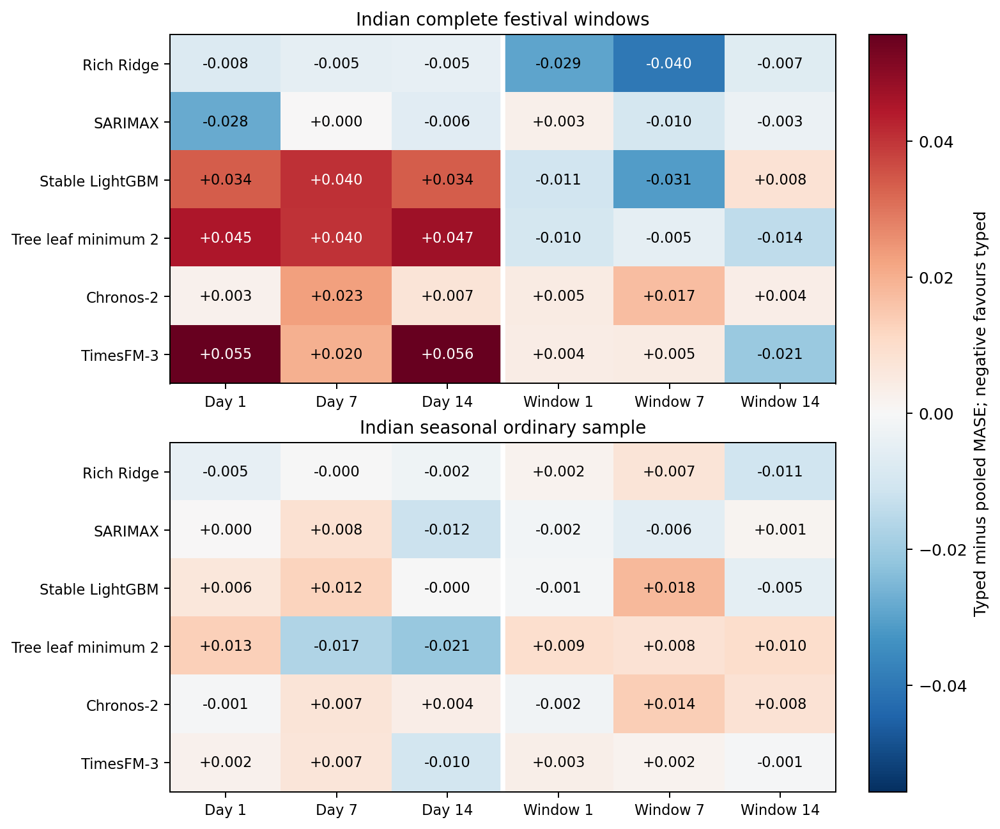
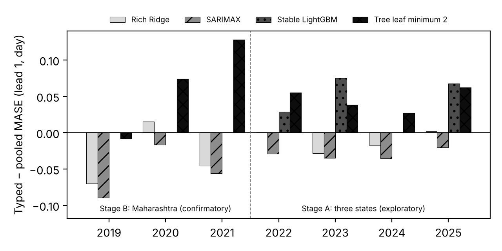

# Online supplement

What replicates when festival indicators are tested on new states? Typed versus pooled indicators in Indian electricity forecasting

## S1. Companion tables

Table S1. 2024–2025 seasonal ordinary sample: lead-1 MASE.

| Model | Calendar | Typed day | Pooled day | Typed window | Pooled window |
| --- | --- | --- | --- | --- | --- |
| Rich Ridge | 0.28458 | 0.27908 | 0.28363 | 0.28887 | 0.28709 |
| SARIMAX | 0.23073 | 0.22949 | 0.22910 | 0.22995 | 0.23155 |
| Stable LightGBM | 0.39366 | 0.39545 | 0.38932 | 0.39507 | 0.39604 |
| Tree leaf minimum 2 | 0.39178 | 0.37852 | 0.36518 | 0.38876 | 0.37951 |
| Chronos-2 | 0.24924 | 0.26482 | 0.26567 | 0.26108 | 0.26287 |
| TimesFM-3 | 0.26547 | 0.26931 | 0.26685 | 0.26196 | 0.25877 |

Table S2. NYC ordinary sample: decision lead 1 (model step 8), MASE.

| Model | Calendar | Typed day | Pooled day | Typed window | Pooled window |
| --- | --- | --- | --- | --- | --- |
| Rich Ridge | 0.93022 | 0.82514 | 0.74570 | 0.82214 | 0.69602 |
| SARIMAX | 0.69848 | 0.57159 | 0.53110 | 0.61851 | 0.54580 |
| Stable LightGBM | 0.83653 | 0.83653 | 0.83653 | 0.83653 | 0.75887 |
| Tree leaf minimum 2 | 0.76625 | 0.75037 | 0.71580 | 0.72767 | 0.71070 |
| Chronos-2 | 0.32126 | 0.35468 | 0.37401 | 0.31593 | 0.40822 |
| TimesFM-3 | 0.36890 | 0.40051 | 0.39322 | 0.33823 | 0.35082 |

Table S3. Fixed response-profile comparators on the original Indian case ledger (separate, unchanged sensitivity).

| Method | Lead 1 | Lead 7 | Lead 14 |
| --- | --- | --- | --- |
| response_none | 1.05617 | 1.05617 | 1.12777 |
| response_partial | 0.99059 | 1.04974 | 1.08356 |
| response_pooled | 1.04499 | 1.06250 | 1.11693 |
| response_typed | 1.02429 | 1.11325 | 1.11001 |

Table S4. 2024–2025 typed-minus-pooled MASE at lead 1 by event year and family. Positive favours pooling. LOFO: leave-one-family-out balanced contrast.

| Model | Rep. | Balanced | 2024 | 2025 | Pooled / typed clusters | LOFO range |
| --- | --- | --- | --- | --- | --- | --- |
| Rich Ridge | day | -0.00776 | -0.01727 | 0.00175 | 3 / 7 | -0.01819 to -0.00060 |
| Rich Ridge | window | -0.02924 | -0.04483 | -0.01365 | 4 / 6 | -0.04266 to -0.01290 |
| SARIMAX | day | -0.02812 | -0.03562 | -0.02063 | 4 / 6 | -0.04526 to -0.00690 |
| SARIMAX | window | 0.00276 | 0.00899 | -0.00347 | 4 / 6 | -0.00285 to 0.00699 |
| Stable LightGBM | day | 0.03374 | 0.00000 | 0.06747 | 4 / 1 | 0.02864 to 0.04316 |
| Stable LightGBM | window | -0.01065 | -0.02319 | 0.00190 | 4 / 6 | -0.01804 to -0.00069 |
| Tree leaf minimum 2 | day | 0.04483 | 0.02723 | 0.06242 | 7 / 3 | 0.03075 to 0.07359 |
| Tree leaf minimum 2 | window | -0.00973 | -0.01785 | -0.00161 | 6 / 4 | -0.01763 to 0.00141 |
| Chronos-2 | day | 0.00257 | -0.00069 | 0.00583 | 8 / 2 | -0.00191 to 0.01638 |
| Chronos-2 | window | 0.00452 | 0.00740 | 0.00163 | 6 / 4 | 0.00082 to 0.00828 |
| TimesFM-3 | day | 0.05546 | 0.06834 | 0.04257 | 9 / 1 | 0.04781 to 0.06439 |
| TimesFM-3 | window | 0.00409 | 0.00895 | -0.00078 | 8 / 2 | 0.00227 to 0.00627 |

Table S5. Day-representation lead-1 Spearman diagnostics of past support and response heterogeneity. n counts family/state/year cells, not independent replications.

| Model | Support rho | Support n | Response rho | Response n |
| --- | --- | --- | --- | --- |
| Rich Ridge | 0.05912 | 24 | 0.15478 | 24 |
| SARIMAX | 0.46684 | 24 | 0.12087 | 24 |
| Stable LightGBM | 0.30970 | 24 | 0.01451 | 24 |
| Tree leaf minimum 2 | 0.37794 | 24 | 0.08000 | 24 |
| Chronos-2 | -0.04204 | 24 | 0.17391 | 24 |
| TimesFM-3 | 0.10992 | 24 | -0.02174 | 24 |

Table S6. Pure daily calendar encodings for the foundation models on 2024–2025 festival windows, lead-1 MASE.

| Encoding | Chronos-2 | TimesFM-3 |
| --- | --- | --- |
| history | 0.54769 | 0.55366 |
| zero1 | 0.55892 | 0.55616 |
| ordinal | 0.51574 | 0.42608 |
| onehot | 0.51171 | 0.43188 |
| cyclic | 0.51636 | 0.45004 |
| te_weekday | 0.56433 | 0.55172 |
| te_sunday | 0.51563 | 0.42528 |
| te_holiday | 0.52400 | 0.39840 |
| te_joint | 0.53781 | 0.44470 |
| te_separate | 0.52832 | 0.41227 |
| calendar | 0.53767 | 0.55148 |

Table S7. Ziel adaptations on NYC event windows: decision lead 1, local-model MASE.

| Model | Calendar | Typed day | Pooled day | hSun | Rph | RpH |
| --- | --- | --- | --- | --- | --- | --- |
| Rich Ridge | 0.99718 | 1.00451 | 1.16887 | 1.09958 | 1.25617 | 1.03266 |
| SARIMAX | 0.99947 | 0.79417 | 1.04067 | 1.31300 | 1.02060 | 0.87342 |
| Stable LightGBM | 0.91940 | 0.91940 | 0.91940 | 0.97497 | 0.94489 | 0.94489 |
| Tree leaf minimum 2 | 0.84819 | 0.84610 | 0.87819 | 0.97599 | 0.86605 | 0.91324 |

Table S8. Lead-1 contrasts for the Ziel adaptations, India (top) and NYC (bottom, modes in place of years). Negative favours the first arm.

| Model | Contrast | Balanced | 2024 | 2025 | LOFO range | Label |
| --- | --- | --- | --- | --- | --- | --- |
| Rich Ridge | hSun − pooled day | 0.00281 | 0.00109 | 0.00454 | -0.01393 to 0.02915 | negligible |
| Rich Ridge | Rph − pooled day | -0.01504 | -0.01297 | -0.01712 | -0.01786 to -0.01059 | consistent |
| Rich Ridge | RpH − typed day | -0.01463 | 0.01235 | -0.04161 | -0.02383 to -0.00173 | unstable |
| Rich Ridge | RpH − Rph | -0.00735 | 0.00804 | -0.02274 | -0.02726 to 0.00756 | unstable |
| SARIMAX | hSun − pooled day | -0.00016 | 0.02551 | -0.02582 | -0.01257 to 0.02889 | negligible |
| SARIMAX | Rph − pooled day | -0.01905 | 0.01441 | -0.05252 | -0.02450 to -0.00273 | unstable |
| SARIMAX | RpH − typed day | -0.01041 | 0.02030 | -0.04112 | -0.02160 to 0.00749 | unstable |
| SARIMAX | RpH − Rph | -0.01948 | -0.02973 | -0.00922 | -0.03008 to 0.00193 | unstable |
| Stable LightGBM | hSun − pooled day | -0.06832 | -0.09185 | -0.04480 | -0.07478 to -0.05970 | consistent |
| Stable LightGBM | Rph − pooled day | -0.01775 | -0.00914 | -0.02637 | -0.02282 to -0.00821 | consistent |
| Stable LightGBM | RpH − typed day | -0.02858 | -0.00914 | -0.04803 | -0.03655 to -0.01424 | consistent |
| Stable LightGBM | RpH − Rph | 0.02290 | 0.00000 | 0.04581 | 0.01638 to 0.03713 | unstable |
| Tree leaf minimum 2 | hSun − pooled day | -0.00574 | 0.01585 | -0.02733 | -0.02179 to 0.00874 | unstable |
| Tree leaf minimum 2 | Rph − pooled day | -0.00940 | 0.01465 | -0.03345 | -0.01458 to -0.00420 | unstable |
| Tree leaf minimum 2 | RpH − typed day | -0.02837 | -0.00887 | -0.04787 | -0.03504 to -0.02112 | consistent |
| Tree leaf minimum 2 | RpH − Rph | 0.02586 | 0.00372 | 0.04800 | 0.00871 to 0.05995 | consistent |

| Model | Contrast | Balanced | Bus | Subway | LOFO range | Label |
| --- | --- | --- | --- | --- | --- | --- |
| Rich Ridge | hSun − pooled day | -0.06929 | -0.16887 | 0.03029 | -0.10211 to -0.03647 | unstable |
| Rich Ridge | Rph − pooled day | 0.08730 | 0.06703 | 0.10757 | 0.06802 to 0.10658 | consistent |
| Rich Ridge | RpH − typed day | 0.02816 | -0.04323 | 0.09955 | 0.01199 to 0.04432 | unstable |
| Rich Ridge | RpH − Rph | -0.22351 | -0.25205 | -0.19496 | -0.32138 to -0.12563 | consistent |
| SARIMAX | hSun − pooled day | 0.27233 | 0.29639 | 0.24827 | 0.26394 to 0.28072 | consistent |
| SARIMAX | Rph − pooled day | -0.02007 | 0.00345 | -0.04358 | -0.02622 to -0.01391 | unstable |
| SARIMAX | RpH − typed day | 0.07925 | 0.08910 | 0.06940 | 0.00484 to 0.15365 | consistent |
| SARIMAX | RpH − Rph | -0.14719 | -0.14985 | -0.14452 | -0.21144 to -0.08293 | consistent |
| Stable LightGBM | hSun − pooled day | 0.05557 | 0.05085 | 0.06030 | -0.18779 to 0.29894 | unstable |
| Stable LightGBM | Rph − pooled day | 0.02549 | 0.06735 | -0.01636 | -0.03794 to 0.08893 | unstable |
| Stable LightGBM | RpH − typed day | 0.02549 | 0.06735 | -0.01636 | -0.03794 to 0.08893 | unstable |
| Stable LightGBM | RpH − Rph | 0.00000 | 0.00000 | 0.00000 | 0.00000 to 0.00000 | negligible |
| Tree leaf minimum 2 | hSun − pooled day | 0.09779 | 0.03509 | 0.16049 | -0.03651 to 0.23210 | unstable |
| Tree leaf minimum 2 | Rph − pooled day | -0.01214 | -0.01049 | -0.01380 | -0.01631 to -0.00797 | consistent |
| Tree leaf minimum 2 | RpH − typed day | 0.06714 | 0.09603 | 0.03825 | 0.05458 to 0.07970 | consistent |
| Tree leaf minimum 2 | RpH − Rph | 0.04719 | 0.03239 | 0.06198 | -0.08911 to 0.18349 | unstable |

Table S9. Native 2024–2025 festival-window 80% intervals at lead 1.

| Model | Arm | Coverage 80% | Scaled width | Scaled WIS80 |
| --- | --- | --- | --- | --- |
| Chronos-2 | Calendar | 0.70714 | 1.44736 | 0.36718 |
| Chronos-2 | Typed day | 0.73466 | 1.44335 | 0.35160 |
| Chronos-2 | Pooled day | 0.72619 | 1.45710 | 0.34982 |
| Chronos-2 | Pooled window | 0.73228 | 1.48578 | 0.36511 |
| Chronos-2 | Typed window | 0.72381 | 1.45537 | 0.36526 |
| TimesFM-3 | Calendar | 0.65926 | 1.21333 | 0.38483 |
| TimesFM-3 | Typed day | 0.70238 | 1.23353 | 0.32158 |
| TimesFM-3 | Pooled day | 0.70741 | 1.16836 | 0.27890 |
| TimesFM-3 | Pooled window | 0.63651 | 1.19181 | 0.38615 |
| TimesFM-3 | Typed window | 0.64735 | 1.21759 | 0.38944 |

Table S10. Native 80% coverage across the ten 2024–2025 family/year clusters at lead 1.

| Model | Arm | Minimum | Maximum | Clusters below 0.80 |
| --- | --- | --- | --- | --- |
| Chronos-2 | Calendar | 0.429 | 0.857 | 8 of 10 |
| Chronos-2 | Typed day | 0.500 | 0.857 | 8 of 10 |
| Chronos-2 | Pooled day | 0.357 | 0.929 | 7 of 10 |
| Chronos-2 | Typed window | 0.500 | 0.929 | 8 of 10 |
| Chronos-2 | Pooled window | 0.429 | 0.929 | 8 of 10 |
| TimesFM-3 | Calendar | 0.357 | 0.786 | 10 of 10 |
| TimesFM-3 | Typed day | 0.500 | 0.841 | 9 of 10 |
| TimesFM-3 | Pooled day | 0.500 | 0.926 | 7 of 10 |
| TimesFM-3 | Typed window | 0.357 | 0.786 | 10 of 10 |
| TimesFM-3 | Pooled window | 0.357 | 0.786 | 10 of 10 |

Table S11. 2024–2025, lead 1: balanced MASE over both years for typed, pooled and their average, and 2025 regret of the follow-2024 rule and of the average.

| Model | Rep. | Typed | Pooled | Average | 2025: follow-2024 regret | 2025: average regret |
| --- | --- | --- | --- | --- | --- | --- |
| Rich Ridge | day | 0.45317 | 0.46093 | 0.44120 | 0.00175 | -0.00851 |
| Rich Ridge | window | 0.57914 | 0.60838 | 0.59121 | 0.00000 | 0.00556 |
| SARIMAX | day | 0.42533 | 0.45345 | 0.42381 | 0.00000 | -0.00755 |
| SARIMAX | window | 0.57787 | 0.57511 | 0.57600 | 0.00347 | 0.00146 |
| Stable LightGBM | day | 0.69483 | 0.66110 | 0.67386 | 0.00000 | 0.02554 |
| Stable LightGBM | window | 0.70168 | 0.71233 | 0.70648 | 0.00190 | -0.00011 |
| Tree leaf minimum 2 | day | 0.64952 | 0.60469 | 0.61833 | 0.00000 | 0.02907 |
| Tree leaf minimum 2 | window | 0.69028 | 0.70001 | 0.69454 | 0.00000 | -0.00025 |
| Chronos-2 | day | 0.52009 | 0.51752 | 0.51755 | 0.00583 | 0.00258 |
| Chronos-2 | window | 0.53720 | 0.53268 | 0.53414 | 0.00000 | 0.00016 |
| TimesFM-3 | day | 0.48005 | 0.42459 | 0.43142 | 0.00000 | 0.00747 |
| TimesFM-3 | window | 0.55540 | 0.55131 | 0.55269 | 0.00078 | -0.00042 |

Table S12. NYC, decision lead 1: balanced MASE for typed, pooled and their equal-weight average.

| Model | Rep. | Typed | Pooled | Average |
| --- | --- | --- | --- | --- |
| Rich Ridge | day | 1.00451 | 1.16887 | 1.02581 |
| Rich Ridge | window | 1.19074 | 1.31328 | 1.23075 |
| SARIMAX | day | 0.79417 | 1.04067 | 0.90579 |
| SARIMAX | window | 1.15250 | 1.40939 | 1.24590 |
| Stable LightGBM | day | 0.91940 | 0.91940 | 0.91940 |
| Stable LightGBM | window | 0.91940 | 1.08484 | 0.98199 |
| Tree leaf minimum 2 | day | 0.84610 | 0.87819 | 0.79478 |
| Tree leaf minimum 2 | window | 0.88083 | 1.02851 | 0.94701 |
| Chronos-2 | day | 0.86384 | 0.76003 | 0.81194 |
| Chronos-2 | window | 0.93928 | 0.92961 | 0.93444 |
| TimesFM-3 | day | 0.75636 | 0.79143 | 0.59071 |
| TimesFM-3 | window | 0.86121 | 0.91833 | 0.88977 |

Table S13. 2024–2025 typed-minus-pooled MASE at lead 1 with family-year clusters as units. The t interval is descriptive and unadjusted (df 9). Sign-flip p: exact two-sided test over 1,024 sign assignments; Holm across all 36 cells (smallest attainable 0.070); year-change p: sign-flip over 5 family-level (2025 minus 2024) differences.

| Model | Rep. | Mean (10 clusters) | 95% t interval | Sign-flip p | Holm p | Year-change p |
| --- | --- | --- | --- | --- | --- | --- |
| Rich Ridge | day | -0.00776 | -0.03177 to 0.01625 | 0.4688 | 1.0000 | 0.3125 |
| Rich Ridge | window | -0.02924 | -0.07169 to 0.01321 | 0.1367 | 1.0000 | 0.5000 |
| SARIMAX | day | -0.02812 | -0.07205 to 0.01581 | 0.1855 | 1.0000 | 0.6250 |
| SARIMAX | window | 0.00276 | -0.01040 to 0.01592 | 0.6406 | 1.0000 | 0.0625 |
| Stable LightGBM | day | 0.03374 | 0.00070 to 0.06678 | 0.1250 | 1.0000 | 0.1250 |
| Stable LightGBM | window | -0.01065 | -0.03528 to 0.01398 | 0.4082 | 1.0000 | 0.2500 |
| Tree leaf minimum 2 | day | 0.04483 | -0.00982 to 0.09948 | 0.0996 | 1.0000 | 0.4375 |
| Tree leaf minimum 2 | window | -0.00973 | -0.04074 to 0.02128 | 0.4941 | 1.0000 | 0.6250 |
| Chronos-2 | day | 0.00257 | -0.02146 to 0.02660 | 0.8438 | 1.0000 | 0.6875 |
| Chronos-2 | window | 0.00452 | -0.00516 to 0.01420 | 0.3633 | 1.0000 | 0.5625 |
| TimesFM-3 | day | 0.05546 | 0.02497 to 0.08595 | 0.0059 | 0.2109 | 0.3750 |
| TimesFM-3 | window | 0.00409 | -0.00355 to 0.01173 | 0.2500 | 1.0000 | 0.1875 |

Table S14. Controls at lead 1, 2024–2025 (India) and decision lead 1 (NYC), MASE. A dash marks an arm that was not run for that model.

| Source | Model | History | Cal. | + zeros | Placebo | Typed | Pooled |
| ------- | --------------- | -------- | -------- | -------- | -------- | -------- | -------- |
| India | Rich Ridge | – | 0.57699 | 0.57699 | 0.57810 | 0.45317 | 0.46093 |
| India | SARIMAX | – | 0.57301 | 0.57306 | 0.57315 | 0.42533 | 0.45345 |
| India | Stable LightGBM | – | 0.69865 | 0.69865 | 0.69865 | 0.69483 | 0.66110 |
| India | Tree leaf minimum 2 | – | 0.68582 | 0.68582 | 0.68674 | 0.64952 | 0.60469 |
| India | Chronos-2 | – | 0.53767 | 0.53323 | 0.53663 | 0.52009 | 0.51752 |
| India | TimesFM-3 | – | 0.55148 | 0.54888 | 0.55219 | 0.48005 | 0.42459 |
| NYC | Rich Ridge | – | 0.99718 | 0.99718 | 0.99530 | 1.00451 | 1.16887 |
| NYC | SARIMAX | – | 0.99947 | 0.99947 | 1.00081 | 0.79417 | 1.04067 |
| NYC | Stable LightGBM | – | 0.91940 | 0.91940 | 0.91940 | 0.91940 | 0.91940 |
| NYC | Tree leaf minimum 2 | – | 0.84819 | 0.84819 | 0.84819 | 0.84610 | 0.87819 |
| NYC | Chronos-2 | 0.78758 | 0.93276 | 0.90651 | 0.89233 | 0.86384 | 0.76003 |
| NYC | TimesFM-3 | 0.78966 | 0.88394 | 0.87408 | 0.87275 | 0.75636 | 0.79143 |
| NYC | Last value | 2.31585 | – | – | – | – | – |
| NYC | Seasonal naive | 1.49642 | – | – | – | – | – |

Table S15. NESO calendar models at decision lead 1: ideal (model step 1) versus 21-day delay (model step 22), MASE.

| Model | Ideal | Lag 21 |
| --- | --- | --- |
| Rich Ridge | 0.48703 | 0.50152 |
| SARIMAX | 0.48080 | 0.46981 |
| Stable LightGBM | 0.53385 | 0.46448 |
| Tree leaf minimum 2 | 0.55685 | 0.47201 |
| Chronos-2 | 0.53605 | 0.59170 |
| TimesFM-3 | 0.45629 | 0.38886 |

All leads, cohorts and registered contrasts are in the supplement CSV files.

## S2. Reproduction map

Rows refer to the previous draft (v12) numbering, mapped as follows: v12 Tables 2–7 are Tables S16–S21; 8, 8c are Table 3 of the main paper; 8b and 9 are Tables S28–S29; 10–12 are S22–S24; 13 is replaced by Table 6 of the main paper; 14 is S25; B1 and C1 are S26 and S27; v12 Figures 1–4 are Figures S1–S4; v12 Sections 5, 7, 8 and 10 are Supplementary Sections S3, S4, S5 and S6, and v12 Section 6 is Section 5 of the main paper. New in v13: Table 2 (results/longer_panel_stage_a_v1, longer_panel_foundation_v1); Table 3 and Figures 1–2 (src/scorecard_v1.py, figures_v13.py; results/scorecard_v1); Table 4 (src/leaf_size_experiment_v1.py, leaf_size_analysis_v1.py); Table 5, Figure 3 and Section S10 (src/robustness_experiments_v1.py, robustness_analysis_v1.py); Table 6 (src/decision_rules_14_v1.py); manuscript built by src/build_journal_v13.py.

Each row names the result folder and the script that wrote it; foundation-model runs were made in a hosted notebook following docs/reproduction/.

| Paper item | Result files | How to reproduce |
| --- | --- | --- |
| Table 1 | results/longer_panel_stage_a_v1, longer_panel_stage_b_v1, new_states_v1/design_summary.json | src/longer_panel_stage_a_v1.py, longer_panel_stage_b_v1.py, new_states_v1.py |
| Table 2 | results/calendar_recenter_recovery_v1/analysis/breadth | src/continue_pipeline_recovery_v2.py |
| Figure 1 | results/calendar_recenter_recovery_v1/analysis/breadth | src/build_integrated_review.py |
| Table 3 | results/longer_panel_stage_a_v1/analysis | src/longer_panel_stage_a_v1.py (forecasts), longer_panel_analysis_stage_a_v1.py (tests) |
| Table 4 | results/longer_panel_stage_a_v1/analysis | src/longer_panel_stage_a_v1.py (forecasts), longer_panel_analysis_stage_a_v1.py (tests) |
| Table 5 | results/longer_panel_foundation_v1/analysis | src/longer_panel_foundation_v1.py (hosted notebook), longer_panel_foundation_analysis_v1.py |
| Table 6 | results/longer_panel_stage_b_v1/analysis | src/longer_panel_stage_b_v1.py (forecasts), longer_panel_analysis_stage_b_v1.py (tests) |
| Table 7 | results/longer_panel_stage_b_v1/analysis | src/longer_panel_stage_b_v1.py (forecasts), longer_panel_analysis_stage_b_v1.py (tests) |
| Figure 2 | results/longer_panel_stage_a_v1, longer_panel_stage_b_v1 | drawn by src/build_journal_v9.py |
| Table 8 | results/new_states_v1/analysis | src/new_states_v1.py (forecasts); src/new_states_analysis_v1.py (registered tests) |
| Table 8b | results/new_states_v1/analysis | src/new_states_analysis_v1.py (registered) |
| Table 9 | results/new_states_v1/analysis/balanced.csv | src/new_states_analysis_v1.py (registered) |
| Figure 3 | results/simulation_typed_pooled_v3, window_profile_v1, longer_panel_stage_a_v1 | src/simulation_typed_pooled_v3.py, window_profile_v1.py; drawn by src/build_journal_v10.py |
| Table 10 | results/new_states_v1_diagnostics | src/new_states_diagnostics_v1.py |
| Table 11 | results/simulation_states_v3_seedcheck | src/simulation_states_v3.py --stable-seed |
| Table 12 | results/new_states_v1_official_plus_confirmed | src/new_states_official_plus_confirmed_v1.py (rerun reproduces it exactly) |
| Figure 4 | results/simulation_states_v3_seedcheck | src/simulation_states_v3.py --stable-seed; drawn by src/build_journal_v10.py |
| Table 13 | results/longer_panel_stage_a_v1/analysis/decision_rules.csv | src/longer_panel_analysis_stage_a_v1.py |
| Table 14 | results/prospective_20261030_scoring_v1, prospective_chronos_20261031_scoring_v1, prospective_interval_20261030_scoring_v1 | src/collect_prospective_actuals.py, score_chronos_competitor.py, score_interval_annex.py |
| Table C1 | results/ziel_replacing_v2 | src/ziel_replacing_v2.py, ziel_replacing_analysis_v2.py |
| Table B1 | results/mta_holiday_recovery_v1/analysis | src/continue_pipeline_recovery_v2.py |
| Section 7 SARIMAX simulation | results/simulation_sarimax_v3 | src/simulation_sarimax_v3.py |
| Section 7 window profile (−9.9%) | results/window_profile_v1 | src/window_profile_v1.py |
| Section 8 festival-level analysis | results/new_states_v1_family_mechanism | src/new_states_family_mechanism_v1.py |
| Section 6 TimesFM-3 encoding control | results/new_states_v1_fm_control/analysis | src/new_states_fm_control_v1.py analyse; src/new_states_fm_control_loso_v1.py |
| Independent recomputation | results/new_states_v1_independent_check | indep.py in that folder |
| This manuscript | manuscript/journal_v13 | src/build_journal_v13.py (from journal_v12) |

## S3. Exploratory stages in detail

This section summarises the exploratory work on the three original states and the registered follow-up on further Maharashtra years. It is the basis of the hypotheses tested in Section 5 of the main paper, not the main evidence.

### S3.1 Two event years with all six models

Table S16 gives the next-day comparison on the 528 festival-window cases of 2024–2025, and Figure S1 all leads. Festival information helps the local models: typed and pooled day flags lower Rich Ridge event MASE from 0.57699 to 0.45317 and 0.46093, and SARIMAX from 0.57301 to 0.42533 and 0.45345. Chronos-2 gains little; TimesFM-3 gains with both day flags (typed 0.48005, pooled 0.42459, against 0.55148 for calendar). Window indicators help little. The typed-minus-pooled contrast ranges from -0.03971 to 0.05564 across the 36 model/representation/lead cells and its sign is opposite between 2024 and 2025 in 19 cells (supplement; lead 1 by family in Supplementary Table S4). Across the 36 cells, 3 reach a raw sign-flip p below 0.05, against 1.8 expected if every null were true; the smallest raw p is 0.0059 (TimesFM-3 day flags). With 10 clusters no ordering can be confirmed (Supplementary Table S13). On ordinary days (Supplementary Table S1) the arms differ less, but for both foundation models the day arms slightly raise ordinary-day MASE. Zero-channel and placebo controls for this cohort are in Supplementary Table S14; pure daily calendar encodings for the foundation models, fixed response-profile comparators and support/heterogeneity diagnostics are in Supplementary Tables S6, S3 and S5.

Table S16. 2024–2025 festival windows (document-aligned, recentered): lead-1 MASE.

| Model | Calendar | Typed day | Pooled day | Typed window | Pooled window |
| --- | --- | --- | --- | --- | --- |
| Rich Ridge | 0.57699 | 0.45317 | 0.46093 | 0.57914 | 0.60838 |
| SARIMAX | 0.57301 | 0.42533 | 0.45345 | 0.57787 | 0.57511 |
| Stable LightGBM | 0.69865 | 0.69483 | 0.66110 | 0.70168 | 0.71233 |
| Tree leaf minimum 2 | 0.68582 | 0.64952 | 0.60469 | 0.69028 | 0.70001 |
| Chronos-2 | 0.53767 | 0.52009 | 0.51752 | 0.53720 | 0.53268 |
| TimesFM-3 | 0.55148 | 0.48005 | 0.42459 | 0.55540 | 0.55131 |

### S3.2 Stage A: four event years

Two earlier event years (2022–2023) were added after the 2020–2021 calendars needed as their training history had been checked; this doubles the event cases to 1,056 and the clusters to 20. Parameters for the new years were selected by the unchanged pre-year procedure, and re-running the 2024–2025 subset reproduced the stored local forecasts (maximum difference 1.4 × 10^-13). Table S17 gives the lead-1 contrasts.

One cell passes the pre-set rule (Holm p below 0.05 and the same sign in at least three of four years): Stable LightGBM is better with the pooled day flag (+0.0429, Holm p 0.029; 2024 is an exact tie). The leaf-2 LightGBM points the same way in all four years (+0.0458, Holm p 0.063), and SARIMAX points the other way in all four years (−0.0300, raw p 0.0266, Holm p 0.160). Rich Ridge shows no ordering. Leaving out any one festival family does not change the sign of these three day contrasts. The window representations show no clear ordering. The LightGBM result needs care: a typed flag has at most four flagged days in a 730-day training window, fewer than the minimum of five or 20 samples per leaf that the stable LightGBM may select, so its trees cannot split on typed flags at all, whereas the pooled flag can have more than ten flagged days. Its pooling advantage may therefore reflect the number of flagged days rather than a preference for pooled information; the leaf-2 LightGBM, which can split on typed flags, still favours pooling in all four years. Over all 24 model/representation/lead cells, 6 have a raw p below 0.05 and none survives Holm over 24.

The controls behave as intended (Table S18): at lead 1 the zero-channel and placebo-day arms stay within 0.0013 of the calendar arm for every local model (0.0028 including the window placebos), whereas typed and pooled day flags lower Rich Ridge and SARIMAX MASE by more than 0.1. The gains therefore come from the festival dates, not from extra channels.

Table S17. Stage A (2022–2025, 20 clusters): lead-1 typed minus pooled MASE, balanced over all years and by year. Positive favours pooling. LGBM: Stable LightGBM; LGBM-2: tree leaf minimum 2. Same sign: years agreeing with the all-years sign. p: exact two-sided sign-flip; Holm over the eight lead-1 cells. Typed and pooled MASE are in Table S18.

| Model | Rep. | All years | 2022 | 2023 | 2024 | 2025 | Same sign | p | Holm p |
| --- | --- | --- | --- | --- | --- | --- | --- | --- | --- |
| Ridge | day | −0.0109 | +0.0001 | −0.0283 | −0.0173 | +0.0018 | 2/4 | 0.1959 | 0.588 |
| Ridge | window | −0.0084 | +0.0153 | +0.0096 | −0.0448 | −0.0137 | 2/4 | 0.5662 | 0.677 |
| SARIMAX | day | −0.0300 | −0.0287 | −0.0351 | −0.0356 | −0.0206 | 4/4 | 0.0266 | 0.160 |
| SARIMAX | window | +0.0052 | +0.0098 | +0.0054 | +0.0090 | −0.0035 | 3/4 | 0.3386 | 0.677 |
| LGBM | day | +0.0429 | +0.0288 | +0.0751 | 0.0000 | +0.0675 | 3/4 | 0.0036 | 0.029 |
| LGBM | window | −0.0150 | −0.0156 | −0.0232 | −0.0232 | +0.0019 | 3/4 | 0.0934 | 0.467 |
| LGBM-2 | day | +0.0458 | +0.0551 | +0.0385 | +0.0272 | +0.0624 | 4/4 | 0.0090 | 0.063 |
| LGBM-2 | window | −0.0143 | −0.0052 | −0.0326 | −0.0178 | −0.0016 | 4/4 | 0.1284 | 0.513 |

Table S18. Stage A controls: lead-1 event MASE.

| Model | Calendar | + zeros | Placebo | Typed day | Pooled day | Typed window | Pooled window |
| --- | --- | --- | --- | --- | --- | --- | --- |
| Rich Ridge | 0.60902 | 0.60902 | 0.60979 | 0.49107 | 0.50200 | 0.61942 | 0.62783 |
| SARIMAX | 0.62374 | 0.62374 | 0.62393 | 0.48087 | 0.51090 | 0.63438 | 0.62920 |
| Stable LightGBM | 0.73719 | 0.73719 | 0.73719 | 0.73528 | 0.69242 | 0.73110 | 0.74611 |
| Tree leaf minimum 2 | 0.73341 | 0.73341 | 0.73473 | 0.71033 | 0.66452 | 0.72915 | 0.74346 |

### S3.3 Foundation models over four years

The foundation models were extended to the Stage A years by a separately registered run (results/longer_panel_foundation_v1; protocol committed before any of its forecasts, run on a hosted CPU notebook). It first re-forecast the 2024 event cases for three reference arms: all 1,584 forecasts matched the stored ones within the registered tolerance (largest difference 0.00018 GWh), so the new 2022–2023 forecasts were combined with the stored 2024–2025 ones. This analysis is exploratory: the registered model-class hypothesis concerns the local models only.

Table S19 gives the lead-1 contrasts. TimesFM-3 is better with the pooled day flag (+0.0506, Holm p 0.017, all four years), which passes the Stage A rule. The two new years agree with the 2024–2025 pattern noted in the earlier version as an expectation for future confirmation (+0.0529 in 2022 and +0.0387 in 2023), although that expectation was not registered as a hypothesis; registered later as H2, it did not replicate in seven further states (Section 5 of the main paper). The pooled day flag lowers TimesFM-3 MASE from 0.57904 (calendar) to 0.46855, while the typed flags give 0.51918. Chronos-2 shows no ordering (+0.0038, raw p 0.5343) and gains little from either flag. The zero-channel and placebo arms stay within 0.0063 of calendar for both models. Unlike the stable LightGBM, TimesFM-3 receives the flags as input channels and can in principle use typed flags, so its preference for pooling is not explained by a minimum leaf size.

Table S19. Foundation models over Stage A (2022–2025, 20 clusters): lead-1 MASE and typed minus pooled contrast. Positive favours pooling. Holm over the four lead-1 cells. 2022–2023 forecasts from the registered extension; 2024–2025 from the stored runs.

| Model | Rep. | Typed | Pooled | All years | 2022 | 2023 | 2024 | 2025 | Same sign | p | Holm p |
| --- | --- | --- | --- | --- | --- | --- | --- | --- | --- | --- | --- |
| Chronos-2 | day | 0.56285 | 0.55900 | +0.0038 | +0.0074 | +0.0028 | −0.0007 | +0.0058 | 3/4 | 0.5343 | 1.000 |
| Chronos-2 | window | 0.58190 | 0.57561 | +0.0063 | +0.0119 | +0.0042 | +0.0074 | +0.0016 | 4/4 | 0.0541 | 0.162 |
| TimesFM-3 | day | 0.51918 | 0.46855 | +0.0506 | +0.0529 | +0.0387 | +0.0683 | +0.0426 | 4/4 | 0.0042 | 0.017 |
| TimesFM-3 | window | 0.57935 | 0.57890 | +0.0004 | −0.0027 | −0.0037 | +0.0090 | −0.0008 | 1/4 | 0.8914 | 1.000 |

The TimesFM-3 preference for pooling did not replicate in the registered test on seven further states (Section 5 of the main paper).

### S3.4 Stage B: registered test on further years

Because the model-class pattern was found in the Stage A data, it was stated as a hypothesis before any new test data were used: H1, Stable LightGBM favours the pooled day flag; H2, SARIMAX favours typed day flags; H1b (secondary), the same as H1 for the leaf-2 LightGBM; H3, Ridge, reported only. The test data are Maharashtra event years 2019–2021, which had not been evaluated as targets by any model or arm; their 2020–2021 values were, however, training history for the 2022–2023 Stage A models, and Maharashtra is one of the Stage A states. Calendars for 2017–2021 were checked by hand (327 cases, 15 clusters, no missing labels). The decision rule was fixed in advance: one-sided exact sign-flip p over 15 clusters, Holm across H1 and H2, and the sign must hold in at least two of three years; the COVID year 2020 is removed as a pre-declared sensitivity.

Table S20 gives the result. H2 is confirmed (−0.0539, one-sided p 0.0154, Holm p 0.0307, all three years) and still holds without 2020 (−0.0726, Holm p 0.0137). H1 is exactly zero, which makes the test uninformative rather than evidence against H1: for lead 1 the pre-year selection chose a minimum of 20 samples per leaf in all three years, while the pooled flag is set on at most 13 and a typed flag on at most four of the 730 training days, so no tree splits on any festival column and every arm gives the same forecast (balanced MASE 0.98138 for all five arms, Table S21). The same mechanism explains the exact tie in Stage A's 2024. It could have been anticipated from that tie but was not written into the registration, so the registered decision stands. The leaf-2 LightGBM, whose trees can use the flags, favours pooling (+0.0648, unadjusted one-sided p 0.0197, two of three years; 2019 has the opposite sign); the registration fixed a decision rule only for H1 and H2, so this secondary result is descriptive, and it does not hold without 2020 (+0.0600, p 0.0889). Rich Ridge favours typed flags in Maharashtra (−0.0335), unlike Stage A. Figure S2 shows the yearly contrasts across both stages.

Table S20. Stage B (Maharashtra 2019–2021, 15 clusters): registered hypothesis tests at lead 1 (day flags), typed minus pooled MASE. H1 and H1b expect a positive value (pooling better), H2 a negative one. H1b is secondary and not Holm-adjusted. Decision rule: Holm p below 0.05 and the expected sign in at least two of three years.

| Hyp. | Model | All years | 2019 | 2020 | 2021 | One-sided p | Holm p | Decision | Without 2020 |
| --- | --- | --- | --- | --- | --- | --- | --- | --- | --- |
| H1 | LGBM | 0.0000 | 0.0000 | 0.0000 | 0.0000 | 1.0000 | 1.0000 | not confirmed | not confirmed |
| H2 | SARIMAX | −0.0539 | −0.0893 | −0.0166 | −0.0558 | 0.0154 | 0.0307 | confirmed | confirmed |
| H1b | LGBM-2 | +0.0648 | −0.0082 | +0.0743 | +0.1282 | 0.0197 | – | meets rule, unadjusted | does not meet rule |

Table S21. Stage B controls: lead-1 event MASE (Maharashtra 2019–2021).

| Model | Calendar | + zeros | Placebo | Typed day | Pooled day |
| --- | --- | --- | --- | --- | --- |
| Rich Ridge | 0.72425 | 0.72425 | 0.72361 | 0.55409 | 0.58762 |
| SARIMAX | 0.73161 | 0.73161 | 0.73105 | 0.53395 | 0.58787 |
| Stable LightGBM | 0.98138 | 0.98138 | 0.98138 | 0.98138 | 0.98138 |
| Tree leaf minimum 2 | 0.98711 | 0.98711 | 0.98690 | 0.98199 | 0.91722 |

## S4. Simulations of the typed-pooled trade-off

Tree models need a minimum number of training rows on each side of a split; because each tree model is fitted to one state, a row is a day. A typed flag is set on one training day per year, so a tree with minimum leaf size L cannot split on it until there are L training years, while the pooled flag is set about five times as often. In the empirical models the trees are trained on a 730-day window, in which a typed flag is set on at most about four days; Stable LightGBM's selected minimum leaf sizes (5 or 20 in the new states, 20 in Stage B) are never reached, which is why its typed arm equals its calendar arm in Stage B, in Table S29 and in the second test (Section 5 of the main paper), while the pooled flag, set on up to about a dozen days, can be used.

A synthetic study illustrates this and the trade-off for a linear model. It covers Ridge and LightGBM, and in its first version also the two foundation models; it does not cover SARIMAX. Daily series with weekly and annual cycles and autoregressive noise carry five festival families whose effects are μ(1 + h·z), where z takes five fixed values with mean 0 and standard deviation 1 and h measures how much the families differ, plus occurrence noise; it is calibrated to the three original states (festival-day effect −9.6%; −9.9% in a regression that also models the neighbouring days, whose relative profile the generator uses; h 0.46 with a 90% year-bootstrap band 0.30–0.69). A first version, committed before the new-states analysis, used one-day effects, trained on all earlier years and scored the festival day only; it reproduced the directions but gave effects about ten times the observed ones (0.16 MASE for Ridge at the calibrated h). After that analysis, and after this mismatch had been seen, a second version was built to match the forecasting pipeline in three respects only: each festival's effect is spread over its window with the profile measured on the three original states (the day after a festival keeps about two thirds of the festival-day effect), models are refitted monthly on the previous 730 days, and every day of the ±3-day window is scored. At the calibrated h it gives −0.0133 for Ridge, against −0.0109 observed in Stage A; exactly zero in every replication for a LightGBM with minimum leaf size 20, as for Stable LightGBM's typed arm; +0.0837 with leaf size 5, which at Stage A's lead-1 mix of selected leaf sizes (5 in 7 of 12 fits, otherwise 20) implies about +0.0488 against +0.0429 observed; and +0.0306 with leaf size 2, against +0.0458 in Stage A (Figure S3). These comparisons are in-sample, because the calibration, the window profile and Stage A use the same three states. Applied unchanged to the seven further states, the three-state parameters overstate the tree effects there by a factor of about 2.6 to 4.5; the per-state, out-of-time check in Section S5 uses each state's own earlier parameters instead. In this version Ridge typed flags start to win between h = 0.25 and h = 0.46. The first version was also run for Chronos-2 and TimesFM-3 at lead 1 (pooled flag without padding): both do better with a pooled flag when festival effects are alike (h = 0: +0.0860 and +0.2693), slightly better with it at the calibrated h (+0.0674 and +0.0618), and much better with typed flags when effects differ strongly (h = 2: −0.3578 and −1.1918). Only these directions are informative, because that version overstates sizes; they are consistent with the Stage A pooling preference of TimesFM-3 and with a null average over the further states, which mix low-heterogeneity states with Gujarat and Tamil Nadu.

SARIMAX, the model of the confirmed H1, was added to the pipeline-matched simulation afterwards, with the registered specification (one fit per year on the previous 730 days, a first-order autoregression with a weekly seasonal term, parameters then held fixed). At the three-state calibration it does better with a pooled flag when festival effects are alike (+0.0129 at h = 0, +0.0062 at h = 0.25) and with typed flags from the calibrated heterogeneity upwards (−0.0082 at h = 0.46, −0.0701 at h = 1, −0.1975 at h = 2), the direction of H1 at the measured heterogeneity. In the second registered test, SARIMAX showed no typed advantage (Section 5 of the main paper). Its per-state predictions are weaker than for Ridge and the trees: with each further state's 2015–2020 parameters it predicts an average of −0.0069 against −0.0164 observed for 2021–2025, with a state-level correlation of 0.49 (Spearman 0.57, not significant), and the observed SARIMAX favours typed flags in Rajasthan and Madhya Pradesh where the simulation predicts a pooled advantage. The simulated gain at the calibrated h is also about 3.6 times smaller than the observed Stage A value (−0.0300), and Tamil Nadu is over-predicted (−0.0915 against −0.0218 observed). With seven states this is supporting evidence, not a test: the simulation accounts for the direction of H1 at the calibrated heterogeneity but not for its size or its distribution across states.

![Figure S3. Pipeline-matched simulation calibrated to the three original states (exploratory; designed after the registered analysis). Left: Ridge typed minus pooled MASE against festival-effect heterogeneity h (shaded: calibrated 90% band; cross: observed Stage A value). Right: LightGBM at the calibrated h for minimum leaf sizes 2, 5 and 20 (bars), the implied value for Stable LightGBM at Stage A's lead-1 mix of leaf sizes (circle), and observed Stage A values (crosses). Positive values favour pooling.](figures/figure3_simulation.png)

## S5. Exploratory follow-ups to the first registered test

The analyses in this section were written after the first registered test and are not confirmatory.

**Robustness and power.** Leaving out one state or one year at a time (unadjusted one-sided p), H1 keeps its sign in 16 of 16 cases (p below 0.05 in 15) and H3 in 16 of 16 (14). Both depend most on Gujarat: without it, H1 shrinks from −0.0097 to −0.0029 and H3 from +0.0068 to +0.0011, and all 44 Gujarat calendar rows come from secondary sources. H2 has no consistent sign (8 of 16). With 45 clusters, the minimum effect detectable with 80% power is about 0.011 MASE for H1, larger than the observed 0.0097.

**Regions.** Table S24 splits the seven states into two groups, a split chosen after seeing the results and applied with all calendar rows. In Uttar Pradesh, Rajasthan, Madhya Pradesh and Gujarat, typed flags help SARIMAX (−0.0235), carried mainly by Gujarat (−0.0758), while Uttar Pradesh goes the other way (+0.0110); in Andhra Pradesh, Telangana and Tamil Nadu typed flags do not help SARIMAX (+0.0040), and there TimesFM-3 does better with typed flags (−0.0137), the opposite of H2. The two groups also differ in festival mix: the southern states include Ganesh Chaturthi and Ugadi, the others mainly Holi, Dussehra and Diwali. Possible reasons are discussed below.

**Festivals.** If typing helps because festivals differ, the gain should be largest for festivals whose effect differs most from the state's average festival effect. Across the 27 state-festival pairs, that deviation is correlated with the typed advantage for Ridge (Spearman ρ -0.68) and SARIMAX (-0.50) when both are measured on 2017–2025, which is partly circular; measuring the effects on 2015–2020 and the gains on 2021–2025 leaves Ridge at -0.43 (unadjusted p 0.027; twelve correlations were computed) and SARIMAX at -0.26. Within states, after removing each state's mean, the Ridge relation is weak (-0.35 and -0.25), so the pattern is mainly between states and is carried by Gujarat and Tamil Nadu. Both have strongly heterogeneous festival effects (Gujarat: Diwali -27%, Holi -23%, Dussehra -4%; Tamil Nadu: Diwali -27%, its other festivals between -0% and -5%) and large Ridge gains from typing, which is consistent with the mechanism, although the registered test of Section 5 of the main paper did not confirm it; Uttar Pradesh has almost no festival effect.

**Size and horizons.** Averaged over states, the effects are small (Table S22): relative to pooled flags, typed flags reduce Ridge's mean absolute error by 0.33 GWh and SARIMAX's by 0.20 GWh per festival-window day, against mean demand of 257 GWh. At leads 7 and 14, TimesFM-3 does better with typed flags (−0.0779 and −0.0785; unadjusted two-sided p 0.005 and 0.0005, 0.096 and 0.009 after Bonferroni over the 18 model-lead cells), with the same sign in both separately run cohorts. This was not a registered horizon. Because the registered pooled arm carries four all-zero channels, a control run was made afterwards (exploratory; it reproduced the registered pooled forecasts exactly) with the pooled flag alone and with five zero channels. The padding costs +0.0175 and +0.0150 at leads 7 and 14, but typed flags still beat the unpadded pooled flag (−0.0604 and −0.0636; two-sided p 0.019 and 0.0015), so the longer-lead advantage is not mainly an encoding artefact. It rests on Gujarat and Tamil Nadu: without Gujarat it is −0.0351 and −0.0254 (one-sided p 0.056 and 0.060), and without Tamil Nadu −0.0147 at lead 7. At lead 1 typed and unpadded pooled flags do not differ (+0.0022, p 0.66), and both beat the zero arm by about 0.04.

**States.** The average hides large differences between states (Table S23). To check the mechanism out of time, the pipeline-matched simulation was run for each further state with that state's own parameters estimated on 2015–2020, and its predictions were compared with the registered forecasts for 2021–2025. Averaged over the seven states it predicts −0.0118 for Ridge (observed −0.0275), +0.0144 for the leaf-2 LightGBM (observed +0.0123) and +0.0275 for Stable LightGBM at its lead-1 mix of leaf sizes (observed +0.0239). Across states, predicted and observed sizes agree for Ridge (Pearson r 0.88, Spearman 0.75) and the leaf-2 LightGBM (0.89, 0.86), less for Stable LightGBM (0.80, 0.36) and SARIMAX, which is not simulated (0.55). Without Gujarat and Tamil Nadu the Ridge agreement disappears (0.32) while the leaf-2 agreement remains (0.92). There are clear misses: in Tamil Nadu both tree models do better with typed flags although the simulation predicts a pooled advantage, and in Rajasthan Ridge does better with typed flags although its 2015–2020 heterogeneity is about half its threshold. The predicted Ridge direction matches in 4 of the 6 states with a defined threshold (Uttar Pradesh, with no mean festival effect, has none). With seven states, a simulator designed after the registered analysis, and agreement driven by Gujarat and Tamil Nadu, this is supporting evidence, not a test. The second registered test (Section 5 of the main paper) checked the heterogeneity explanation for Ridge on seven more states and did not confirm it. A test on 2027–2028 festivals with official calendars only was submitted for registration on OSF on 15 November 2026; its typed-state labels rest on that unconfirmed explanation.

Table S22. Seven further states: typed minus pooled MASE by lead and, for lead 1, the difference in mean absolute error in GWh per festival-window day. Only the lead-1 values for SARIMAX, TimesFM-3 and the leaf-2 LightGBM are registered tests (Table 3 of the main paper); all other cells are exploratory. Negative favours typed flags.

| Model | Lead 1 | Lead 7 | Lead 14 | Lead-1 GWh |
| --- | --- | --- | --- | --- |
| Rich Ridge | −0.0154 | −0.0056 | −0.0175 | −0.3319 |
| SARIMAX | −0.0097 | −0.0142 | −0.0127 | −0.2023 |
| Stable LightGBM | +0.0181 | +0.0141 | +0.0171 | +0.3379 |
| Tree leaf minimum 2 | +0.0068 | +0.0110 | +0.0017 | +0.1559 |
| Chronos-2 | +0.0036 | +0.0042 | +0.0020 | +0.0611 |
| TimesFM-3 | −0.0004 | −0.0779 | −0.0785 | −0.0049 |

Table S23. Seven further states, out of time (exploratory): festival-day effect μ and heterogeneity h estimated on 2015–2020, the pipeline-matched simulation's Ridge threshold and predicted typed minus pooled MASE at that h, and the observed lead-1 values for 2021–2025. Uttar Pradesh had a positive mean effect in 2015–2020, so no threshold is defined.

| State | Effect μ, 2015–20 | h, 2015–20 | Threshold h* | Ridge predicted | Ridge observed | Leaf-2 predicted | Leaf-2 observed |
| --- | --- | --- | --- | --- | --- | --- | --- |
| Tamil Nadu | -7.7% | 1.60 | 0.55 | −0.1079 | −0.0949 | +0.0070 | −0.0270 |
| Gujarat | -18.8% | 0.61 | 0.25 | −0.0576 | −0.0676 | +0.0415 | +0.0809 |
| Rajasthan | -9.8% | 0.17 | 0.35 | +0.0099 | −0.0494 | +0.0286 | +0.0246 |
| Telangana | -3.8% | 0.00 | 0.81 | +0.0122 | +0.0050 | +0.0070 | +0.0040 |
| Andhra Pradesh | -4.6% | 0.00 | 0.57 | +0.0116 | +0.0080 | +0.0109 | +0.0042 |
| Madhya Pradesh | -4.5% | 0.00 | 1.33 | +0.0280 | −0.0071 | +0.0048 | −0.0044 |
| Uttar Pradesh | +3.1% | 0.00 | n/a | +0.0214 | +0.0139 | +0.0014 | +0.0037 |

Table S24. Lead-1 typed minus pooled MASE by state group, all calendar rows, and whether the registered decision rule would be met in each group. The split was chosen after seeing the results and is not corrected for that choice (exploratory).

| State group | H1 SARIMAX | H2 TimesFM-3 | H3 LightGBM leaf 2 |
| --- | --- | --- | --- |
| Uttar Pradesh, Rajasthan, Madhya Pradesh, Gujarat | −0.0235 (meets rule) | +0.0065 (does not meet rule) | +0.0107 (does not meet rule) |
| Andhra Pradesh, Telangana, Tamil Nadu | +0.0040 (does not meet rule) | −0.0137 (opposite direction) | −0.0013 (does not meet rule) |

## S6. Uncertainty, reproducibility and frozen prospective episodes

Both foundation models are compared on their native quantiles 0.1–0.9 for 2024–2025 (Supplementary Table S9); family/year coverage of the nominal 80% interval falls below 0.80 in 85 of 100 cluster/arm cells (Supplementary Table S10). The NESO delay check is in Supplementary Table S15. Complete clean-environment reruns of all 5,952 direct-comparator forecasts and 2,560 simulation cells are byte-identical, and Stage A reproduced the stored 2024–2025 local forecasts to 1.4 × 10^-13. These are internal software checks, not independent review. The new-states analysis was also recomputed by a second implementation, written by a separate automated agent from the registration text alone without access to the registered script; all effects, year counts and decisions agree, and p-values differ only by Monte Carlo noise (at most 0.0012 unadjusted, 0.0026 after Holm). Failures are retained with notes next to the results: in Stage B, one parameter-selection run stopped at import after an environment reset, a second could not write its final log because of a relative path (its integrity check had passed and all 16 protected inputs were re-checked), and two workers did not start on the first launch; none changed a forecast.

**Frozen prospective forecasts.** Two forecast episodes were frozen before their targets existed and scored afterwards with the first complete actual vintage (retrieved 2026-11-13), without retuning: episode 1 was issued on 2026-10-30 for 31 October–11 November 2026 (leads 3–14, three states), and episode 2, a Chronos-2 competitor, on 2026-10-30 UTC for 1–11 November; episode 2 was observed on the public repository before its first target day. The scorer checks that the forecast file is byte-identical to the original freeze commit. Both episodes use ordinary calendar features only, so they do not test typed versus pooled festival flags, and the window contains Diwali 2026, which none of the models was given. All forecasts have MASE above 1 on this window (episode 1: 1.214 to 1.928), but every forecasting model beats the last-value and weekly-repeat baselines; Chronos-2 with calendar features has the lowest error in episode 2 (Table S25). The TimesFM-3 80% intervals cover 0.75 to 0.86 of the 36 targets across its two arms and three interval calibrations (native, and conformalised quantile recalibrations [40] on frozen and on expanding calibration windows). These are single 12-day episodes on one shared source, so no ranking or significance claim is made.

Table S25. Frozen prospective episodes: MASE on all eligible targets (three states). Both episodes use the same forecast origin (29 October); episode 2 adds Chronos-2, and its other rows are the episode-1 forecasts restricted to the episode-2 targets.

| Model | Episode 1: 31 Oct–11 Nov (36 cases) | Episode 2: 1–11 Nov (33 cases) |
| --- | --- | --- |
| Chronos-2, calendar | – | 1.177 |
| Chronos-2, history only | – | 1.351 |
| TimesFM-3, calendar | 1.335 | 1.404 |
| TimesFM-3, history only | 1.415 | 1.482 |
| Rich Ridge, calendar | 1.214 | 1.286 |
| Stable LightGBM, calendar | 1.234 | 1.278 |
| Last value | 1.645 | 1.708 |
| Weekly repeat | 1.928 | 1.944 |

## S7. NYC transit replication

### S7.1 Data

The MTA daily ridership dataset (identifier sayj-mze2) provides Subway and Bus estimated counts. The protocol was committed before the evaluation records were acquired. The 84 event cases cover complete ±3-day windows around Yom Kippur and Columbus Day 2026, two modes and three decision leads; a fixed seven-day observation buffer maps decision leads 1/7/14 to model steps 8/14/21. Two observances in one city support a bounded robustness check only. A further check on England/Wales transmission demand (NESO) concerns observation delay, not holidays (Supplementary Table S15).

### S7.2 Results

Table S26 repeats the main comparison on NYC. Within NYC, 36 of 144 family/mode/step cells favour pooling, 96 favour separate identities and 12 tie. India (2024–2025) and NYC agree in sign in 22 of 36 cells, are opposite in 11 and tie in 3. SARIMAX typed-day flags improve on calendar while pooled-day flags worsen it, consistent with the Indian SARIMAX result, whereas pooling helps the NYC ordinary sample (Supplementary Table S2); Rich Ridge also prefers typed flags in NYC, while Chronos-2 prefers pooled.

Table S26. NYC event windows: decision lead 1 (model step 8), MASE.

| Model | Calendar | Typed day | Pooled day | Typed window | Pooled window |
| --- | --- | --- | --- | --- | --- |
| Rich Ridge | 0.99718 | 1.00451 | 1.16887 | 1.19074 | 1.31328 |
| SARIMAX | 0.99947 | 0.79417 | 1.04067 | 1.15250 | 1.40939 |
| Stable LightGBM | 0.91940 | 0.91940 | 0.91940 | 0.91940 | 1.08484 |
| Tree leaf minimum 2 | 0.84819 | 0.84610 | 0.87819 | 0.88083 | 1.02851 |
| Chronos-2 | 0.93276 | 0.86384 | 0.76003 | 0.93928 | 0.92961 |
| TimesFM-3 | 0.88394 | 0.75636 | 0.79143 | 0.86121 | 0.91833 |

## S8. Closest-method comparators

Ziel's designs (Table S27) improve on the calendar baseline in all 12 Indian local model/lead cells for each design in 2024–2025, but the additive typed and pooled day flags also do so in 22 of their 24 cells, and the replacing designs differ consistently from the additive flags they carry in only 3 (Rph) and 4 (RpH) of 12 cells. For SARIMAX and Rich Ridge the typed replacing design (RpH) has the lowest lead-1 MASE among the arms in Table S27, which agrees with the SARIMAX preference for typed flags. In NYC event windows hSun raises MASE relative to calendar in all 12 local cells, and Rph and RpH in 9 and 6 of 12 (Supplementary Tables S7 and S8).

Table S27. Ziel adaptations on Indian festival windows (2024–2025): local-model lead-1 MASE. The first three columns equal Table S16.

| Model | Calendar | Typed day | Pooled day | hSun | Rph | RpH |
| --- | --- | --- | --- | --- | --- | --- |
| Rich Ridge | 0.57699 | 0.45317 | 0.46093 | 0.46375 | 0.44589 | 0.43854 |
| SARIMAX | 0.57301 | 0.42533 | 0.45345 | 0.45329 | 0.43439 | 0.41492 |
| Stable LightGBM | 0.69865 | 0.69483 | 0.66110 | 0.59277 | 0.64334 | 0.66625 |
| Tree leaf minimum 2 | 0.68582 | 0.64952 | 0.60469 | 0.59895 | 0.59529 | 0.62115 |

## S9. First registered test: arms and sensitivities

Table S28. Decisions (and typed minus pooled MASE) under the two registered sensitivities.

| Hypothesis | Without 2020–2021 (35 clusters) | Official calendar sources only (44 clusters) |
| --- | --- | --- |
| H1 SARIMAX | not confirmed (−0.0086) | not confirmed (−0.0043) |
| H2 TimesFM-3 | not confirmed (+0.0022) | contradicted (−0.0220) |
| H3 LightGBM leaf 2 | confirmed (+0.0086) | not confirmed (−0.0074) |

Table S29. Seven further states: lead-1 event MASE by arm. Foundation models were run without the zero and placebo arms.

| Model | Calendar | + zeros | Placebo | Typed day | Pooled day |
| --- | --- | --- | --- | --- | --- |
| Rich Ridge | 0.57195 | 0.57195 | 0.57254 | 0.51822 | 0.53364 |
| SARIMAX | 0.58318 | 0.58319 | 0.58300 | 0.55037 | 0.56005 |
| Stable LightGBM | 0.70192 | 0.70192 | 0.70192 | 0.70192 | 0.68383 |
| Tree leaf minimum 2 | 0.71115 | 0.71115 | 0.71147 | 0.69326 | 0.68648 |
| Chronos-2 | 0.55472 | – | – | 0.54694 | 0.54335 |
| TimesFM-3 | 0.53529 | – | – | 0.49841 | 0.49882 |

## S10. Robustness experiments

All exploratory, lead 1, with predictions committed before the runs (results/leaf_size_experiment_v1/PREDICTION.md and results/robustness_experiments_v1/PREDICTION.md); each prediction is listed as held or failed in the README files of those folders.

Table S30. Balanced lead-1 MASE by arm and training window, event years 2021–2025.

| Test | Window (days) | Model | Calendar | Typed | Pooled | Hybrid |
| --- | --- | --- | --- | --- | --- | --- |
| first | 730 | Leaf-2 LightGBM | 0.6205 | 0.6064 | 0.5996 | 0.5965 |
| first | 730 | Tuned LightGBM | 0.6243 | 0.6243 | 0.6093 | 0.6093 |
| first | 730 | Rich Ridge | 0.5134 | 0.4597 | 0.4809 | 0.4599 |
| first | 1460 | Leaf-2 LightGBM | 0.5992 | 0.5718 | 0.5745 | 0.5642 |
| first | 1460 | Tuned LightGBM | 0.5967 | 0.5900 | 0.5764 | 0.5764 |
| first | 1460 | Rich Ridge | 0.4952 | 0.4403 | 0.4601 | 0.4403 |
| first | 2190 | Leaf-2 LightGBM | 0.5976 | 0.5622 | 0.5683 | 0.5584 |
| first | 2190 | Tuned LightGBM | 0.5972 | 0.5718 | 0.5620 | 0.5590 |
| first | 2190 | Rich Ridge | 0.4953 | 0.4376 | 0.4591 | 0.4376 |
| second | 730 | Leaf-2 LightGBM | 0.5970 | 0.5904 | 0.5742 | 0.5740 |
| second | 730 | Tuned LightGBM | 0.5836 | 0.5836 | 0.5703 | 0.5703 |
| second | 730 | Rich Ridge | 0.5372 | 0.5038 | 0.5085 | 0.5038 |
| second | 1460 | Leaf-2 LightGBM | 0.5683 | 0.5538 | 0.5423 | 0.5407 |
| second | 1460 | Tuned LightGBM | 0.5631 | 0.5631 | 0.5486 | 0.5486 |
| second | 1460 | Rich Ridge | 0.5105 | 0.4712 | 0.4768 | 0.4712 |
| second | 2190 | Leaf-2 LightGBM | 0.5773 | 0.5601 | 0.5493 | 0.5478 |
| second | 2190 | Tuned LightGBM | 0.5741 | 0.5648 | 0.5619 | 0.5611 |
| second | 2190 | Rich Ridge | 0.5068 | 0.4664 | 0.4716 | 0.4663 |

Table S31. Date-noise experiment: 20% of festival dates moved by one day (two seeds), event years 2017–2025.

| Test | Model | Seed | Typed − pooled (moved dates) | Registered calendar | Change |
| --- | --- | --- | --- | --- | --- |
| first | Leaf-2 LightGBM | 1 | +0.0079 | +0.0068 | +0.0011 |
| first | Rich Ridge | 1 | −0.0003 | −0.0154 | +0.0152 |
| first | Leaf-2 LightGBM | 2 | +0.0026 | +0.0068 | −0.0042 |
| first | Rich Ridge | 2 | −0.0087 | −0.0154 | +0.0067 |
| second | Leaf-2 LightGBM | 1 | +0.0066 | +0.0147 | −0.0081 |
| second | Rich Ridge | 1 | +0.0011 | −0.0011 | +0.0021 |
| second | Leaf-2 LightGBM | 2 | +0.0092 | +0.0147 | −0.0055 |
| second | Rich Ridge | 2 | +0.0125 | −0.0011 | +0.0135 |

Table S32. Ridge with fixed penalties for every arm, 730-day window, event years 2017–2025: balanced lead-1 MASE.

| Test | Penalty | Calendar | Typed | Pooled | Hybrid | Typed − pooled |
| --- | --- | --- | --- | --- | --- | --- |
| first | 0.1 | 0.5713 | 0.5194 | 0.5342 | 0.5196 | −0.0148 |
| first | 1 | 0.5712 | 0.5184 | 0.5337 | 0.5186 | −0.0152 |
| first | 10 | 0.5885 | 0.5328 | 0.5486 | 0.5328 | −0.0158 |
| first | 100 | 0.6981 | 0.6413 | 0.6544 | 0.6403 | −0.0132 |
| first | 1000 | 0.9019 | 0.8664 | 0.8744 | 0.8565 | −0.0081 |
| second | 0.1 | 0.5724 | 0.5435 | 0.5446 | 0.5435 | −0.0011 |
| second | 1 | 0.5696 | 0.5412 | 0.5420 | 0.5412 | −0.0008 |
| second | 10 | 0.5670 | 0.5397 | 0.5397 | 0.5397 | +0.0000 |
| second | 100 | 0.6168 | 0.5850 | 0.5879 | 0.5845 | −0.0029 |
| second | 1000 | 0.7779 | 0.7540 | 0.7576 | 0.7479 | −0.0036 |

## References cited in the supplement

[40] Romano, Y., Patterson, E., & Candès, E. J. (2019). Conformalized quantile regression. Advances in Neural Information Processing Systems, 32. arXiv:1905.03222. https://arxiv.org/abs/1905.03222
