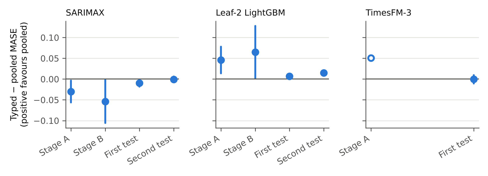

# What replicates when festival indicators are tested on new states? Typed versus pooled indicators in Indian electricity forecasting

Binay Verma

Affiliation: __________ . Corresponding author email: __________ .

## Abstract

Forecasters who add festival indicators to a demand model must choose between one indicator per festival (typed) and one shared indicator (pooled). We compare both for daily electricity in seventeen Indian states, with zero-channel and placebo controls, four local models and two time-series foundation models. Patterns found in three exploratory states were registered and tested on seven new states, then on seven more. Most exploratory effects shrank or vanished: the typed advantage of SARIMAX held in one test only, the pooling preference of TimesFM-3 and a heterogeneity explanation were not confirmed. One result replicated in both tests: a LightGBM with minimum leaf size 2 did better with the pooled indicator. A pre-registered experiment shows why. In a two-year training window a typed indicator is set on two to four days, and a tree cannot split on it once its minimum leaf size exceeds that count. «ABSTRACT_WINDOW»

**Keywords:** holiday effects; event covariates; load forecasting; gradient boosting; time-series foundation models; replication; pre-registration.

## Highlights

- Typed and pooled festival flags compared in 17 Indian states with controls
- Most exploratory effects shrank or vanished in two registered tests
- Small-leaf LightGBM preferred one pooled flag in both registered tests
- A tree cannot use a flag set on fewer training days than its leaf size
- «HIGHLIGHT_WINDOW»

## 1. Introduction

Holidays and festivals are rare, recurring and heterogeneous. A forecaster who adds them to a model faces an old choice: give each named event its own indicator, so that each can have its own effect, or pool them into one indicator, so that sparse events borrow strength from one another [9, 10]. Covariate-informed time-series foundation models (TSFMs) such as Chronos-2 [6] and TimesFM-3 [7] reopen the choice in a new form, because the forecaster no longer estimates the effect but only decides which channels to pass [1, 2].

We study this choice for daily electricity in Indian states, where festivals such as Holi, Dussehra and Diwali move with the lunisolar calendar and differ in size and sign from state to state. Our first, exploratory analyses on three states suggested a tidy model-class pattern: SARIMAX gained from typed flags, LightGBM and TimesFM-3 from a pooled flag. Exploratory patterns of this kind often fail to replicate [50], so we registered them and tested them on data no model had been evaluated on: further years for one state, then seven new states, then seven more.

The main finding is how little survived. Of the exploratory effects, the SARIMAX typed advantage held in one test of two and was ten times smaller than in the exploratory data; the TimesFM-3 pooling preference vanished; and a mechanism proposed to explain which states gain from typing was not confirmed. One result replicated in both state-level tests: a LightGBM with a minimum leaf size of 2 forecast better with one pooled flag. Its explanation is mechanical. In the two-year training window used here, each typed flag is set on two to four days, and a tree cannot split on a flag that is set on fewer days than its minimum leaf size. An experiment whose predictions were committed before it was run confirms this exactly (Section 6).

Our contributions are:

1. **A replication record.** All registered typed-versus-pooled hypotheses, with their decisions, sensitivities and 95% intervals, in one scorecard, showing how effects shrink from exploration to confirmation (Section 5).
2. **A support mechanism for tree models.** The number of training days on which an indicator is set, relative to the minimum leaf size, decides whether a tree can use typed indicators at all; we show this exactly and trace how the typed-versus-pooled difference depends on leaf size «CONTRIB_WINDOW» (Section 6).
3. **Negative results reported as such.** No replicated preference exists for SARIMAX, Ridge, Chronos-2 or TimesFM-3, and festival-effect heterogeneity estimated from past data did not predict which states gain from typing (Sections 5 and 7).
4. **A practical rule.** When the better representation is uncertain, averaging the two forecasts limits the worst case across 192 decisions in fourteen states (Section 8).

The study does not introduce typed or pooled indicators, which are established, and makes no claim of a new method. Its value is in testing how the choice behaves when the same pipeline meets new data.

## 2. Related work

**Holidays in load forecasting.** Load forecasting is reviewed in [17], and competition models give public holidays special treatment [19, 20]. Ziel [9] compared one shared holiday dummy, grouped dummies and one dummy per holiday for German load and found that many per-holiday dummies did not clearly improve on one additional dummy. Arora and Taylor treat special days with rule-based seasonal models [10, 18]. For India, evidence is sparse: a regional study found no significant effect of a pooled national-holiday dummy on northern-grid load [21], day-ahead holiday load forecasting has been addressed at a conference [22], and moving Indian holidays have been modelled in manufacturing statistics [3].

**Moving holidays and shrinkage.** Calendar adjustment has long used holiday-specific regressors for lunar and lunisolar festivals [23, 24, 25], and practical procedures select or drop them by information criteria [26, 27]. Prophet gives each named holiday its own effect with a prior that shrinks it [28], which sits between typed and pooled indicators; we test such a hybrid arm only as an exploratory check (Section 7). For tree models, the minimum leaf size limits which splits are possible [40, 41].

**Foundation models and covariates.** Pretrained time-series models were introduced without covariates [30, 31, 32]; support for known future covariates came later [33, 34] and is native in Chronos-2 and TimesFM-3 [6, 7]. Kreusel et al. [1] examine calendar encodings in these two models, Alipour et al. [2] learn event representations from residual responses, Kaljevic et al. [4] benchmark foundation models for load forecasting under covariate uncertainty, and Meyer et al. [5] show how information leakage can affect their evaluation.

**Evaluation, replication and combination.** We use the mean absolute scaled error [13, 47]. Because our unit of evidence is a festival-year cluster and there are few of them, we use sign-flip randomisation tests [45, 46] rather than pairwise tests [42], with Holm's adjustment [16]. Forecasting results do not always replicate [50], and registering hypotheses before testing them separates hypotheses formed from data from those tested on new data [15]. Equal-weight averaging of forecasts [11, 12] is used here only as a hedge between two representations.

## 3. Data and design

### 3.1 Electricity series and states

The target is daily energy met in GWh from a GRID-INDIA/POSOCO compilation, for seventeen states in three groups: three exploratory states (Delhi, Karnataka, Maharashtra); seven states of the first registered test (Uttar Pradesh, Rajasthan, Madhya Pradesh, Gujarat, Telangana, Andhra Pradesh, Tamil Nadu); and seven of the second (Punjab, Haryana, West Bengal, Kerala, Bihar, Odisha, Chhattisgarh), which are all remaining states with mean daily energy of at least 70 GWh. The series are energy met, not unconstrained demand. All values are public and historical, so every result is retrospective: the registrations fix the analysis before it is run, not before the data exist.

### 3.2 Festival calendars

Five festival families are used where they are public holidays in most years: Holi, Dussehra, Ganesh Chaturthi, Ugadi/Gudi Padwa and Diwali. The festival day itself is flagged, also when it falls on a weekend. Calendar quality is the weakest part of the data, and we state it plainly. In the exploratory states, rows for 2022–2025 were checked against retained state documents. In the first registered test, 90 of 331 rows (2015–2025) come from official notifications or government reproductions and 241 from secondary sources (reposts and holiday aggregators); the author checked every row, but the method of each check was not recorded. In the second test, the 231 rows were found by machine search, again mostly on secondary sources, and compared with the dates verified for the same festival and year in the first test: 183 agree, 43 were checked by the author one by one (the 22 that disagreed and a random sample of 21 that agreed, in which two Holi dates were on the eve), and 5 Holi rows were moved to the Holi day by rule. Agreement with other states corroborates the festival day; it does not show each state's own notification. Section 7 tests how sensitive the results are to dating errors.

### 3.3 Models, arms and controls

Four local models are refitted monthly on the previous 730 days: a rich Ridge regression, LightGBM [14] with parameters selected each year on the 180 days before the event year using the ordinary calendar only ("tuned LightGBM", whose selected minimum leaf size is 5 or 20), the same LightGBM with the minimum leaf size fixed at 2 ("leaf-2 LightGBM"), and SARIMAX(1,0,0)(1,0,0,7). Ridge and LightGBM use 27 past-only history features. Two pinned TSFMs, Chronos-2 and TimesFM-3, are used zero-shot with 730 days of context. Selected parameters are shared by all arms of a model, so arms differ only in their festival channels.

Every arm keeps 13 ordinary calendar channels. The compared arms add five channels: **typed** (one indicator per festival family, on the festival day), **pooled** (one indicator on any festival day, padded with four zero channels to equal dimension), **zero** (five zero channels) and **placebo** (the typed indicators shifted by seeded, weekday-preserving offsets of four to six weeks). For each festival a ±3-day window is forecast at leads 1, 7 and 14; the registered tests concern lead 1.

### 3.4 Error measure and tests

The error measure is MASE [13] with a fixed scale from the 730 days before each event year. Errors are averaged within state, festival family and year, then over states within each family-year, and each family-year is one cluster. The registered tests use the mean typed-minus-pooled MASE over clusters (positive favours pooling) with a one-sided sign-flip test in the hypothesised direction and Holm's adjustment within each registration. A sign-flip test assumes symmetric cluster differences; clusters in the same year share weather and data vintage, so the tests are approximate. We add descriptive 95% t intervals over clusters and a linear mixed model with crossed random effects for state and family-year.

### 3.5 Registration sequence

Table 1 gives the sequence. The Stage A and Stage B protocols are commits in the author's public repository, whose timestamps are author-set; the two state-level tests are also registered on OSF. For the first state-level test, the OSF registration was recorded after local parameter selection (ordinary calendar only) had started but before any forecast with festival indicators. For the second, the protocol and analysis script were committed at 17:52 UTC on 15 November 2026 and, by the author's record, the OSF submission was complete by 18:21 UTC, the minute parameter selection started; all its forecasts ran afterwards and its analysis script was run once. These registrations are weaker evidence of pre-specification than an independently timestamped registry would be, and we rely on them only for the order of analysis and forecasts.

Table 1. Cohorts and registration sequence.

| Stage | Role | States | Event years | Event cases | Clusters | Models | Fixed before forecasts |
| --- | --- | --- | --- | --- | --- | --- | --- |
| Stage A | exploratory | 3 | 2022–2025 | 1,056 | 20 | 6 | – |
| Stage B | registered (repository) | Maharashtra | 2019–2021 | 327 | 15 | 4 local | hypotheses H1–H2, rule |
| First test | registered (osf.io/yw7mr) | 7 | 2017–2025 | 5,157 | 45 | 6 | H1–H3, rule, script |
| Second test | registered (osf.io/f9tv4) | 7 | 2017–2025 | 3,969 | 36 | 4 local | R1, R2, M1, M2, rule, script, power |
| 2027–2028 | registered (osf.io/xr25s) | 3 + 4 | 2027–2028 | – | – | 4 | P1, P2; not yet observed |

## 4. Where the hypotheses came from

On the three exploratory states over 2022–2025 (Stage A), festival flags clearly helped Ridge and SARIMAX: at lead 1, typed and pooled day flags lowered their MASE by more than 0.1 against the calendar arm, while the zero and placebo arms stayed within 0.003 of it, so the gains come from festival dates, not from extra channels. The typed-versus-pooled contrasts depended on the model (Table 2). The tuned LightGBM was better with the pooled flag (+0.0429, Holm p 0.029 over eight lead-1 cells), the leaf-2 LightGBM pointed the same way in all four years (+0.0458, Holm p 0.063), SARIMAX pointed to typed flags in all four years (−0.0300, Holm p 0.160), and TimesFM-3 favoured the pooled flag (+0.0506, Holm p 0.017 over four foundation-model cells); Ridge and Chronos-2 showed no ordering. Over all 24 local model/representation/lead cells, six had a raw p below 0.05 and none survived Holm over 24. Details, all leads and the window representations are in Supplementary Section S3.

Table 2. Stage A (three states, 2022–2025, 20 clusters): lead-1 typed minus pooled MASE, exploratory. Positive favours pooling.

| Model | Typed − pooled | Holm p (family of cells) |
| --- | --- | --- |
| Rich Ridge | −0.0109 | 0.588 (8 local) |
| SARIMAX | −0.0300 | 0.160 (8 local) |
| Tuned LightGBM | +0.0429 | 0.029 (8 local) |
| Leaf-2 LightGBM | +0.0458 | 0.063 (8 local) |
| Chronos-2 | +0.0038 | 1.000 (4 foundation) |
| TimesFM-3 | +0.0506 | 0.017 (4 foundation) |

## 5. Registered tests

### 5.1 Hypotheses

Stage B tested on further Maharashtra years (2019–2021; their 2020–2021 values had been Stage A training history) that the tuned LightGBM favours the pooled flag and SARIMAX typed flags, with the leaf-2 LightGBM as a secondary hypothesis. The first state-level test registered three hypotheses on seven new states: SARIMAX favours typed flags (H1), TimesFM-3 the pooled flag (H2) and the leaf-2 LightGBM the pooled flag (H3), each requiring a Holm-adjusted p below 0.05 and the hypothesised sign in at least six of nine event years. After that test, exploratory analyses suggested that typing helps where a state's festival effects differ strongly. The second state-level test therefore repeated H1 and H3 (as R1 and R2) on seven more states and added two mechanism hypotheses: Ridge gains from typing in the three states with the most dispersed festival effects, estimated from 2015–2020 demand only (M1), and dispersion is negatively rank-correlated with the Ridge gain across the seven states (M2). Its registration stated in advance that, if the true effects equalled those of the first test, R1 and R2 would pass in only about 18–34% and 19–36% of simulated replications.

### 5.2 Results

Table 3 lists every registered hypothesis. Four were confirmed and five were not. The tuned LightGBM hypothesis of Stage B gave an exact zero, because its selected minimum leaf size of 20 exceeded the number of days on which any festival flag was set, so all its arms gave identical forecasts (Section 6). The SARIMAX typed advantage was confirmed in Stage B and in the first state-level test but not in the second, where it was close to zero (−0.0008, 95% interval −0.0076 to 0.0060). The TimesFM-3 pooling preference was not confirmed (−0.0004). The mechanism hypotheses M1 and M2 pointed in the predicted direction but were not confirmed. The leaf-2 LightGBM favoured the pooled flag in both state-level tests (+0.0068 and +0.0147), the second time in all nine event years.

Table 3. Registered typed-versus-pooled hypotheses (lead 1, day flags). Estimate: typed minus pooled MASE (M2: Spearman correlation); positive favours pooling. Interval: descriptive 95% t interval over the units, not adjusted. Holm p within each registration.

«SCORECARD_TABLE»

The effects shrank from exploration to confirmation (Figure 1). SARIMAX went from −0.0300 (Stage A) and −0.0539 (Stage B) to −0.0097 and −0.0008; TimesFM-3 from +0.0506 to −0.0004; the leaf-2 LightGBM from +0.0458 and +0.0648 to +0.0068 and +0.0147. The surviving effect is small in absolute terms: in the first test, the leaf-2 LightGBM's pooling advantage corresponds to 0.16 GWh per festival-window day, against mean demand of 257 GWh, about 2% of its lead-1 MASE.

**Sensitivities.** Without 2020–2021, the decisions of both state-level tests are unchanged except that the first test's SARIMAX result is no longer significant (−0.0086, Holm p 0.115). The leaf-2 LightGBM result does not hold on the best-checked calendar rows alone: with official-source rows only, the first test's estimate reverses (−0.0074, 44 clusters, almost all from Tamil Nadu and Telangana), and with the 43 rows checked one by one the second test's is +0.0040 (24 clusters, six of nine years, not confirmed). Both subsets are small and leave out the states that carry the main effects, so they have little power, but the result is not shown on the best-documented rows.

**States.** Figure 2 shows the state-level estimates. In the first test the leaf-2 LightGBM result rests mainly on Gujarat (+0.065), and Madhya Pradesh and Tamil Nadu go the other way; in the second it is positive in four states (Haryana +0.066, Punjab +0.030, Chhattisgarh +0.025, West Bengal +0.013) and about zero in the three states with the smallest festival effects (Bihar, Kerala, Odisha). The SARIMAX typed advantage of the first test comes mostly from Gujarat (−0.076); no second-test state shows a clear typed advantage. A mixed model over all fourteen states with crossed random effects for state and family-year gives +0.0146 (95% interval 0.0012 to 0.0279) for the leaf-2 LightGBM and −0.0064 (−0.0189 to 0.0061) for SARIMAX.

## 6. Why trees ignore typed flags

A regression tree needs at least L training rows on each side of a split, where L is the minimum leaf size, and each of our trees is fitted to one state, so a row is a day. A typed flag is set on one day per festival per year, so in a 730-day training window it is set on two days, or three to four where a state lists a second festival day; the pooled flag is set on every festival day, a median of six to eight days. Once L exceeds the number of days on which a typed flag is set, the tree cannot split on it, and the typed arm must give the same forecasts as the calendar arm.

We tested this with an experiment whose predictions were committed to the repository before it was run. For all fourteen states of both registered tests, lead 1 was re-forecast with every selected parameter kept except the minimum leaf size L, set to 1, 2, 3, 4, 5, 6, 8, 10 or 20. At L = 2 and at each fit's selected L, all 3,042 forecasts per arm equal the registered ones exactly, so the experiment uses the registered pipeline. The prediction that the typed arm equals the calendar arm whenever no typed flag reaches L training days held in every such fit (1,501 of 1,501 in the first test, 1,314 of 1,314 in the second), and the share of fits with identical typed and calendar forecasts rose with L, reaching 1.00 at L = 5 and L = 4. Two predictions failed: we expected LightGBM's default bin construction (at least three rows per bin) to make flags set on only two days unusable at any L, but 137 and 147 such fits did use them; and in the second test the pooled flag was unused in about half the fits even at small L.

Table 4 shows the consequence. Typed minus pooled MASE is positive at every leaf size from 1 to 6, peaks at L = 3 to 5 (about +0.022 in both tests), where typed flags are mostly unusable but the pooled flag is not, and falls to exactly zero once neither flag can be used (L ≥ 10 and L ≥ 8). The leaf-2 result of the registered tests therefore sits on a curve whose shape is set by how many training days each flag covers. The tuned LightGBM, whose selected L of 5 or 20 makes typed flags invisible, is the extreme case: its "preference" for pooling is a support effect, not a judgement on typed information.

Table 4. Leaf-size experiment (exploratory, predictions committed before the run): lead-1 typed minus pooled MASE and the share of fits in which the typed arm equals the calendar arm.

«LEAF_TABLE»

«WINDOW_SECTION»

## 7. Other checks

«HYBRID_NOISE_ALPHA_SECTION»

**Heterogeneity.** Exploratory analyses after the first test suggested that typing helps Ridge where a state's festival effects differ strongly; a simulation matched to the pipeline, built after that test, reproduced the differences between states mainly through Gujarat and Tamil Nadu (Supplementary Section S4). The second registered test did not confirm this out of sample (M1 −0.0081, interval −0.0247 to 0.0085; M2 ρ −0.43). We treat it as an unconfirmed explanation.

**Foundation models at longer leads.** In the first test, TimesFM-3 did better with typed flags at leads 7 and 14 (−0.078 and −0.079), also against a pooled flag without zero padding (−0.060 and −0.064). This was not a registered horizon, rests mainly on Gujarat and Tamil Nadu, and is the subject of the 2027–2028 registration (Table 1).

## 8. What should a forecaster do?

If the better representation cannot be known in advance, choosing it from past performance helps little. Using the stored forecasts of both registered tests (four local models, three leads, eight event years with a previous year; 192 decisions), we compare always-typed, always-pooled, following last year's winner, and an equal-weight average of the typed and pooled point forecasts. Regret is MASE minus that of the better representation in hindsight. Following last year's winner picked the worse representation in 59 of 192 decisions. Mean regret was «DR_MEAN»; the largest regret was «DR_MAX» (Table 5). Because the absolute error of an average is at most the mean of the two absolute errors, the average cannot be worse than the worse representation; its value is in limiting the worst case, not in a new method. The rules were chosen after the instability had been seen, so this analysis is exploratory.

Table 5. Decision rules over 192 decisions in the fourteen states (regret in MASE against the hindsight-better representation; exploratory).

«DR_TABLE»

For tree models the practical advice is concrete: count how many training days each flag covers and compare it with the minimum leaf size; a typed flag below that count is a wasted channel, and a pooled flag, or a longer training window, is needed for the tree to use festival information at all.

## 9. Limitations

- All data are historical and public, so the registrations fix the analysis order, not the data; registration times rest on repository commits and, for the second test, on the author's record of the OSF submission (Section 3.5).
- Calendar quality is limited: most rows come from secondary sources, the second test's calendar is corroborated mainly by agreement with other states, and the confirmed LightGBM result is not shown on the best-checked rows alone.
- The effects are small (about 2% of MASE) and spread unevenly over states; the first test's results rest mainly on Gujarat.
- Power was low for some tests: R1 had 18–34% power at the first test's effect, so its failure is weak evidence against that effect.
- The parameters are selected on ordinary days and shared by all arms; weather, supply constraints and coincident observances are not modelled; foundation models are used zero-shot and their pretraining data are not known to exclude these series [5].
- The experiments in Sections 6 and 7 were designed after the registered results were known; their predictions were committed before they were run, but they remain exploratory.
- The reuse terms of the electricity compilation are unresolved.

## 10. Conclusion

Typed and pooled festival indicators are a small choice with a small effect in our data, and most of what an exploratory analysis suggested about it did not survive two registered tests on new states. The one result that replicated, that a LightGBM with a small minimum leaf size forecasts better with a pooled flag, has a mechanical explanation: a tree cannot use an indicator that is set on fewer training days than its minimum leaf size, and typed festival indicators are set on very few days. «CONCLUSION_WINDOW» Where the better representation is uncertain, averaging the two forecasts limits the worst case. A registered test on 2027–2028 festivals with official calendars will check the remaining exploratory leads.

## Declarations

**Data availability.** Code, protocols, forecasts, failures and audits are at https://github.com/Binay-verma/tsaf_project. The GRID-INDIA/POSOCO compilation curated by Robbie Andrew and the two seven-state extracts from the same source are in the repository; their reuse terms are unresolved. Registrations: https://osf.io/yw7mr (first state-level test), https://osf.io/f9tv4 (second) and https://osf.io/xr25s (2027–2028). Model weights are not redistributed.

**Funding.** __________ [author to confirm].

**Competing interests.** __________ [author to confirm].

**Author contribution.** Binay Verma: __________ [author to complete, CRediT roles].

**Use of generative AI.** __________ [author to complete according to the journal's policy before submission].
