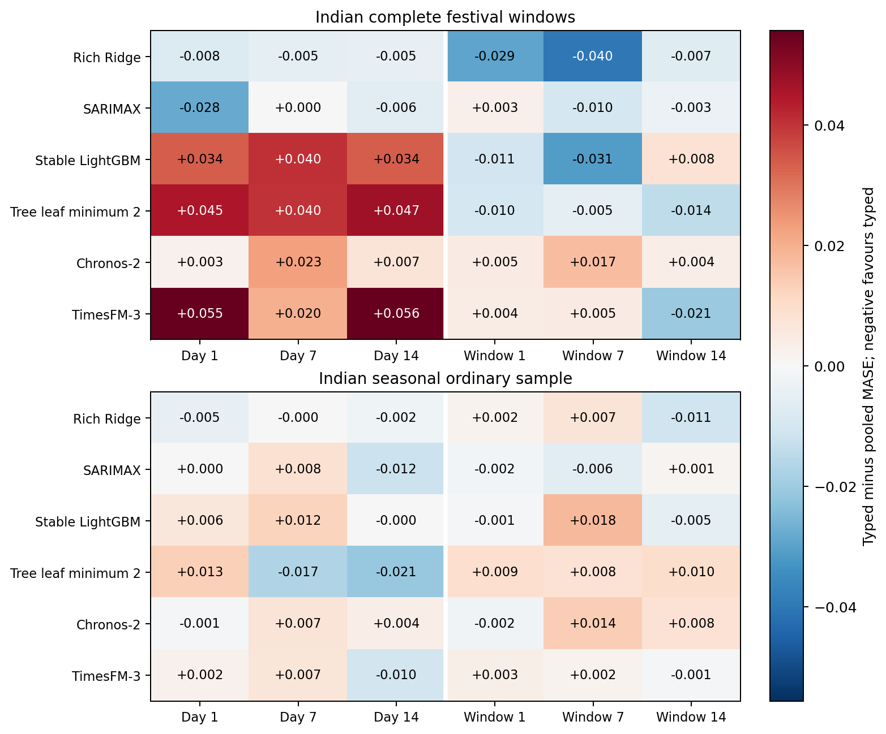
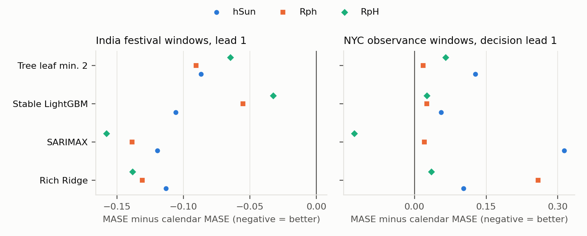
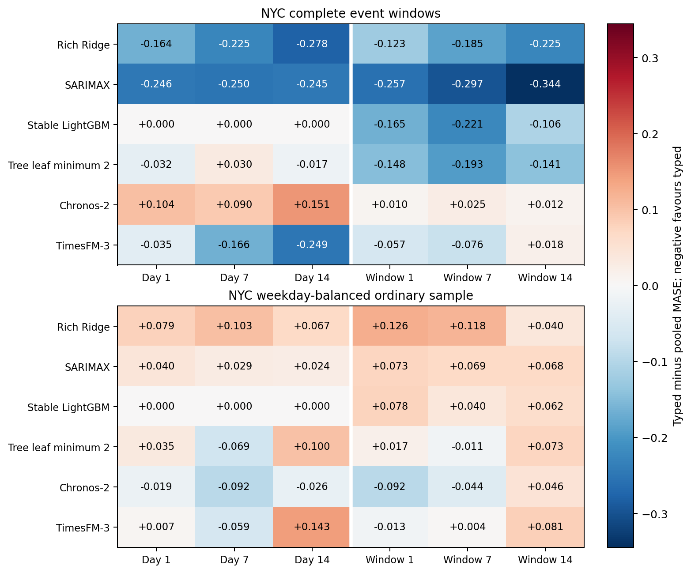
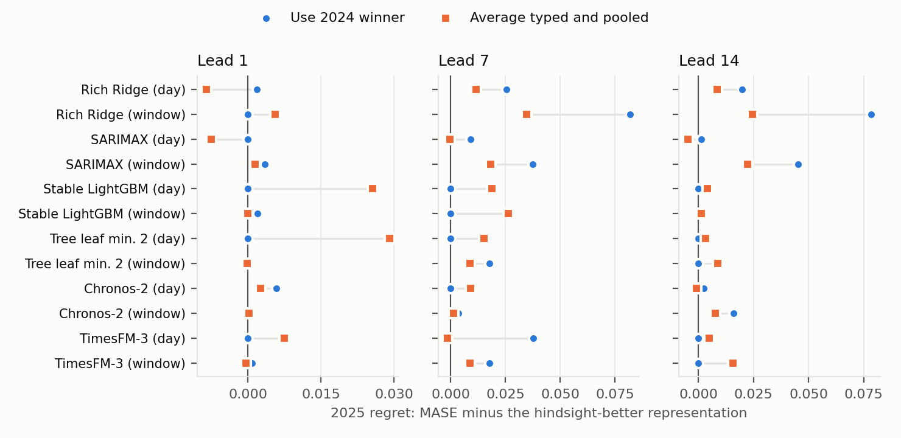
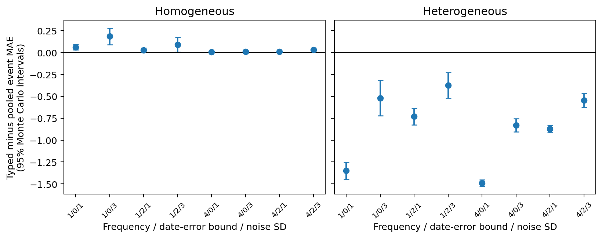

# Typed or pooled? Festival covariates in foundation and local forecasting models: unstable orderings, matched controls and a combination hedge

Binay Verma

Affiliation: __________ . Corresponding author email: __________ .

**Draft for supervisor review (journal format, version 8). Not submitted.**

## Abstract

Forecasters who add festival or holiday indicators to a model must decide whether to give each named event its own channel (typed) or to share one channel across events (pooled). We examine this choice for two pinned time-series foundation models (Chronos-2 and TimesFM-3) and four local models on daily electricity supplied in three Indian states, with matched calendar, zero-channel and weekday-placebo controls, a source-driven correction of one festival date, and a separately registered replication on New York City transit ridership. On 528 Indian festival-window cases, typed-minus-pooled MASE ranges from -0.03971 to 0.05564 across 36 model/representation/lead cells, and its sign is opposite between the two event years in 19 cells. Exact sign-flip tests on the 10 family-year clusters detect no cell after Holm adjustment; India and NYC disagree in sign in 11 of 36 cells, including all TimesFM-3 cells. Daily adaptations of Ziel's holiday-as-Sunday and replacing designs improve on the calendar baseline in India, as the additive flags do, but not in NYC event windows. Because the better representation cannot be identified in advance, we evaluate two pre-registered decision rules on stored forecasts. Choosing the 2024 winner for 2025 picks the worse representation in 19 of 36 cells; an equal-weight average of the typed and pooled forecasts, whose error is bounded by the mean of the two by construction, has lower mean regret (0.0084 versus 0.0113) and beats the follow rule in 21 of 36 cells. The evidence is retrospective, from two event years and two transit observances, and supports a conditional recommendation rather than a general ranking of representations or models.

**Keywords:** holiday effects; event covariates; time-series foundation models; forecast combination; electricity demand; forecast evaluation.

## Highlights

- Typed and pooled festival indicators are compared under matched channel counts, zero and placebo controls.
- The better representation reverses between years, models and data sources.
- No typed-versus-pooled difference survives cluster-level sign-flip tests with Holm adjustment.
- Following last year's winner is no better than chance in this panel; averaging the two forecasts is a safer default.
- All protocols, failures, corrections and forecasts are retained in a public repository.

## 1. Introduction

Holidays and festivals are rare, recurring and heterogeneous. A forecaster who adds them to a model faces a choice that predates modern machine learning: give each named event its own indicator, so that each can have its own response, or pool them into one indicator, so that sparse events borrow strength from one another. In load forecasting the trade-off is familiar [9, 10]. Covariate-informed time-series foundation models (TSFMs) such as Chronos-2 [6] and TimesFM-3 [7] reopen it in a new form, because the model is not re-estimated: the forecaster controls only which channels are passed and how they are encoded [1, 2].

This paper asks a narrow question: on the same cases, with the same information budget, does the typed or the pooled representation give lower error, and is the answer stable enough to act on? We answer it for daily electricity supplied in Delhi, Karnataka and Maharashtra around five Indian festival families, and repeat the design on two later NYC transit observances. Our contributions are:

1. **A matched comparison.** Typed and pooled festival indicators are compared for two pinned TSFMs and four local models on identical cases, with a calendar baseline, an equal-dimension zero-channel control and weekday-shifted placebos, so that gains from adding channels and gains from festival information can be separated (Sections 3 and 4).
2. **Evidence of instability.** The preferred representation changes sign between event years, between models, and between India and NYC. Cluster-level permutation tests detect no stable difference (Sections 4 and 5).
3. **A source-driven calendar correction.** One festival date in the original ledger did not match the state notification. We show how correcting it changes cases and features separately (Section 2).
4. **A decision rule for unstable orderings.** Using stored forecasts only, we show that following the previous year's winner performs no better than chance, while an equal-weight average of the two representations is a safer default (Section 6).

We do not propose a new architecture, claim causal holiday effects or claim contamination-free testing of pretrained models. Section 2 describes the data and calendars, Section 3 the models and controls, Sections 4 to 6 the results, and Section 7 the limitations.

## 2. Related work

**Holidays in load forecasting.** Ziel [9] compared one shared holiday dummy, grouped dummies and a separate dummy for each holiday for German load. He reported that many additional per-holiday dummies did not seem to improve on one additional dummy, with univariate results mixed by holiday type; in his multivariate comparison three models were not significantly worse than the best model forecast, M-RpH (a replacing design with one dummy per holiday), and the holiday-as-Saturday and holiday-as-Sunday designs were in most cases significantly worse than the best approach. Arora and Taylor [10] treat special days with rule-based seasonal ARMA models. Moving Indian holidays have been modelled in official manufacturing statistics [3].

**Covariates in foundation models.** Kreusel et al. [1] examine calendar encodings in Chronos-2 and TimesFM-3. Alipour et al. [2] learn impact-driven event representations from residual responses. Kaljevic et al. [4] benchmark TSFMs for load forecasting under covariate uncertainty.

**Evaluation of pretrained models.** Meyer et al. [5] show that sample and proxy leakage can affect TSFM evaluation, and that model release dates alone do not establish contamination-free tests.

Our study does not introduce typed or pooled indicators, which are established. It examines how that choice behaves through TSFM covariate channels under a fixed channel budget with zero and placebo controls, and what a forecaster should do when the ordering is unstable.

## 3. Data and calendars

### 3.1 Indian electricity and festival dates

The target is daily energy met/supplied in GWh for Delhi, Karnataka and Maharashtra, from a GRID-INDIA/POSOCO compilation. It is not latent unconstrained demand, household consumption or hourly peak load. Outcomes through 28 October 2026 have been inspected, so all historical method choices made after that are exploratory.

Five festival families are used: Holi, Dussehra, Ganesh Chaturthi, Ugadi/Gudi Padwa and Diwali, with declared state scopes and subsidiary anchors. Twelve retained annual state documents support a review of all 58 named dates: 54 match the declared family, two are explicit shared-national-main exceptions, one Karnataka 2025 date did not match, and one Maharashtra 2022 Gudi Padwa date could not be corroborated from the retained one-page schedule. Office closure does not establish a statewide electricity response.

**Correction.** The Karnataka notification labels Vijayadasami on 1 October 2025 and Gandhi Jayanthi on 2 October; the original ledger used 2 October for Dussehra. A separately registered flag-only correction holds cases and placebos fixed. A further registered recentering replaces only three old 5 October target/lead cases with 28 September, yielding the complete 28 September–4 October window, and moves the corresponding +35-day placebo from 6 to 5 November. Same-case aligned-feature changes at lead 1 range from -0.00119 to 0.00836, while replacing the three cases under original features changes the aggregate by -0.00251 to 0.00171; the two are different estimands and are reported separately. No forecast error was used to choose these dates.

The resulting 528 event-window cases are 176 state/target-date combinations at leads 1, 7 and 14 across 24 family/state/year groups in 2024–2025. They cover 75 distinct target dates and 10 family/year clusters; the clusters, not rows, are the effective event units. The 216 ordinary cases are a seasonal sample (the first eligible rotating weekday per month, state and year, excluding festival windows).

### 3.2 NYC transit replication

The MTA daily ridership dataset (identifier sayj-mze2) provides Subway and Bus estimated counts, converted to million rides. The protocol was committed (e7d9423, 20:23:38 UTC on 30 October 2026) before the evaluation records were acquired (20:24:51 UTC); the public push time of that commit has not been independently verified. The 84 event cases cover complete ±3-day windows around Yom Kippur on 21 September and Columbus Day on 12 October 2026, two modes and three decision leads; the 42 ordinary cases balance weekdays. A fixed seven-day observation buffer maps decision leads 1/7/14 to model steps 8/14/21. Two observances in one city support a bounded robustness check only.

### 3.3 England/Wales delay check

NESO transmission demand supplies an independent electricity source with no holiday targets. Sixteen ordinary September 2026 targets are compared under ideal availability and 21 extra days of observation delay (Appendix Table A7). This is a lag sensitivity, not a holiday replication.

## 4. Models, representations and evaluation

### 4.1 Models

Chronos-2 and TimesFM-3 use pinned code and weights, 730 prior target days, fixed seeds, two CPU threads and no task fine-tuning; weight and input bytes are checked, and every registered run includes a future-target perturbation check. The local models are a rich Ridge regression, a float32 LightGBM, a separately reported minimum-leaf-2 LightGBM sensitivity, and SARIMAX(1,0,0)(1,0,0,7). Ridge and LightGBM use 27 past-only history features plus the same calendar and event covariates; their parameters come from pre-evaluation chronological validation with purged future labels and are shared across arms. Local models are refitted monthly while foundation models are frozen, so model rankings do not isolate architecture.

### 4.2 Representations and controls

Every arm keeps 13 ordinary calendar channels (seven weekday indicators and three annual harmonic pairs). The main arms add five channels each:

- **calendar** (no festival information) and **calendar + five zeros** (equal dimension, no information);
- **typed day / typed window**: one indicator per family, on the festival day or on its ±3-day window;
- **pooled day / pooled window**: one shared indicator plus four zero channels;
- **typed day / window placebos**: the same indicators shifted by fixed seeded weekday-preserving offsets that avoid true windows.

Three further local-model arms adapt Ziel's designs [9] to daily festival anchors (Section 5.3): **hSun** treats each anchor day as a Sunday; **Rph** adds the pooled day flag and sets all seven weekday dummies to zero on flagged days; **RpH** does the same with the five typed flags (Ziel's Eq. 11).

### 4.3 Evaluation

Each origin is the first unseen date, and the target date is origin plus model step minus one. The error measure is MASE with a fixed pre-year scale (the mean absolute weekly difference over the previous 730 days); imputed labels are never scored. Indian event summaries average errors within state/year/family, then states within year, years within family, and families equally. NYC uses the analogous mode hierarchy.

Because rows are correlated, we report every registered contrast with its sign by year and leave-one-family-out (LOFO) range, and use exact sign-flip permutation tests with clusters as units (10 Indian family-year clusters; 4 NYC family-mode cells), Holm-adjusted across the 36 cells of each test family. These tests were registered before any p-value was computed, but the cluster values had already been reported descriptively.

## 5. Results

### 5.1 Indian festival windows

Table 1 gives the pre-specified next-day comparison and Figure 1 all leads. Festival information helps the local models: typed and pooled day flags lower Rich Ridge event MASE from 0.57699 to 0.45317 and 0.46093, and SARIMAX from 0.57301 to 0.42533 and 0.45345. The foundation models gain less, except TimesFM-3 with the pooled day flag (0.42459 versus 0.55148 for calendar). Window indicators help little. On ordinary days (Table 2) the differences between arms are smaller, but for both foundation models the day arms slightly raise ordinary-day MASE relative to calendar.

Table 1. Indian festival windows (document-aligned, recentered): lead-1 MASE.

| Model | Calendar | Typed day | Pooled day | Typed window | Pooled window |
| --- | --- | --- | --- | --- | --- |
| Rich Ridge | 0.57699 | 0.45317 | 0.46093 | 0.57914 | 0.60838 |
| SARIMAX | 0.57301 | 0.42533 | 0.45345 | 0.57787 | 0.57511 |
| Stable LightGBM | 0.69865 | 0.69483 | 0.66110 | 0.70168 | 0.71233 |
| Tree leaf minimum 2 | 0.68582 | 0.64952 | 0.60469 | 0.69028 | 0.70001 |
| Chronos-2 | 0.53767 | 0.52009 | 0.51752 | 0.53720 | 0.53268 |
| TimesFM-3 | 0.55148 | 0.48005 | 0.42459 | 0.55540 | 0.55131 |

Table 2. Indian seasonal ordinary sample: lead-1 MASE.

| Model | Calendar | Typed day | Pooled day | Typed window | Pooled window |
| --- | --- | --- | --- | --- | --- |
| Rich Ridge | 0.28458 | 0.27908 | 0.28363 | 0.28887 | 0.28709 |
| SARIMAX | 0.23073 | 0.22949 | 0.22910 | 0.22995 | 0.23155 |
| Stable LightGBM | 0.39366 | 0.39545 | 0.38932 | 0.39507 | 0.39604 |
| Tree leaf minimum 2 | 0.39178 | 0.37852 | 0.36518 | 0.38876 | 0.37951 |
| Chronos-2 | 0.24924 | 0.26482 | 0.26567 | 0.26108 | 0.26287 |
| TimesFM-3 | 0.26547 | 0.26931 | 0.26685 | 0.26196 | 0.25877 |

### 5.2 Is there a winner?

The typed-minus-pooled contrast ranges from -0.03971 to 0.05564 across the 36 model/representation/lead cells. Its sign is opposite between 2024 and 2025 in 19 cells (one more is an exact tie), and leaving out one festival family flips the balanced sign in 17 (Appendix Table A4).

Table 3 gives the cluster-level tests at lead 1. Across all 36 cells, 3 reach a raw sign-flip p below 0.05 and none survives Holm adjustment; the smallest raw p is 0.0059 (TimesFM-3 day flags, Holm p 0.211). The year-interaction test, with five family-level differences, cannot reach 0.05 (smallest attainable p 0.0625), and no NYC cell can (smallest attainable p 0.125). With 10 clusters these tests have little power, so "not detected" is not evidence of no difference; it does mean that no ordering in this panel is established.

Table 3. Indian typed-minus-pooled MASE at lead 1 with family-year clusters as units. Positive favours pooling. Sign-flip p: exact two-sided test over 1,024 sign assignments; Holm across all 36 cells; year-change p: sign-flip over 5 family-level (2025 minus 2024) differences.

| Model | Rep. | Mean (10 clusters) | 95% t interval | Sign-flip p | Holm p | Year-change p |
| --- | --- | --- | --- | --- | --- | --- |
| Rich Ridge | day | -0.00776 | -0.03177 to 0.01625 | 0.4688 | 1.0000 | 0.3125 |
| Rich Ridge | window | -0.02924 | -0.07169 to 0.01321 | 0.1367 | 1.0000 | 0.5000 |
| SARIMAX | day | -0.02812 | -0.07205 to 0.01581 | 0.1855 | 1.0000 | 0.6250 |
| SARIMAX | window | 0.00276 | -0.01040 to 0.01592 | 0.6406 | 1.0000 | 0.0625 |
| Stable LightGBM | day | 0.03374 | 0.00070 to 0.06678 | 0.1250 | 1.0000 | 0.1250 |
| Stable LightGBM | window | -0.01065 | -0.03528 to 0.01398 | 0.4082 | 1.0000 | 0.2500 |
| Tree leaf minimum 2 | day | 0.04483 | -0.00982 to 0.09948 | 0.0996 | 1.0000 | 0.4375 |
| Tree leaf minimum 2 | window | -0.00973 | -0.04074 to 0.02128 | 0.4941 | 1.0000 | 0.6250 |
| Chronos-2 | day | 0.00257 | -0.02146 to 0.02660 | 0.8438 | 1.0000 | 0.6875 |
| Chronos-2 | window | 0.00452 | -0.00516 to 0.01420 | 0.3633 | 1.0000 | 0.5625 |
| TimesFM-3 | day | 0.05546 | 0.02497 to 0.08595 | 0.0059 | 0.2109 | 0.3750 |
| TimesFM-3 | window | 0.00409 | -0.00355 to 0.01173 | 0.2500 | 1.0000 | 0.1875 |

### 5.3 Closest-method comparators

Ziel's designs (Table 4; Figure 2) improve on the calendar baseline in all 12 Indian local model/lead cells for each design, but the additive typed and pooled day flags also do so in 22 of their 24 cells, and the replacing designs differ consistently from the additive flags they carry in only 3 (Rph) and 4 (RpH) of 12 cells. In NYC event windows hSun raises MASE relative to calendar in all 12 local cells. Pure daily encodings of the calendar (ordinal, one-hot, cyclic and context-mean target encodings) for the foundation models are in Appendix Table A6, and fixed response-profile comparators in Table A2.

Table 4. Ziel adaptations on Indian festival windows: local-model lead-1 MASE. The first three columns equal Table 1.

| Model | Calendar | Typed day | Pooled day | hSun | Rph | RpH |
| --- | --- | --- | --- | --- | --- | --- |
| Rich Ridge | 0.57699 | 0.45317 | 0.46093 | 0.46375 | 0.44589 | 0.43854 |
| SARIMAX | 0.57301 | 0.42533 | 0.45345 | 0.45329 | 0.43439 | 0.41492 |
| Stable LightGBM | 0.69865 | 0.69483 | 0.66110 | 0.59277 | 0.64334 | 0.66625 |
| Tree leaf minimum 2 | 0.68582 | 0.64952 | 0.60469 | 0.59895 | 0.59529 | 0.62115 |

### 5.4 NYC replication

Table 5 and Figure 3 repeat the main comparison on NYC. The contrast range is wider, -0.34441 to 0.15136. Within NYC, 36 of 144 family/mode/step cells favour pooling, 96 favour separate identities and 12 tie. India and NYC agree in sign in 22 of 36 cells, are opposite in 11 and tie in 3; TimesFM-3 favours pooling in India and separate identities in NYC in all 6 of its cells. SARIMAX typed-day flags improve on calendar while pooled-day flags worsen it, whereas pooling helps the ordinary sample (Appendix Table A1).

Table 5. NYC event windows: decision lead 1 (model step 8), MASE.

| Model | Calendar | Typed day | Pooled day | Typed window | Pooled window |
| --- | --- | --- | --- | --- | --- |
| Rich Ridge | 0.99718 | 1.00451 | 1.16887 | 1.19074 | 1.31328 |
| SARIMAX | 0.99947 | 0.79417 | 1.04067 | 1.15250 | 1.40939 |
| Stable LightGBM | 0.91940 | 0.91940 | 0.91940 | 0.91940 | 1.08484 |
| Tree leaf minimum 2 | 0.84819 | 0.84610 | 0.87819 | 0.88083 | 1.02851 |
| Chronos-2 | 0.93276 | 0.86384 | 0.76003 | 0.93928 | 0.92961 |
| TimesFM-3 | 0.88394 | 0.75636 | 0.79143 | 0.86121 | 0.91833 |

## 6. What should a forecaster do?

If the better representation reverses between years and sources, choosing it from past performance may not help. We compared, on stored forecasts and with a protocol registered before any combined forecast was computed, always-typed, always-pooled, an equal-weight average of the typed and pooled point forecasts, and (for India, where an earlier event year exists) a rule that uses in 2025 whichever representation had the lower 2024 MASE. Regret is MASE minus that of the better representation in hindsight.

Following the 2024 winner picks the worse representation in 2025 in 19 of 36 cells, which is no better than chance. The average has lower mean 2025 regret (0.0084 versus 0.0113) and beats the follow rule in 21 of 36 cells (Table 6, Figure 4).

By construction, the absolute error of an equal-weight average is at most the average of the two absolute errors, so the average can never be worse than the worse representation; that part is not an empirical finding. What the data add is how far below this bound it lands. Over both years its mean regret is 0.0032 in India against a guaranteed bound of 0.0095 (half the mean typed-pooled gap), and 0.0399 against 0.0679 in NYC; it beats both representations in 10 of 36 Indian cells and 5 of 36 NYC cells (Appendix Table A11). None of the average-versus-single differences is detected by the Holm-adjusted cluster tests. The practical implication is modest but usable: when a representation cannot be chosen reliably, averaging the two forecasts caps the loss at little cost.

Table 6. India, lead 1: balanced MASE over both years for typed, pooled and their average, and 2025 regret of the follow-2024 rule and of the average.

| Model | Rep. | Typed | Pooled | Average | 2025: follow-2024 regret | 2025: average regret |
| --- | --- | --- | --- | --- | --- | --- |
| Rich Ridge | day | 0.45317 | 0.46093 | 0.44120 | 0.00175 | -0.00851 |
| Rich Ridge | window | 0.57914 | 0.60838 | 0.59121 | 0.00000 | 0.00556 |
| SARIMAX | day | 0.42533 | 0.45345 | 0.42381 | 0.00000 | -0.00755 |
| SARIMAX | window | 0.57787 | 0.57511 | 0.57600 | 0.00347 | 0.00146 |
| Stable LightGBM | day | 0.69483 | 0.66110 | 0.67386 | 0.00000 | 0.02554 |
| Stable LightGBM | window | 0.70168 | 0.71233 | 0.70648 | 0.00190 | -0.00011 |
| Tree leaf minimum 2 | day | 0.64952 | 0.60469 | 0.61833 | 0.00000 | 0.02907 |
| Tree leaf minimum 2 | window | 0.69028 | 0.70001 | 0.69454 | 0.00000 | -0.00025 |
| Chronos-2 | day | 0.52009 | 0.51752 | 0.51755 | 0.00583 | 0.00258 |
| Chronos-2 | window | 0.53720 | 0.53268 | 0.53414 | 0.00000 | 0.00016 |
| TimesFM-3 | day | 0.48005 | 0.42459 | 0.43142 | 0.00000 | 0.00747 |
| TimesFM-3 | window | 0.55540 | 0.55131 | 0.55269 | 0.00078 | -0.00042 |

## 7. Uncertainty and reproducibility

Both foundation models are compared on their native quantiles 0.1–0.9 (Table 7). Means hide dispersion across event clusters: at lead 1, family/year coverage of the nominal 80% interval falls below 0.80 in 85 of 100 cluster/arm cells (Appendix Table A5). This cohort has 0 crossing quantile pairs and 0 invalid interval endpoints.

Table 7. Native Indian festival-window 80% intervals at lead 1.

| Model | Arm | Coverage 80% | Scaled width | Scaled WIS80 |
| --- | --- | --- | --- | --- |
| Chronos-2 | Calendar | 0.70714 | 1.44736 | 0.36718 |
| Chronos-2 | Typed day | 0.73466 | 1.44335 | 0.35160 |
| Chronos-2 | Pooled day | 0.72619 | 1.45710 | 0.34982 |
| Chronos-2 | Pooled window | 0.73228 | 1.48578 | 0.36511 |
| Chronos-2 | Typed window | 0.72381 | 1.45537 | 0.36526 |
| TimesFM-3 | Calendar | 0.65926 | 1.21333 | 0.38483 |
| TimesFM-3 | Typed day | 0.70238 | 1.23353 | 0.32158 |
| TimesFM-3 | Pooled day | 0.70741 | 1.16836 | 0.27890 |
| TimesFM-3 | Pooled window | 0.63651 | 1.19181 | 0.38615 |
| TimesFM-3 | Typed window | 0.64735 | 1.21759 | 0.38944 |

Separate audits reconstruct source transformations, dates, cohorts, scales, inputs, local fit/query arrays, label purging and metrics. Complete clean-environment reruns of all 5,952 direct-comparator forecasts and 2,560 simulation cells are byte-identical, and an isolated NYC rerun reproduces all 4,032 local forecasts. These are internal software checks on one machine, not independent review. Earlier numerical failures are retained: a float64 tree reproduction failed before a separately named float32 revision, and 15 of 45 Delhi lead-1 near-zero feature entries differ after float32 conversion. A controlled simulation (512 datasets, 2,560 method cells; Figure 5) reproduces the familiar pooling trade-off under homogeneous versus heterogeneous effects; it does not explain foundation-model internals.

## 8. Limitations

The evidence is conditional on source, event definition, representation, horizon and adaptation policy. India has two event years and 10 family-year clusters; NYC contributes two observances in one city; the NESO check has no holiday targets. A drafted Singapore replication was not registered because the history start and licence scope of the source could not be verified. Weather, supply constraints, coincident observances, source revisions and calendar amendments are alternative explanations. Local models are refitted monthly and foundation models are frozen, so their histories and adaptation differ. Weight dates do not rule out correlated pretraining exposure [5]. The Ziel adaptations treat only the five festival families and were run for the local models only. The decision-rule analysis is retrospective and uses forecasts whose single-representation results had already been inspected.

Two prospective components are pending: frozen forecasts for 31 October–11 November 2026, to be scored with the first complete actual vintage from 12 November, and a registered weekly rolling study that is not yet activated. Neither tests the typed-versus-pooled hypothesis directly.

## 9. Conclusion

On matched cases with complete controls, neither typed nor pooled festival indicators is reliably better: the ordering reverses between years, models and data sources, and no difference survives cluster-level tests. Festival information itself helps the local models in Indian festival windows, and Ziel-style replacing designs do not change that picture in a transferable way. When the representation cannot be chosen in advance, averaging the typed and pooled forecasts is a simple default that bounds the loss and, in this panel, outperformed following the previous year's winner. Confirming any of these orderings requires future event years with calendars verified before the outcomes exist.

## Declarations

**Data availability.** Code, protocols, forecasts, failures and audits are at https://github.com/Binay-verma/tsaf_project . The GRID-INDIA/POSOCO compilation curated by Robbie Andrew is in the repository; its reuse terms are unresolved and a request to the curator is pending. The MTA snapshot is an attributed minimal filtered extract. NESO raw archives are kept outside the repository. Model weights are not redistributed.

**Funding.** __________ [author to confirm].

**Competing interests.** __________ [author to confirm].

**Author contribution.** Binay Verma: __________ [author to complete, CRediT roles].

**Use of generative AI.** __________ [author to complete according to the journal's policy before submission].

## References

[1] Kreusel et al. (2026). On the Encoding of Calendar Features in Covariate-Informed Time Series Foundation Models. arXiv:2610.13676v1. https://arxiv.org/abs/2610.13676

[2] Alipour et al. Impact-driven event covariates for time-series foundation models. https://www.amazon.science/publications/impact-driven-event-covariates-for-time-series-foundation-models

[3] Sanyal, Mitra, McElroy and Roy (2017). Holiday Effects in Indian Manufacturing Series. U.S. Census Bureau RRS2017-04. https://www.census.gov/library/working-papers/2017/adrm/rrs2017-04.html

[4] Kaljevic, Arzola and Zhang (2026). Benchmarking Time Series Foundation Models for Load Forecasting Under Covariate Uncertainty. arXiv:2610.07232v1. https://arxiv.org/abs/2610.07232

[5] Meyer et al. Rethinking Evaluation in the Era of Time Series Foundation Models: (Un)known Information Leakage Challenges. arXiv:2510.13654v3. https://arxiv.org/abs/2510.13654

[6] Ansari et al. (2025). Chronos-2: From Univariate to Universal Forecasting. arXiv:2510.15821v1. https://arxiv.org/abs/2510.15821

[7] Jain and Sen (2026). TimesFM-3: A zero-shot foundation model for multivariate forecasting. Google Research. https://research.google/blog/timesfm-3-a-zero-shot-foundation-model-for-multivariate-forecasting/

[8] Romano, Patterson and Candès (2019). Conformalized Quantile Regression. arXiv:1905.03222v1. https://arxiv.org/abs/1905.03222

[9] Ziel (2018). Modeling public holidays in load forecasting: a German case study. Journal of Modern Power Systems and Clean Energy 6(2), 191–207. https://doi.org/10.1007/s40565-018-0385-5

[10] Arora and Taylor (2018). Rule-based autoregressive moving average models for forecasting load on special days: A case study for France. European Journal of Operational Research 266(1), 259–268. https://doi.org/10.1016/j.ejor.2017.08.056

## Appendix A. Companion tables

Table A1. NYC ordinary sample: decision lead 1 (model step 8), MASE.

| Model | Calendar | Typed day | Pooled day | Typed window | Pooled window |
| --- | --- | --- | --- | --- | --- |
| Rich Ridge | 0.93022 | 0.82514 | 0.74570 | 0.82214 | 0.69602 |
| SARIMAX | 0.69848 | 0.57159 | 0.53110 | 0.61851 | 0.54580 |
| Stable LightGBM | 0.83653 | 0.83653 | 0.83653 | 0.83653 | 0.75887 |
| Tree leaf minimum 2 | 0.76625 | 0.75037 | 0.71580 | 0.72767 | 0.71070 |
| Chronos-2 | 0.32126 | 0.35468 | 0.37401 | 0.31593 | 0.40822 |
| TimesFM-3 | 0.36890 | 0.40051 | 0.39322 | 0.33823 | 0.35082 |

Table A2. Fixed response-profile comparators on the original Indian case ledger (separate, unchanged sensitivity).

| Method | Lead 1 | Lead 7 | Lead 14 |
| --- | --- | --- | --- |
| response_none | 1.05617 | 1.05617 | 1.12777 |
| response_partial | 0.99059 | 1.04974 | 1.08356 |
| response_pooled | 1.04499 | 1.06250 | 1.11693 |
| response_typed | 1.02429 | 1.11325 | 1.11001 |

Table A3. Day-representation lead-1 Spearman diagnostics of past support and response heterogeneity. n counts family/state/year cells, not independent replications.

| Model | Support rho | Support n | Response rho | Response n |
| --- | --- | --- | --- | --- |
| Rich Ridge | 0.05912 | 24 | 0.15478 | 24 |
| SARIMAX | 0.46684 | 24 | 0.12087 | 24 |
| Stable LightGBM | 0.30970 | 24 | 0.01451 | 24 |
| Tree leaf minimum 2 | 0.37794 | 24 | 0.08000 | 24 |
| Chronos-2 | -0.04204 | 24 | 0.17391 | 24 |
| TimesFM-3 | 0.10992 | 24 | -0.02174 | 24 |

Table A4. Indian typed-minus-pooled MASE at lead 1 by event year and family. Positive favours pooling. LOFO: leave-one-family-out balanced contrast.

| Model | Rep. | Balanced | 2024 | 2025 | Pooled / typed clusters | LOFO range |
| --- | --- | --- | --- | --- | --- | --- |
| Rich Ridge | day | -0.00776 | -0.01727 | 0.00175 | 3 / 7 | -0.01819 to -0.00060 |
| Rich Ridge | window | -0.02924 | -0.04483 | -0.01365 | 4 / 6 | -0.04266 to -0.01290 |
| SARIMAX | day | -0.02812 | -0.03562 | -0.02063 | 4 / 6 | -0.04526 to -0.00690 |
| SARIMAX | window | 0.00276 | 0.00899 | -0.00347 | 4 / 6 | -0.00285 to 0.00699 |
| Stable LightGBM | day | 0.03374 | 0.00000 | 0.06747 | 4 / 1 | 0.02864 to 0.04316 |
| Stable LightGBM | window | -0.01065 | -0.02319 | 0.00190 | 4 / 6 | -0.01804 to -0.00069 |
| Tree leaf minimum 2 | day | 0.04483 | 0.02723 | 0.06242 | 7 / 3 | 0.03075 to 0.07359 |
| Tree leaf minimum 2 | window | -0.00973 | -0.01785 | -0.00161 | 6 / 4 | -0.01763 to 0.00141 |
| Chronos-2 | day | 0.00257 | -0.00069 | 0.00583 | 8 / 2 | -0.00191 to 0.01638 |
| Chronos-2 | window | 0.00452 | 0.00740 | 0.00163 | 6 / 4 | 0.00082 to 0.00828 |
| TimesFM-3 | day | 0.05546 | 0.06834 | 0.04257 | 9 / 1 | 0.04781 to 0.06439 |
| TimesFM-3 | window | 0.00409 | 0.00895 | -0.00078 | 8 / 2 | 0.00227 to 0.00627 |

Table A5. Native 80% coverage across the ten Indian family/year clusters at lead 1.

| Model | Arm | Minimum | Maximum | Clusters below 0.80 |
| --- | --- | --- | --- | --- |
| Chronos-2 | Calendar | 0.429 | 0.857 | 8 of 10 |
| Chronos-2 | Typed day | 0.500 | 0.857 | 8 of 10 |
| Chronos-2 | Pooled day | 0.357 | 0.929 | 7 of 10 |
| Chronos-2 | Typed window | 0.500 | 0.929 | 8 of 10 |
| Chronos-2 | Pooled window | 0.429 | 0.929 | 8 of 10 |
| TimesFM-3 | Calendar | 0.357 | 0.786 | 10 of 10 |
| TimesFM-3 | Typed day | 0.500 | 0.841 | 9 of 10 |
| TimesFM-3 | Pooled day | 0.500 | 0.926 | 7 of 10 |
| TimesFM-3 | Typed window | 0.357 | 0.786 | 10 of 10 |
| TimesFM-3 | Pooled window | 0.357 | 0.786 | 10 of 10 |

Table A6. Pure daily calendar encodings for the foundation models on Indian festival windows, lead-1 MASE.

| Encoding | Chronos-2 | TimesFM-3 |
| --- | --- | --- |
| history | 0.54769 | 0.55366 |
| zero1 | 0.55892 | 0.55616 |
| ordinal | 0.51574 | 0.42608 |
| onehot | 0.51171 | 0.43188 |
| cyclic | 0.51636 | 0.45004 |
| te_weekday | 0.56433 | 0.55172 |
| te_sunday | 0.51563 | 0.42528 |
| te_holiday | 0.52400 | 0.39840 |
| te_joint | 0.53781 | 0.44470 |
| te_separate | 0.52832 | 0.41227 |
| calendar | 0.53767 | 0.55148 |

Table A7. NESO calendar models at decision lead 1: ideal (model step 1) versus 21-day delay (model step 22), MASE.

| Model | Ideal | Lag 21 |
| --- | --- | --- |
| Rich Ridge | 0.48703 | 0.50152 |
| SARIMAX | 0.48080 | 0.46981 |
| Stable LightGBM | 0.53385 | 0.46448 |
| Tree leaf minimum 2 | 0.55685 | 0.47201 |
| Chronos-2 | 0.53605 | 0.59170 |
| TimesFM-3 | 0.45629 | 0.38886 |

Table A8. Indian lead-1 contrasts for the Ziel adaptations. Negative favours the first arm. Label: consistent = same sign in both years and every leave-one-family-out subset; negligible = absolute value below 0.005; otherwise unstable.

| Model | Contrast | Balanced | 2024 | 2025 | LOFO range | Label |
| --- | --- | --- | --- | --- | --- | --- |
| Rich Ridge | hSun − pooled day | 0.00281 | 0.00109 | 0.00454 | -0.01393 to 0.02915 | negligible |
| Rich Ridge | Rph − pooled day | -0.01504 | -0.01297 | -0.01712 | -0.01786 to -0.01059 | consistent |
| Rich Ridge | RpH − typed day | -0.01463 | 0.01235 | -0.04161 | -0.02383 to -0.00173 | unstable |
| Rich Ridge | RpH − Rph | -0.00735 | 0.00804 | -0.02274 | -0.02726 to 0.00756 | unstable |
| SARIMAX | hSun − pooled day | -0.00016 | 0.02551 | -0.02582 | -0.01257 to 0.02889 | negligible |
| SARIMAX | Rph − pooled day | -0.01905 | 0.01441 | -0.05252 | -0.02450 to -0.00273 | unstable |
| SARIMAX | RpH − typed day | -0.01041 | 0.02030 | -0.04112 | -0.02160 to 0.00749 | unstable |
| SARIMAX | RpH − Rph | -0.01948 | -0.02973 | -0.00922 | -0.03008 to 0.00193 | unstable |
| Stable LightGBM | hSun − pooled day | -0.06832 | -0.09185 | -0.04480 | -0.07478 to -0.05970 | consistent |
| Stable LightGBM | Rph − pooled day | -0.01775 | -0.00914 | -0.02637 | -0.02282 to -0.00821 | consistent |
| Stable LightGBM | RpH − typed day | -0.02858 | -0.00914 | -0.04803 | -0.03655 to -0.01424 | consistent |
| Stable LightGBM | RpH − Rph | 0.02290 | 0.00000 | 0.04581 | 0.01638 to 0.03713 | unstable |
| Tree leaf minimum 2 | hSun − pooled day | -0.00574 | 0.01585 | -0.02733 | -0.02179 to 0.00874 | unstable |
| Tree leaf minimum 2 | Rph − pooled day | -0.00940 | 0.01465 | -0.03345 | -0.01458 to -0.00420 | unstable |
| Tree leaf minimum 2 | RpH − typed day | -0.02837 | -0.00887 | -0.04787 | -0.03504 to -0.02112 | consistent |
| Tree leaf minimum 2 | RpH − Rph | 0.02586 | 0.00372 | 0.04800 | 0.00871 to 0.05995 | consistent |

Table A9. Ziel adaptations on NYC event windows: decision lead 1, local-model MASE.

| Model | Calendar | Typed day | Pooled day | hSun | Rph | RpH |
| --- | --- | --- | --- | --- | --- | --- |
| Rich Ridge | 0.99718 | 1.00451 | 1.16887 | 1.09958 | 1.25617 | 1.03266 |
| SARIMAX | 0.99947 | 0.79417 | 1.04067 | 1.31300 | 1.02060 | 0.87342 |
| Stable LightGBM | 0.91940 | 0.91940 | 0.91940 | 0.97497 | 0.94489 | 0.94489 |
| Tree leaf minimum 2 | 0.84819 | 0.84610 | 0.87819 | 0.97599 | 0.86605 | 0.91324 |

Table A10. NYC lead-1 contrasts for the Ziel adaptations (modes in place of years).

| Model | Contrast | Balanced | Bus | Subway | LOFO range | Label |
| --- | --- | --- | --- | --- | --- | --- |
| Rich Ridge | hSun − pooled day | -0.06929 | -0.16887 | 0.03029 | -0.10211 to -0.03647 | unstable |
| Rich Ridge | Rph − pooled day | 0.08730 | 0.06703 | 0.10757 | 0.06802 to 0.10658 | consistent |
| Rich Ridge | RpH − typed day | 0.02816 | -0.04323 | 0.09955 | 0.01199 to 0.04432 | unstable |
| Rich Ridge | RpH − Rph | -0.22351 | -0.25205 | -0.19496 | -0.32138 to -0.12563 | consistent |
| SARIMAX | hSun − pooled day | 0.27233 | 0.29639 | 0.24827 | 0.26394 to 0.28072 | consistent |
| SARIMAX | Rph − pooled day | -0.02007 | 0.00345 | -0.04358 | -0.02622 to -0.01391 | unstable |
| SARIMAX | RpH − typed day | 0.07925 | 0.08910 | 0.06940 | 0.00484 to 0.15365 | consistent |
| SARIMAX | RpH − Rph | -0.14719 | -0.14985 | -0.14452 | -0.21144 to -0.08293 | consistent |
| Stable LightGBM | hSun − pooled day | 0.05557 | 0.05085 | 0.06030 | -0.18779 to 0.29894 | unstable |
| Stable LightGBM | Rph − pooled day | 0.02549 | 0.06735 | -0.01636 | -0.03794 to 0.08893 | unstable |
| Stable LightGBM | RpH − typed day | 0.02549 | 0.06735 | -0.01636 | -0.03794 to 0.08893 | unstable |
| Stable LightGBM | RpH − Rph | 0.00000 | 0.00000 | 0.00000 | 0.00000 to 0.00000 | negligible |
| Tree leaf minimum 2 | hSun − pooled day | 0.09779 | 0.03509 | 0.16049 | -0.03651 to 0.23210 | unstable |
| Tree leaf minimum 2 | Rph − pooled day | -0.01214 | -0.01049 | -0.01380 | -0.01631 to -0.00797 | consistent |
| Tree leaf minimum 2 | RpH − typed day | 0.06714 | 0.09603 | 0.03825 | 0.05458 to 0.07970 | consistent |
| Tree leaf minimum 2 | RpH − Rph | 0.04719 | 0.03239 | 0.06198 | -0.08911 to 0.18349 | unstable |

Table A11. NYC, decision lead 1: balanced MASE for typed, pooled and their equal-weight average.

| Model | Rep. | Typed | Pooled | Average |
| --- | --- | --- | --- | --- |
| Rich Ridge | day | 1.00451 | 1.16887 | 1.02581 |
| Rich Ridge | window | 1.19074 | 1.31328 | 1.23075 |
| SARIMAX | day | 0.79417 | 1.04067 | 0.90579 |
| SARIMAX | window | 1.15250 | 1.40939 | 1.24590 |
| Stable LightGBM | day | 0.91940 | 0.91940 | 0.91940 |
| Stable LightGBM | window | 0.91940 | 1.08484 | 0.98199 |
| Tree leaf minimum 2 | day | 0.84610 | 0.87819 | 0.79478 |
| Tree leaf minimum 2 | window | 0.88083 | 1.02851 | 0.94701 |
| Chronos-2 | day | 0.86384 | 0.76003 | 0.81194 |
| Chronos-2 | window | 0.93928 | 0.92961 | 0.93444 |
| TimesFM-3 | day | 0.75636 | 0.79143 | 0.59071 |
| TimesFM-3 | window | 0.86121 | 0.91833 | 0.88977 |

All leads, cohorts and registered contrasts are in the supplement CSV files.
