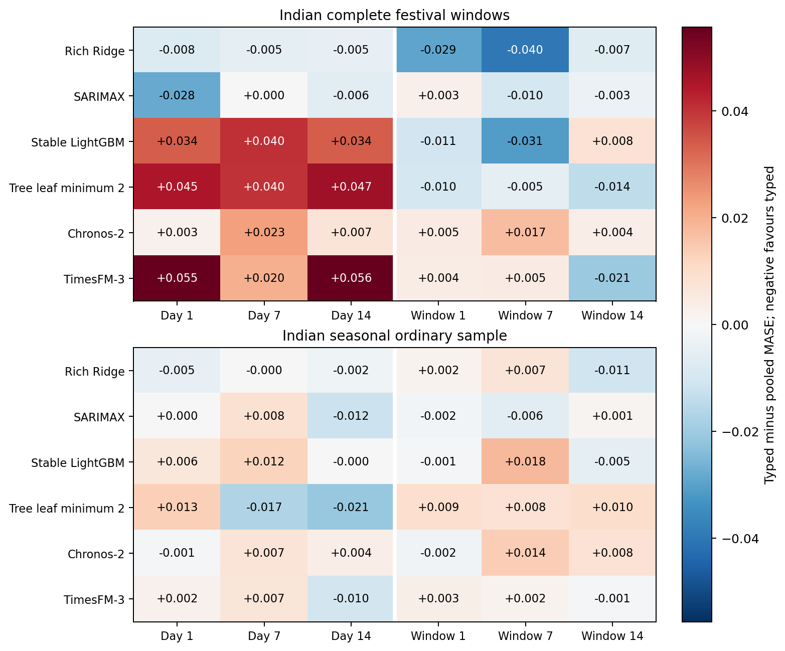
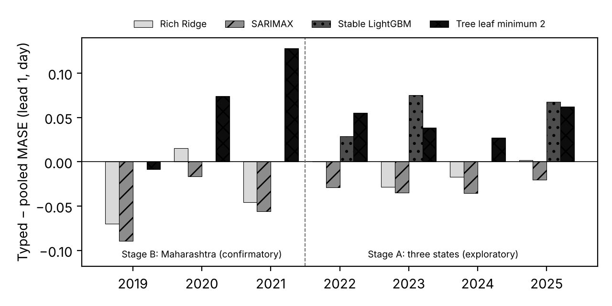

# Typed or pooled festival indicators? The answer depends on the model class: Indian electricity evidence with a pre-registered confirmation

Binay Verma

Affiliation: __________ . Corresponding author email: __________ .

**Draft for supervisor review (journal format, version 9). Not submitted. Two marked sections are pending.**

## Abstract

Forecasters who add festival indicators to a model must choose between one indicator per festival (typed) and one shared indicator (pooled). We compare the two for daily electricity in three Indian states, with matched zero-channel and placebo controls, for two foundation models and four local models. For the local models over four event years (1,056 festival-window cases, 20 family-year clusters), the better representation depends on the model class: LightGBM is better with a pooled flag (Holm p 0.029), SARIMAX leans towards typed flags and Ridge shows no ordering. Stated as a hypothesis and committed before new data were used, the SARIMAX preference was confirmed on unseen Maharashtra years 2019–2021 (Holm p 0.0307, all three years). The LightGBM test was uninformative, because the selected trees never split on the rare flags. Choosing the representation from last year's winner picked the worse one in 30 of 72 cases, while averaging the two forecasts gave the smallest worst-case regret.

**Keywords:** holiday effects; event covariates; load forecasting; time-series foundation models; forecast combination; pre-registration.

## Highlights

- Typed and pooled festival flags compared with matched zero and placebo controls
- Linear models prefer typed flags; tree models prefer one pooled flag
- SARIMAX typed preference confirmed on unseen years under a registered test
- Trees ignore rare flags unless their leaves may hold very few samples
- Averaging typed and pooled forecasts limits the worst-case loss

## 1. Introduction

Holidays and festivals are rare, recurring and heterogeneous. A forecaster who adds them to a model faces a choice that predates modern machine learning: give each named event its own indicator, so that each can have its own response, or pool them into one indicator, so that sparse events borrow strength from one another. In load forecasting the trade-off is familiar [9, 10]. Covariate-informed time-series foundation models (TSFMs) such as Chronos-2 [6] and TimesFM-3 [7] reopen it in a new form, because the model is not re-estimated: the forecaster controls only which channels are passed and how they are encoded [1, 2].

An earlier version of this study, with two event years and 10 family-year clusters, found that the ordering changed between years, models and data sources and that no ordering could be confirmed. This version doubles the evaluation period and adds a confirmatory step. Our contributions are:

1. **A matched comparison.** Typed and pooled festival indicators are compared for two pinned TSFMs and four local models on identical cases, with a calendar baseline, an equal-dimension zero-channel control and weekday-shifted placebos, so that gains from adding channels and gains from festival information can be separated (Sections 3 and 4).
2. **A model-class pattern over four years.** With 1,056 festival-window cases in 2022–2025 and hand-checked state calendars, the preferred representation depends on the model class (Section 5.2).
3. **A pre-registered confirmation.** The pattern was written down as a hypothesis and committed before three further event years were used; the SARIMAX part was confirmed, and the LightGBM part could not be tested, for a reason that explains the pattern itself (Section 5.3).
4. **Decision rules for unstable orderings.** Following last year's winner is unreliable, and an equal-weight average of the two representations limits the worst case (Section 6).

We do not propose a new architecture, claim causal holiday effects or claim contamination-free testing of pretrained models. Section 2 reviews related work, Section 3 the data and calendars, Section 4 the models and evaluation, Sections 5 and 6 the results, and Sections 7 to 9 reproducibility, limitations and conclusions.

## 2. Related work

**Holidays in load forecasting.** Ziel [9] compared one shared holiday dummy, grouped dummies and a separate dummy for each holiday for German load. He reported that many additional per-holiday dummies did not seem to improve on one additional dummy, with univariate results mixed by holiday type; in his multivariate comparison three models were not significantly worse than the best model forecast, M-RpH (a replacing design with one dummy per holiday), and the holiday-as-Saturday and holiday-as-Sunday designs were in most cases significantly worse than the best approach. Arora and Taylor [10] treat special days with rule-based seasonal ARMA models. Moving Indian holidays have been modelled in official manufacturing statistics [3].

**Covariates in foundation models.** Kreusel et al. [1] examine calendar encodings in Chronos-2 and TimesFM-3. Alipour et al. [2] learn impact-driven event representations from residual responses. Kaljevic et al. [4] benchmark TSFMs for load forecasting under covariate uncertainty.

**Forecast combination and evaluation.** Averaging forecasts goes back to Bates and Granger [11]; simple equal weights often perform as well as estimated weights [12]. We use equal weights only as a hedge between two representations. Meyer et al. [5] show that information leakage can affect TSFM evaluation. Pre-registration [15] separates hypotheses formed from data from those tested on new data.

Our study does not introduce typed or pooled indicators, which are established. It examines how that choice behaves under a fixed channel budget with zero and placebo controls, across model classes, and what a forecaster should do when the ordering is uncertain.

## 3. Data and calendars

### 3.1 Electricity data

The target is daily energy met/supplied in GWh for Delhi, Karnataka and Maharashtra, from a GRID-INDIA/POSOCO compilation. It is not latent unconstrained demand, household consumption or hourly peak load. Days with a missing or non-positive value are never scored.

### 3.2 Festival calendars

Five festival families are used: Holi, Dussehra, Ganesh Chaturthi, Ugadi/Gudi Padwa and Diwali, each in the states where it is a listed holiday; Diwali has a main anchor and a state-listed second day. Each calendar row records its source document and was checked by hand before use, and the code refuses unchecked rows. For 2022–2025, twelve retained annual state documents support an internal review of all 58 named dates: 54 match the declared family, two are explicit shared-national-main exceptions, one Karnataka 2025 date did not match, and one Maharashtra 2022 Gudi Padwa date could not be corroborated from the retained one-page schedule. The Karnataka notification labels Vijayadasami on 1 October 2025 while the original ledger used 2 October (Gandhi Jayanthi); a separately registered flag-only correction and recentering are reported in the supplement. Rows for 2017–2021 were added from state notifications and reproductions for the longer panel and checked by the author before registration; a check found, for example, that a reposted 2019 Maharashtra list gave 26 October for Laxmi Pujan, while the official date was 27 October. Visible notification dates are not certified first-publication histories, so it is not established that every flag was publicly known at each forecast origin.

### 3.3 Evaluation cohorts

For each festival anchor a ±3-day window is formed, overlapping windows are merged, and every target date in the window is forecast at leads 1, 7 and 14. Family-year combinations (clusters), not rows, are the effective event units. A seasonal ordinary sample takes the first eligible rotating weekday per month, state and year, outside festival windows. Table 1 lists the cohorts.

Table 1. Evaluation cohorts.

| Cohort | Role | States | Event years | Event cases | Ordinary cases | Clusters | Models |
| --- | --- | --- | --- | --- | --- | --- | --- |
| Two-year (Section 5.1) | exploratory | 3 | 2024–2025 | 528 | 216 | 10 | 6 |
| Stage A (Section 5.2) | exploratory | 3 | 2022–2025 | 1,056 | 432 | 20 | 4 local |
| Stage B (Section 5.3) | confirmatory | Maharashtra | 2019–2021 | 327 | – | 15 | 4 local |

### 3.4 NYC transit replication

The MTA daily ridership dataset (identifier sayj-mze2) provides Subway and Bus estimated counts. The protocol was committed before the evaluation records were acquired. The 84 event cases cover complete ±3-day windows around Yom Kippur and Columbus Day 2026, two modes and three decision leads; a fixed seven-day observation buffer maps decision leads 1/7/14 to model steps 8/14/21. Two observances in one city support a bounded robustness check only.

## 4. Models, representations and evaluation

### 4.1 Models

Chronos-2 and TimesFM-3 use pinned code and weights, 730 prior target days, fixed seeds, two CPU threads and no task fine-tuning. The four local specifications are a rich Ridge regression, a float32 LightGBM [14], a minimum-leaf-2 LightGBM sensitivity ("tree leaf minimum 2"), and SARIMAX(1,0,0)(1,0,0,7). Ridge and LightGBM use 27 past-only history features; their parameters are selected for each year, state and lead on the 180 days before the event year, with the ordinary calendar only and purged future labels, and are then shared by all arms, so arms differ only in their festival channels. Local models are refitted monthly while foundation models are frozen, so model rankings do not isolate architecture.

### 4.2 Representations and controls

Every arm keeps 13 ordinary calendar channels (seven weekday indicators and three annual harmonic pairs). Apart from the calendar arm, each main arm adds five channels:

- **calendar** (no festival information) and **calendar + five zeros** (equal dimension, no information);
- **typed day / typed window**: one indicator per family, on the festival day or on its ±3-day window;
- **pooled day / pooled window**: one shared indicator plus four zero channels;
- **typed day / window placebos**: the same indicators shifted by fixed seeded weekday-preserving offsets of four to six weeks that avoid true windows.

Three further local-model arms adapt Ziel's designs [9] (Section 5.5): **hSun** treats each anchor day as a Sunday; **Rph** adds the pooled day flag and sets all seven weekday dummies to zero on flagged days; **RpH** does the same with the five typed flags.

### 4.3 Error measure and tests

The error measure is MASE [13] with a fixed pre-year scale (the mean absolute weekly difference over the previous 730 days); imputed labels are never scored. Event summaries average errors within state/year/family, then states within year, years within family, and families equally. The main contrast is typed minus pooled MASE, so positive values favour pooling.

Because rows within a festival window are correlated, contrasts are tested with exact sign-flip permutation tests on family-year cluster means, enumerating all 2^n sign assignments, and Holm-adjusted [16]. With 10 clusters (Section 5.1) the smallest attainable two-sided p is 2/1,024, so Holm over 36 cells cannot go below 0.070; with 20 clusters (Stage A) it is 2/2^20 (about 1.9 × 10^-6), and Holm is applied over the eight lead-1 cells. A sign-flip test assumes cluster differences are symmetric about zero under the null; clusters in the same year share weather and source vintage, so the tests are approximate.

### 4.4 Registration sequence

Each stage was committed to the repository before its outcomes existed, and every worker checks the hashes of its inputs against the registered protocol before running. The order matters for interpreting Section 5: the Stage A protocol was committed at 13:23 UTC on 11 November 2026 and its results at 13:49; the model-class hypothesis (results/model_class_hypothesis_v1) was formed from those results and committed at 14:13, with its test, decision rule and a 2020 sensitivity fixed in advance; the Stage B protocol, carrying the hash of the hypothesis file, at 14:18; and the Stage B analysis at 14:25. These are local commit times; the commits were pushed to the public repository later, so the order rests on the author's commit history rather than an external timestamp. Stage A is therefore exploratory and Stage B confirmatory.

## 5. Results

### 5.1 Two event years with all six models

Table 2 gives the next-day comparison on the 528 festival-window cases of 2024–2025, and Figure 1 all leads. Festival information helps the local models: typed and pooled day flags lower Rich Ridge event MASE from 0.57699 to 0.45317 and 0.46093, and SARIMAX from 0.57301 to 0.42533 and 0.45345. Chronos-2 gains little; TimesFM-3 gains with both day flags (typed 0.48005, pooled 0.42459, against 0.55148 for calendar). Window indicators help little. The typed-minus-pooled contrast ranges from -0.03971 to 0.05564 across the 36 model/representation/lead cells and its sign is opposite between 2024 and 2025 in 19 cells (Appendix Table A4). Across the 36 cells, 3 reach a raw sign-flip p below 0.05, against 1.8 expected if every null were true; the smallest raw p is 0.0059 (TimesFM-3 day flags). With 10 clusters no ordering can be confirmed (Appendix Table A13). On ordinary days (Appendix Table A1) the arms differ less, but for both foundation models the day arms slightly raise ordinary-day MASE.

Table 2. 2024–2025 festival windows (document-aligned, recentered): lead-1 MASE.

| Model | Calendar | Typed day | Pooled day | Typed window | Pooled window |
| --- | --- | --- | --- | --- | --- |
| Rich Ridge | 0.57699 | 0.45317 | 0.46093 | 0.57914 | 0.60838 |
| SARIMAX | 0.57301 | 0.42533 | 0.45345 | 0.57787 | 0.57511 |
| Stable LightGBM | 0.69865 | 0.69483 | 0.66110 | 0.70168 | 0.71233 |
| Tree leaf minimum 2 | 0.68582 | 0.64952 | 0.60469 | 0.69028 | 0.70001 |
| Chronos-2 | 0.53767 | 0.52009 | 0.51752 | 0.53720 | 0.53268 |
| TimesFM-3 | 0.55148 | 0.48005 | 0.42459 | 0.55540 | 0.55131 |

### 5.2 Stage A: four event years

Two earlier event years (2022–2023) were added after the 2020–2021 calendars needed as their training history had been checked; this doubles the event cases to 1,056 and the clusters to 20. Parameters for the new years were selected by the unchanged pre-year procedure, and re-running the 2024–2025 subset reproduced the stored local forecasts (maximum difference 1.4 × 10^-13). Table 3 gives the lead-1 contrasts.

One cell passes the pre-set rule (Holm p below 0.05 and the same sign in at least three of four years): Stable LightGBM is better with the pooled day flag (+0.0429, Holm p 0.029; 2024 is an exact tie). The leaf-2 LightGBM points the same way in all four years (+0.0458, Holm p 0.063), and SARIMAX points the other way in all four years (−0.0300, raw p 0.0266, Holm p 0.160). Rich Ridge shows no ordering. Leaving out any one festival family does not change the sign of these three day contrasts. The window representations show no clear ordering. Over all 24 model/representation/lead cells, 6 have a raw p below 0.05 and none survives Holm over 24.

The controls behave as intended (Table 4): the zero-channel and placebo arms stay within 0.0028 of the calendar arm for every local model, whereas typed and pooled day flags lower Rich Ridge and SARIMAX MASE by more than 0.1. The gains therefore come from the festival dates, not from extra channels.

Table 3. Stage A (2022–2025, 20 clusters): lead-1 typed minus pooled MASE, balanced over all years and by year. Positive favours pooling. LGBM: Stable LightGBM; LGBM-2: tree leaf minimum 2. Same sign: years agreeing with the all-years sign. p: exact two-sided sign-flip; Holm over the eight lead-1 cells. Typed and pooled MASE are in Table 4.

| Model | Rep. | All years | 2022 | 2023 | 2024 | 2025 | Same sign | p | Holm p |
| --- | --- | --- | --- | --- | --- | --- | --- | --- | --- |
| Ridge | day | −0.0109 | +0.0001 | −0.0283 | −0.0173 | +0.0018 | 2/4 | 0.1959 | 0.588 |
| Ridge | window | −0.0084 | +0.0153 | +0.0096 | −0.0448 | −0.0137 | 2/4 | 0.5662 | 0.677 |
| SARIMAX | day | −0.0300 | −0.0287 | −0.0351 | −0.0356 | −0.0206 | 4/4 | 0.0266 | 0.160 |
| SARIMAX | window | +0.0052 | +0.0098 | +0.0054 | +0.0090 | −0.0035 | 3/4 | 0.3386 | 0.677 |
| LGBM | day | +0.0429 | +0.0288 | +0.0751 | 0.0000 | +0.0675 | 3/4 | 0.0036 | 0.029 |
| LGBM | window | −0.0150 | −0.0156 | −0.0232 | −0.0232 | +0.0019 | 3/4 | 0.0934 | 0.467 |
| LGBM-2 | day | +0.0458 | +0.0551 | +0.0385 | +0.0272 | +0.0624 | 4/4 | 0.0090 | 0.063 |
| LGBM-2 | window | −0.0143 | −0.0052 | −0.0326 | −0.0178 | −0.0016 | 4/4 | 0.1284 | 0.513 |

Table 4. Stage A controls: lead-1 event MASE.

| Model | Calendar | + zeros | Placebo | Typed day | Pooled day | Typed window | Pooled window |
| --- | --- | --- | --- | --- | --- | --- | --- |
| Rich Ridge | 0.60902 | 0.60902 | 0.60979 | 0.49107 | 0.50200 | 0.61942 | 0.62783 |
| SARIMAX | 0.62374 | 0.62374 | 0.62393 | 0.48087 | 0.51090 | 0.63438 | 0.62920 |
| Stable LightGBM | 0.73719 | 0.73719 | 0.73719 | 0.73528 | 0.69242 | 0.73110 | 0.74611 |
| Tree leaf minimum 2 | 0.73341 | 0.73341 | 0.73473 | 0.71033 | 0.66452 | 0.72915 | 0.74346 |

### 5.3 Stage B: confirmatory test on unseen years

Because the model-class pattern was found in the Stage A data, it was stated as a hypothesis before any new test data were used: H1, Stable LightGBM favours the pooled day flag; H2, SARIMAX favours typed day flags; H1b (secondary), the same as H1 for the leaf-2 LightGBM; H3, Ridge, reported only. The test data are Maharashtra event years 2019–2021, unseen by every model and arm, with 2017–2021 calendars checked by hand (327 cases, 15 clusters, no missing labels). The decision rule was fixed in advance: one-sided exact sign-flip p over 15 clusters, Holm across H1 and H2, and the sign must hold in at least two of three years; the COVID year 2020 is removed as a pre-declared sensitivity.

Table 5 gives the result. H2 is confirmed (−0.0539, one-sided p 0.0154, Holm p 0.0307, all three years) and still holds without 2020 (−0.0726, Holm p 0.0137). H1 is exactly zero, which makes the test uninformative rather than evidence against H1: for lead 1 the pre-year selection chose a minimum of 20 samples per leaf in all three years, while a festival flag is set on at most about 12 of the 730 training days, so no tree splits on any festival column and every arm gives the same forecast (balanced MASE 0.98138 for all five arms, Table 6). The same mechanism explains the exact tie in Stage A's 2024. It could have been anticipated from that tie but was not written into the registration, so the registered decision stands. The leaf-2 LightGBM, whose trees can use the flags, favours pooling (+0.0648, unadjusted one-sided p 0.0197, two of three years), but not without 2020 (+0.0600, p 0.0889). Rich Ridge favours typed flags in Maharashtra (−0.0335), unlike Stage A. Figure 2 shows the yearly contrasts across both stages.

Table 5. Stage B (Maharashtra 2019–2021, 15 clusters): registered hypothesis tests at lead 1 (day flags), typed minus pooled MASE. H1 and H1b expect a positive value (pooling better), H2 a negative one. H1b is secondary and not Holm-adjusted. Decision rule: Holm p below 0.05 and the expected sign in at least two of three years.

| Hyp. | Model | All years | 2019 | 2020 | 2021 | One-sided p | Holm p | Decision | Without 2020 |
| --- | --- | --- | --- | --- | --- | --- | --- | --- | --- |
| H1 | LGBM | 0.0000 | 0.0000 | 0.0000 | 0.0000 | 1.0000 | 1.0000 | not confirmed | not confirmed |
| H2 | SARIMAX | −0.0539 | −0.0893 | −0.0166 | −0.0558 | 0.0154 | 0.0307 | confirmed | confirmed |
| H1b | LGBM-2 | +0.0648 | −0.0082 | +0.0743 | +0.1282 | 0.0197 | – | confirmed | not confirmed |

Table 6. Stage B controls: lead-1 event MASE (Maharashtra 2019–2021).

| Model | Calendar | + zeros | Placebo | Typed day | Pooled day |
| --- | --- | --- | --- | --- | --- |
| Rich Ridge | 0.72425 | 0.72425 | 0.72361 | 0.55409 | 0.58762 |
| SARIMAX | 0.73161 | 0.73161 | 0.73105 | 0.53395 | 0.58787 |
| Stable LightGBM | 0.98138 | 0.98138 | 0.98138 | 0.98138 | 0.98138 |
| Tree leaf minimum 2 | 0.98711 | 0.98711 | 0.98690 | 0.98199 | 0.91722 |

### 5.4 Foundation models over four years

**[Pending: foundation models on 2022–2023.]** A registered run (results/longer_panel_foundation_v1, commit 5f71883) extends Chronos-2 and TimesFM-3 to the Stage A years, with a reproduction check on 2024. Its results will be inserted here; until then, the foundation-model evidence is limited to 2024–2025 (Section 5.1).

### 5.5 Closest-method comparators

Ziel's designs (Table 7) improve on the calendar baseline in all 12 Indian local model/lead cells for each design in 2024–2025, but the additive typed and pooled day flags also do so in 22 of their 24 cells, and the replacing designs differ consistently from the additive flags they carry in only 3 (Rph) and 4 (RpH) of 12 cells. For SARIMAX and Rich Ridge the typed replacing design (RpH) has the lowest lead-1 MASE among the arms in Table 7, which agrees with the typed preference of the linear models. In NYC event windows hSun raises MASE relative to calendar in all 12 local cells, and Rph and RpH in 9 and 6 of 12.

Table 7. Ziel adaptations on Indian festival windows (2024–2025): local-model lead-1 MASE. The first three columns equal Table 2.

| Model | Calendar | Typed day | Pooled day | hSun | Rph | RpH |
| --- | --- | --- | --- | --- | --- | --- |
| Rich Ridge | 0.57699 | 0.45317 | 0.46093 | 0.46375 | 0.44589 | 0.43854 |
| SARIMAX | 0.57301 | 0.42533 | 0.45345 | 0.45329 | 0.43439 | 0.41492 |
| Stable LightGBM | 0.69865 | 0.69483 | 0.66110 | 0.59277 | 0.64334 | 0.66625 |
| Tree leaf minimum 2 | 0.68582 | 0.64952 | 0.60469 | 0.59895 | 0.59529 | 0.62115 |

### 5.6 NYC replication

Table 8 repeats the main comparison on NYC. Within NYC, 36 of 144 family/mode/step cells favour pooling, 96 favour separate identities and 12 tie. India (2024–2025) and NYC agree in sign in 22 of 36 cells, are opposite in 11 and tie in 3. SARIMAX typed-day flags improve on calendar while pooled-day flags worsen it, consistent with the confirmed Indian result; Rich Ridge also prefers typed flags in NYC, while Chronos-2 prefers pooled.

Table 8. NYC event windows: decision lead 1 (model step 8), MASE.

| Model | Calendar | Typed day | Pooled day | Typed window | Pooled window |
| --- | --- | --- | --- | --- | --- |
| Rich Ridge | 0.99718 | 1.00451 | 1.16887 | 1.19074 | 1.31328 |
| SARIMAX | 0.99947 | 0.79417 | 1.04067 | 1.15250 | 1.40939 |
| Stable LightGBM | 0.91940 | 0.91940 | 0.91940 | 0.91940 | 1.08484 |
| Tree leaf minimum 2 | 0.84819 | 0.84610 | 0.87819 | 0.88083 | 1.02851 |
| Chronos-2 | 0.93276 | 0.86384 | 0.76003 | 0.93928 | 0.92961 |
| TimesFM-3 | 0.88394 | 0.75636 | 0.79143 | 0.86121 | 0.91833 |

## 6. What should a forecaster do?

If the better representation is uncertain, choosing it from past performance may not help. Using stored forecasts only, we compare always-typed, always-pooled, an equal-weight average of the typed and pooled point forecasts, and a rule that uses each year whichever representation had the lower balanced MASE in the previous year. Regret is MASE minus that of the better representation in hindsight for the same cell; it can be negative for the average. The rules were chosen after the instability had been observed, so this analysis is exploratory.

Over the 72 Stage A decision cells (four local models, two representations, three leads, three years with a previous year), following last year's winner picks the worse representation in 30 cells. Mean regret is 0.0118 for the follow rule, 0.0151 for always-typed, 0.0126 for always-pooled and 0.0075 for the average; the largest regret is 0.157, 0.157, 0.082 and 0.040 respectively (Table 9). The 2024–2025 cohort with all six models (Appendix Table A11) and NYC (Appendix Table A12) give the same picture for the worst case: the largest regret of the average is below that of both fixed choices in both sources (India 0.0219 against 0.0556 and 0.0397; NYC 0.1495 against 0.1514 and 0.3444).

By construction, the absolute error of an equal-weight average is at most the mean of the two absolute errors, so the average cannot be worse than the worse representation; its advantage is in limiting the worst case, not a new method. Combined with the model-class result, the practical advice is to use typed flags with linear models, a pooled flag with tree models whose settings allow small leaves, and the average when neither is known to fit.

Table 9. Stage A decision rules over 72 cells (regret in MASE relative to the hindsight-better representation).

| Rule | Mean regret | Largest regret |
| --- | --- | --- |
| Always typed | 0.0151 | 0.157 |
| Always pooled | 0.0126 | 0.082 |
| Follow last year's winner | 0.0118 | 0.157 |
| Average of typed and pooled | 0.0075 | 0.040 |

## 7. Uncertainty and reproducibility

Both foundation models are compared on their native quantiles 0.1–0.9 for 2024–2025 (Appendix Table A9); family/year coverage of the nominal 80% interval falls below 0.80 in 85 of 100 cluster/arm cells (Appendix Table A10). Complete clean-environment reruns of all 5,952 direct-comparator forecasts and 2,560 simulation cells are byte-identical, and Stage A reproduced the stored 2024–2025 local forecasts to 1.4 × 10^-13. These are internal software checks, not independent review. Failures are retained with notes next to the results: in Stage B, one parameter-selection run stopped at import after an environment reset, a second could not write its final log because of a relative path (its integrity check had passed and all 16 protected inputs were re-checked), and two workers did not start on the first launch; none changed a forecast.

**[Pending: frozen prospective forecasts.]** Forecasts frozen before their targets existed (31 October–11 November 2026) are to be scored with the first complete actual vintage from 12 November 2026. They do not test the typed-versus-pooled hypothesis directly.

## 8. Limitations

The evidence covers three states, five festival families and a few hundred festival days. Stage B uses one state, so the confirmed SARIMAX result is not yet shown for Delhi or Karnataka, and its 15 clusters give limited power. The LightGBM hypothesis could not be tested in Stage B, and the cause was visible in Stage A. The registration order rests on local commit history (Section 4.4). Foundation models are evaluated on 2024–2025 only until the pending run is added. Weather, supply constraints, coincident observances, source revisions and calendar amendments are alternative explanations; local models are refitted monthly and foundation models are frozen; weight dates do not rule out correlated pretraining exposure [5]. The decision-rule analysis is retrospective and covers only simple rules. The reuse terms of the electricity compilation are unresolved.

## 9. Conclusion

Festival day flags clearly improve the local models over a plain calendar, beyond what zero or placebo channels give. Whether typed or pooled flags are better depends on the model class. SARIMAX prefers typed flags, and this was confirmed on unseen years under a pre-registered test. Tree models prefer a pooled flag, but only when their settings let them split on rare events; with the larger minimum leaf size selected in Stage B they ignored festival flags altogether. A forecaster who cannot tell in advance which representation will win can average the two forecasts to limit the worst case. Testing the tree-model hypothesis needs a registered design in which the trees can use the flags.

## Declarations

**Data availability.** Code, protocols, forecasts, failures and audits are at https://github.com/Binay-verma/tsaf_project. The GRID-INDIA/POSOCO compilation curated by Robbie Andrew is in the repository; its reuse terms are unresolved. The MTA snapshot is an attributed minimal filtered extract. Model weights are not redistributed.

**Funding.** __________ [author to confirm].

**Competing interests.** __________ [author to confirm].

**Author contribution.** Binay Verma: __________ [author to complete, CRediT roles].

**Use of generative AI.** __________ [author to complete according to the journal's policy before submission].

## References

[1] Kreusel et al. (2026). On the Encoding of Calendar Features in Covariate-Informed Time Series Foundation Models. arXiv:2610.13676v1. https://arxiv.org/abs/2610.13676

[2] Alipour et al. Impact-driven event covariates for time-series foundation models. https://www.amazon.science/publications/impact-driven-event-covariates-for-time-series-foundation-models

[3] Sanyal, Mitra, McElroy and Roy (2017). Holiday Effects in Indian Manufacturing Series. U.S. Census Bureau RRS2017-04. https://www.census.gov/library/working-papers/2017/adrm/rrs2017-04.html

[4] Kaljevic, Arzola and Zhang (2026). Benchmarking Time Series Foundation Models for Load Forecasting Under Covariate Uncertainty. arXiv:2610.07232v1. https://arxiv.org/abs/2610.07232

[5] Meyer et al. Rethinking Evaluation in the Era of Time Series Foundation Models: (Un)known Information Leakage Challenges. arXiv:2510.13654v3. https://arxiv.org/abs/2510.13654

[6] Ansari et al. (2025). Chronos-2: From Univariate to Universal Forecasting. arXiv:2510.15821v1. https://arxiv.org/abs/2510.15821

[7] Jain and Sen (2026). TimesFM-3: A zero-shot foundation model for multivariate forecasting. Google Research. https://research.google/blog/timesfm-3-a-zero-shot-foundation-model-for-multivariate-forecasting/

[8] Romano, Patterson and Candès (2019). Conformalized Quantile Regression. arXiv:1905.03222v1. https://arxiv.org/abs/1905.03222

[9] Ziel (2018). Modeling public holidays in load forecasting: a German case study. Journal of Modern Power Systems and Clean Energy 6(2), 191–207. https://doi.org/10.1007/s40565-018-0385-5

[10] Arora and Taylor (2018). Rule-based autoregressive moving average models for forecasting load on special days: A case study for France. European Journal of Operational Research 266(1), 259–268. https://doi.org/10.1016/j.ejor.2017.08.056

[11] Bates and Granger (1969). The combination of forecasts. Operational Research Quarterly 20(4), 451–468. https://doi.org/10.1057/jors.1969.103

[12] Claeskens, Magnus, Vasnev and Wang (2016). The forecast combination puzzle: A simple theoretical explanation. International Journal of Forecasting 32(3), 754–762. https://doi.org/10.1016/j.ijforecast.2015.12.005

[13] Hyndman and Koehler (2006). Another look at measures of forecast accuracy. International Journal of Forecasting 22(4), 679–688. https://doi.org/10.1016/j.ijforecast.2006.03.001

[14] Ke et al. (2017). LightGBM: A highly efficient gradient boosting decision tree. Advances in Neural Information Processing Systems 30, 3146–3154.

[15] Nosek, Ebersole, DeHaven and Mellor (2018). The preregistration revolution. Proceedings of the National Academy of Sciences 115(11), 2600–2606. https://doi.org/10.1073/pnas.1708274114

[16] Holm (1979). A simple sequentially rejective multiple test procedure. Scandinavian Journal of Statistics 6(2), 65–70.

## Appendix A. Companion tables

Table A1. 2024–2025 seasonal ordinary sample: lead-1 MASE.

| Model | Calendar | Typed day | Pooled day | Typed window | Pooled window |
| --- | --- | --- | --- | --- | --- |
| Rich Ridge | 0.28458 | 0.27908 | 0.28363 | 0.28887 | 0.28709 |
| SARIMAX | 0.23073 | 0.22949 | 0.22910 | 0.22995 | 0.23155 |
| Stable LightGBM | 0.39366 | 0.39545 | 0.38932 | 0.39507 | 0.39604 |
| Tree leaf minimum 2 | 0.39178 | 0.37852 | 0.36518 | 0.38876 | 0.37951 |
| Chronos-2 | 0.24924 | 0.26482 | 0.26567 | 0.26108 | 0.26287 |
| TimesFM-3 | 0.26547 | 0.26931 | 0.26685 | 0.26196 | 0.25877 |

Table A2. NYC ordinary sample: decision lead 1 (model step 8), MASE.

| Model | Calendar | Typed day | Pooled day | Typed window | Pooled window |
| --- | --- | --- | --- | --- | --- |
| Rich Ridge | 0.93022 | 0.82514 | 0.74570 | 0.82214 | 0.69602 |
| SARIMAX | 0.69848 | 0.57159 | 0.53110 | 0.61851 | 0.54580 |
| Stable LightGBM | 0.83653 | 0.83653 | 0.83653 | 0.83653 | 0.75887 |
| Tree leaf minimum 2 | 0.76625 | 0.75037 | 0.71580 | 0.72767 | 0.71070 |
| Chronos-2 | 0.32126 | 0.35468 | 0.37401 | 0.31593 | 0.40822 |
| TimesFM-3 | 0.36890 | 0.40051 | 0.39322 | 0.33823 | 0.35082 |

Table A3. Fixed response-profile comparators on the original Indian case ledger (separate, unchanged sensitivity).

| Method | Lead 1 | Lead 7 | Lead 14 |
| --- | --- | --- | --- |
| response_none | 1.05617 | 1.05617 | 1.12777 |
| response_partial | 0.99059 | 1.04974 | 1.08356 |
| response_pooled | 1.04499 | 1.06250 | 1.11693 |
| response_typed | 1.02429 | 1.11325 | 1.11001 |

Table A4. 2024–2025 typed-minus-pooled MASE at lead 1 by event year and family. Positive favours pooling. LOFO: leave-one-family-out balanced contrast.

| Model | Rep. | Balanced | 2024 | 2025 | Pooled / typed clusters | LOFO range |
| --- | --- | --- | --- | --- | --- | --- |
| Rich Ridge | day | -0.00776 | -0.01727 | 0.00175 | 3 / 7 | -0.01819 to -0.00060 |
| Rich Ridge | window | -0.02924 | -0.04483 | -0.01365 | 4 / 6 | -0.04266 to -0.01290 |
| SARIMAX | day | -0.02812 | -0.03562 | -0.02063 | 4 / 6 | -0.04526 to -0.00690 |
| SARIMAX | window | 0.00276 | 0.00899 | -0.00347 | 4 / 6 | -0.00285 to 0.00699 |
| Stable LightGBM | day | 0.03374 | 0.00000 | 0.06747 | 4 / 1 | 0.02864 to 0.04316 |
| Stable LightGBM | window | -0.01065 | -0.02319 | 0.00190 | 4 / 6 | -0.01804 to -0.00069 |
| Tree leaf minimum 2 | day | 0.04483 | 0.02723 | 0.06242 | 7 / 3 | 0.03075 to 0.07359 |
| Tree leaf minimum 2 | window | -0.00973 | -0.01785 | -0.00161 | 6 / 4 | -0.01763 to 0.00141 |
| Chronos-2 | day | 0.00257 | -0.00069 | 0.00583 | 8 / 2 | -0.00191 to 0.01638 |
| Chronos-2 | window | 0.00452 | 0.00740 | 0.00163 | 6 / 4 | 0.00082 to 0.00828 |
| TimesFM-3 | day | 0.05546 | 0.06834 | 0.04257 | 9 / 1 | 0.04781 to 0.06439 |
| TimesFM-3 | window | 0.00409 | 0.00895 | -0.00078 | 8 / 2 | 0.00227 to 0.00627 |

Table A5. Day-representation lead-1 Spearman diagnostics of past support and response heterogeneity. n counts family/state/year cells, not independent replications.

| Model | Support rho | Support n | Response rho | Response n |
| --- | --- | --- | --- | --- |
| Rich Ridge | 0.05912 | 24 | 0.15478 | 24 |
| SARIMAX | 0.46684 | 24 | 0.12087 | 24 |
| Stable LightGBM | 0.30970 | 24 | 0.01451 | 24 |
| Tree leaf minimum 2 | 0.37794 | 24 | 0.08000 | 24 |
| Chronos-2 | -0.04204 | 24 | 0.17391 | 24 |
| TimesFM-3 | 0.10992 | 24 | -0.02174 | 24 |

Table A6. Pure daily calendar encodings for the foundation models on 2024–2025 festival windows, lead-1 MASE.

| Encoding | Chronos-2 | TimesFM-3 |
| --- | --- | --- |
| history | 0.54769 | 0.55366 |
| zero1 | 0.55892 | 0.55616 |
| ordinal | 0.51574 | 0.42608 |
| onehot | 0.51171 | 0.43188 |
| cyclic | 0.51636 | 0.45004 |
| te_weekday | 0.56433 | 0.55172 |
| te_sunday | 0.51563 | 0.42528 |
| te_holiday | 0.52400 | 0.39840 |
| te_joint | 0.53781 | 0.44470 |
| te_separate | 0.52832 | 0.41227 |
| calendar | 0.53767 | 0.55148 |

Table A7. Ziel adaptations on NYC event windows: decision lead 1, local-model MASE.

| Model | Calendar | Typed day | Pooled day | hSun | Rph | RpH |
| --- | --- | --- | --- | --- | --- | --- |
| Rich Ridge | 0.99718 | 1.00451 | 1.16887 | 1.09958 | 1.25617 | 1.03266 |
| SARIMAX | 0.99947 | 0.79417 | 1.04067 | 1.31300 | 1.02060 | 0.87342 |
| Stable LightGBM | 0.91940 | 0.91940 | 0.91940 | 0.97497 | 0.94489 | 0.94489 |
| Tree leaf minimum 2 | 0.84819 | 0.84610 | 0.87819 | 0.97599 | 0.86605 | 0.91324 |

Table A8. Lead-1 contrasts for the Ziel adaptations, India (top) and NYC (bottom, modes in place of years). Negative favours the first arm.

| Model | Contrast | Balanced | 2024 | 2025 | LOFO range | Label |
| --- | --- | --- | --- | --- | --- | --- |
| Rich Ridge | hSun − pooled day | 0.00281 | 0.00109 | 0.00454 | -0.01393 to 0.02915 | negligible |
| Rich Ridge | Rph − pooled day | -0.01504 | -0.01297 | -0.01712 | -0.01786 to -0.01059 | consistent |
| Rich Ridge | RpH − typed day | -0.01463 | 0.01235 | -0.04161 | -0.02383 to -0.00173 | unstable |
| Rich Ridge | RpH − Rph | -0.00735 | 0.00804 | -0.02274 | -0.02726 to 0.00756 | unstable |
| SARIMAX | hSun − pooled day | -0.00016 | 0.02551 | -0.02582 | -0.01257 to 0.02889 | negligible |
| SARIMAX | Rph − pooled day | -0.01905 | 0.01441 | -0.05252 | -0.02450 to -0.00273 | unstable |
| SARIMAX | RpH − typed day | -0.01041 | 0.02030 | -0.04112 | -0.02160 to 0.00749 | unstable |
| SARIMAX | RpH − Rph | -0.01948 | -0.02973 | -0.00922 | -0.03008 to 0.00193 | unstable |
| Stable LightGBM | hSun − pooled day | -0.06832 | -0.09185 | -0.04480 | -0.07478 to -0.05970 | consistent |
| Stable LightGBM | Rph − pooled day | -0.01775 | -0.00914 | -0.02637 | -0.02282 to -0.00821 | consistent |
| Stable LightGBM | RpH − typed day | -0.02858 | -0.00914 | -0.04803 | -0.03655 to -0.01424 | consistent |
| Stable LightGBM | RpH − Rph | 0.02290 | 0.00000 | 0.04581 | 0.01638 to 0.03713 | unstable |
| Tree leaf minimum 2 | hSun − pooled day | -0.00574 | 0.01585 | -0.02733 | -0.02179 to 0.00874 | unstable |
| Tree leaf minimum 2 | Rph − pooled day | -0.00940 | 0.01465 | -0.03345 | -0.01458 to -0.00420 | unstable |
| Tree leaf minimum 2 | RpH − typed day | -0.02837 | -0.00887 | -0.04787 | -0.03504 to -0.02112 | consistent |
| Tree leaf minimum 2 | RpH − Rph | 0.02586 | 0.00372 | 0.04800 | 0.00871 to 0.05995 | consistent |

| Model | Contrast | Balanced | Bus | Subway | LOFO range | Label |
| --- | --- | --- | --- | --- | --- | --- |
| Rich Ridge | hSun − pooled day | -0.06929 | -0.16887 | 0.03029 | -0.10211 to -0.03647 | unstable |
| Rich Ridge | Rph − pooled day | 0.08730 | 0.06703 | 0.10757 | 0.06802 to 0.10658 | consistent |
| Rich Ridge | RpH − typed day | 0.02816 | -0.04323 | 0.09955 | 0.01199 to 0.04432 | unstable |
| Rich Ridge | RpH − Rph | -0.22351 | -0.25205 | -0.19496 | -0.32138 to -0.12563 | consistent |
| SARIMAX | hSun − pooled day | 0.27233 | 0.29639 | 0.24827 | 0.26394 to 0.28072 | consistent |
| SARIMAX | Rph − pooled day | -0.02007 | 0.00345 | -0.04358 | -0.02622 to -0.01391 | unstable |
| SARIMAX | RpH − typed day | 0.07925 | 0.08910 | 0.06940 | 0.00484 to 0.15365 | consistent |
| SARIMAX | RpH − Rph | -0.14719 | -0.14985 | -0.14452 | -0.21144 to -0.08293 | consistent |
| Stable LightGBM | hSun − pooled day | 0.05557 | 0.05085 | 0.06030 | -0.18779 to 0.29894 | unstable |
| Stable LightGBM | Rph − pooled day | 0.02549 | 0.06735 | -0.01636 | -0.03794 to 0.08893 | unstable |
| Stable LightGBM | RpH − typed day | 0.02549 | 0.06735 | -0.01636 | -0.03794 to 0.08893 | unstable |
| Stable LightGBM | RpH − Rph | 0.00000 | 0.00000 | 0.00000 | 0.00000 to 0.00000 | negligible |
| Tree leaf minimum 2 | hSun − pooled day | 0.09779 | 0.03509 | 0.16049 | -0.03651 to 0.23210 | unstable |
| Tree leaf minimum 2 | Rph − pooled day | -0.01214 | -0.01049 | -0.01380 | -0.01631 to -0.00797 | consistent |
| Tree leaf minimum 2 | RpH − typed day | 0.06714 | 0.09603 | 0.03825 | 0.05458 to 0.07970 | consistent |
| Tree leaf minimum 2 | RpH − Rph | 0.04719 | 0.03239 | 0.06198 | -0.08911 to 0.18349 | unstable |

Table A9. Native 2024–2025 festival-window 80% intervals at lead 1.

| Model | Arm | Coverage 80% | Scaled width | Scaled WIS80 |
| --- | --- | --- | --- | --- |
| Chronos-2 | Calendar | 0.70714 | 1.44736 | 0.36718 |
| Chronos-2 | Typed day | 0.73466 | 1.44335 | 0.35160 |
| Chronos-2 | Pooled day | 0.72619 | 1.45710 | 0.34982 |
| Chronos-2 | Pooled window | 0.73228 | 1.48578 | 0.36511 |
| Chronos-2 | Typed window | 0.72381 | 1.45537 | 0.36526 |
| TimesFM-3 | Calendar | 0.65926 | 1.21333 | 0.38483 |
| TimesFM-3 | Typed day | 0.70238 | 1.23353 | 0.32158 |
| TimesFM-3 | Pooled day | 0.70741 | 1.16836 | 0.27890 |
| TimesFM-3 | Pooled window | 0.63651 | 1.19181 | 0.38615 |
| TimesFM-3 | Typed window | 0.64735 | 1.21759 | 0.38944 |

Table A10. Native 80% coverage across the ten 2024–2025 family/year clusters at lead 1.

| Model | Arm | Minimum | Maximum | Clusters below 0.80 |
| --- | --- | --- | --- | --- |
| Chronos-2 | Calendar | 0.429 | 0.857 | 8 of 10 |
| Chronos-2 | Typed day | 0.500 | 0.857 | 8 of 10 |
| Chronos-2 | Pooled day | 0.357 | 0.929 | 7 of 10 |
| Chronos-2 | Typed window | 0.500 | 0.929 | 8 of 10 |
| Chronos-2 | Pooled window | 0.429 | 0.929 | 8 of 10 |
| TimesFM-3 | Calendar | 0.357 | 0.786 | 10 of 10 |
| TimesFM-3 | Typed day | 0.500 | 0.841 | 9 of 10 |
| TimesFM-3 | Pooled day | 0.500 | 0.926 | 7 of 10 |
| TimesFM-3 | Typed window | 0.357 | 0.786 | 10 of 10 |
| TimesFM-3 | Pooled window | 0.357 | 0.786 | 10 of 10 |

Table A11. 2024–2025, lead 1: balanced MASE over both years for typed, pooled and their average, and 2025 regret of the follow-2024 rule and of the average.

| Model | Rep. | Typed | Pooled | Average | 2025: follow-2024 regret | 2025: average regret |
| --- | --- | --- | --- | --- | --- | --- |
| Rich Ridge | day | 0.45317 | 0.46093 | 0.44120 | 0.00175 | -0.00851 |
| Rich Ridge | window | 0.57914 | 0.60838 | 0.59121 | 0.00000 | 0.00556 |
| SARIMAX | day | 0.42533 | 0.45345 | 0.42381 | 0.00000 | -0.00755 |
| SARIMAX | window | 0.57787 | 0.57511 | 0.57600 | 0.00347 | 0.00146 |
| Stable LightGBM | day | 0.69483 | 0.66110 | 0.67386 | 0.00000 | 0.02554 |
| Stable LightGBM | window | 0.70168 | 0.71233 | 0.70648 | 0.00190 | -0.00011 |
| Tree leaf minimum 2 | day | 0.64952 | 0.60469 | 0.61833 | 0.00000 | 0.02907 |
| Tree leaf minimum 2 | window | 0.69028 | 0.70001 | 0.69454 | 0.00000 | -0.00025 |
| Chronos-2 | day | 0.52009 | 0.51752 | 0.51755 | 0.00583 | 0.00258 |
| Chronos-2 | window | 0.53720 | 0.53268 | 0.53414 | 0.00000 | 0.00016 |
| TimesFM-3 | day | 0.48005 | 0.42459 | 0.43142 | 0.00000 | 0.00747 |
| TimesFM-3 | window | 0.55540 | 0.55131 | 0.55269 | 0.00078 | -0.00042 |

Table A12. NYC, decision lead 1: balanced MASE for typed, pooled and their equal-weight average.

| Model | Rep. | Typed | Pooled | Average |
| --- | --- | --- | --- | --- |
| Rich Ridge | day | 1.00451 | 1.16887 | 1.02581 |
| Rich Ridge | window | 1.19074 | 1.31328 | 1.23075 |
| SARIMAX | day | 0.79417 | 1.04067 | 0.90579 |
| SARIMAX | window | 1.15250 | 1.40939 | 1.24590 |
| Stable LightGBM | day | 0.91940 | 0.91940 | 0.91940 |
| Stable LightGBM | window | 0.91940 | 1.08484 | 0.98199 |
| Tree leaf minimum 2 | day | 0.84610 | 0.87819 | 0.79478 |
| Tree leaf minimum 2 | window | 0.88083 | 1.02851 | 0.94701 |
| Chronos-2 | day | 0.86384 | 0.76003 | 0.81194 |
| Chronos-2 | window | 0.93928 | 0.92961 | 0.93444 |
| TimesFM-3 | day | 0.75636 | 0.79143 | 0.59071 |
| TimesFM-3 | window | 0.86121 | 0.91833 | 0.88977 |

Table A13. 2024–2025 typed-minus-pooled MASE at lead 1 with family-year clusters as units. The t interval is descriptive and unadjusted (df 9). Sign-flip p: exact two-sided test over 1,024 sign assignments; Holm across all 36 cells (smallest attainable 0.070); year-change p: sign-flip over 5 family-level (2025 minus 2024) differences.

| Model | Rep. | Mean (10 clusters) | 95% t interval | Sign-flip p | Holm p | Year-change p |
| --- | --- | --- | --- | --- | --- | --- |
| Rich Ridge | day | -0.00776 | -0.03177 to 0.01625 | 0.4688 | 1.0000 | 0.3125 |
| Rich Ridge | window | -0.02924 | -0.07169 to 0.01321 | 0.1367 | 1.0000 | 0.5000 |
| SARIMAX | day | -0.02812 | -0.07205 to 0.01581 | 0.1855 | 1.0000 | 0.6250 |
| SARIMAX | window | 0.00276 | -0.01040 to 0.01592 | 0.6406 | 1.0000 | 0.0625 |
| Stable LightGBM | day | 0.03374 | 0.00070 to 0.06678 | 0.1250 | 1.0000 | 0.1250 |
| Stable LightGBM | window | -0.01065 | -0.03528 to 0.01398 | 0.4082 | 1.0000 | 0.2500 |
| Tree leaf minimum 2 | day | 0.04483 | -0.00982 to 0.09948 | 0.0996 | 1.0000 | 0.4375 |
| Tree leaf minimum 2 | window | -0.00973 | -0.04074 to 0.02128 | 0.4941 | 1.0000 | 0.6250 |
| Chronos-2 | day | 0.00257 | -0.02146 to 0.02660 | 0.8438 | 1.0000 | 0.6875 |
| Chronos-2 | window | 0.00452 | -0.00516 to 0.01420 | 0.3633 | 1.0000 | 0.5625 |
| TimesFM-3 | day | 0.05546 | 0.02497 to 0.08595 | 0.0059 | 0.2109 | 0.3750 |
| TimesFM-3 | window | 0.00409 | -0.00355 to 0.01173 | 0.2500 | 1.0000 | 0.1875 |

Table A14. Controls at lead 1, 2024–2025 (India) and decision lead 1 (NYC), MASE. A dash marks an arm that was not run for that model.

| Source | Model | History | Cal. | + zeros | Placebo | Typed | Pooled |
| ------- | --------------- | -------- | -------- | -------- | -------- | -------- | -------- |
| India | Rich Ridge | – | 0.57699 | 0.57699 | 0.57810 | 0.45317 | 0.46093 |
| India | SARIMAX | – | 0.57301 | 0.57306 | 0.57315 | 0.42533 | 0.45345 |
| India | Stable LightGBM | – | 0.69865 | 0.69865 | 0.69865 | 0.69483 | 0.66110 |
| India | Tree leaf minimum 2 | – | 0.68582 | 0.68582 | 0.68674 | 0.64952 | 0.60469 |
| India | Chronos-2 | – | 0.53767 | 0.53323 | 0.53663 | 0.52009 | 0.51752 |
| India | TimesFM-3 | – | 0.55148 | 0.54888 | 0.55219 | 0.48005 | 0.42459 |
| NYC | Rich Ridge | – | 0.99718 | 0.99718 | 0.99530 | 1.00451 | 1.16887 |
| NYC | SARIMAX | – | 0.99947 | 0.99947 | 1.00081 | 0.79417 | 1.04067 |
| NYC | Stable LightGBM | – | 0.91940 | 0.91940 | 0.91940 | 0.91940 | 0.91940 |
| NYC | Tree leaf minimum 2 | – | 0.84819 | 0.84819 | 0.84819 | 0.84610 | 0.87819 |
| NYC | Chronos-2 | 0.78758 | 0.93276 | 0.90651 | 0.89233 | 0.86384 | 0.76003 |
| NYC | TimesFM-3 | 0.78966 | 0.88394 | 0.87408 | 0.87275 | 0.75636 | 0.79143 |
| NYC | Last value | 2.31585 | – | – | – | – | – |
| NYC | Seasonal naive | 1.49642 | – | – | – | – | – |

Table A15. NESO calendar models at decision lead 1: ideal (model step 1) versus 21-day delay (model step 22), MASE.

| Model | Ideal | Lag 21 |
| --- | --- | --- |
| Rich Ridge | 0.48703 | 0.50152 |
| SARIMAX | 0.48080 | 0.46981 |
| Stable LightGBM | 0.53385 | 0.46448 |
| Tree leaf minimum 2 | 0.55685 | 0.47201 |
| Chronos-2 | 0.53605 | 0.59170 |
| TimesFM-3 | 0.45629 | 0.38886 |

All leads, cohorts and registered contrasts are in the supplement CSV files.
